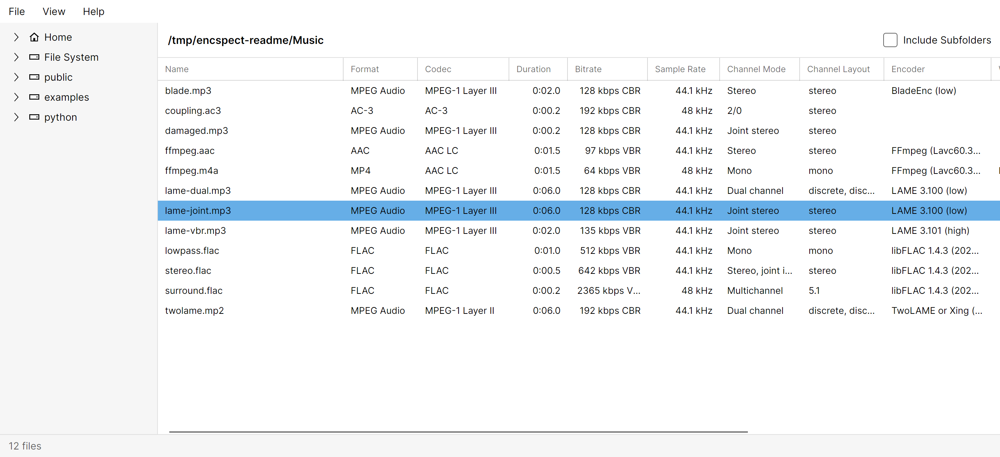
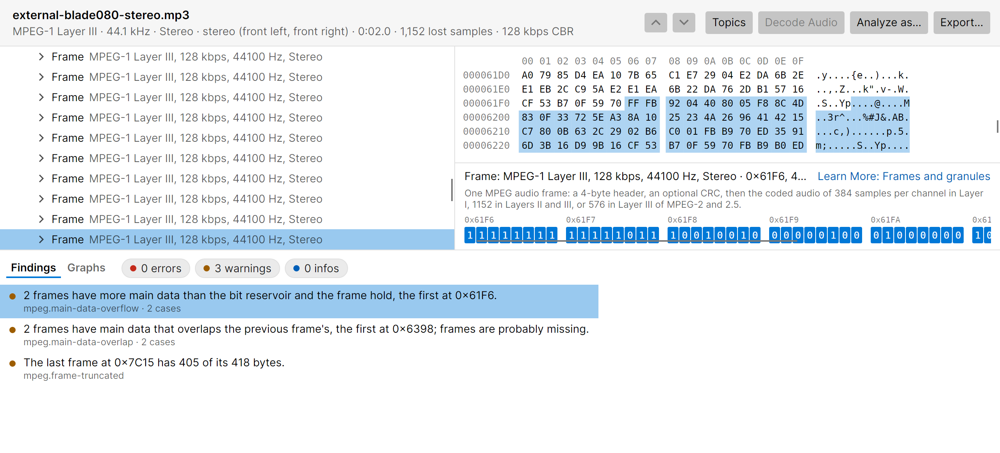
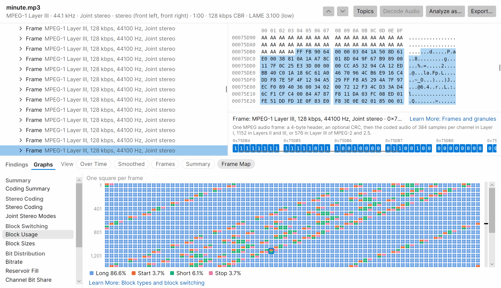
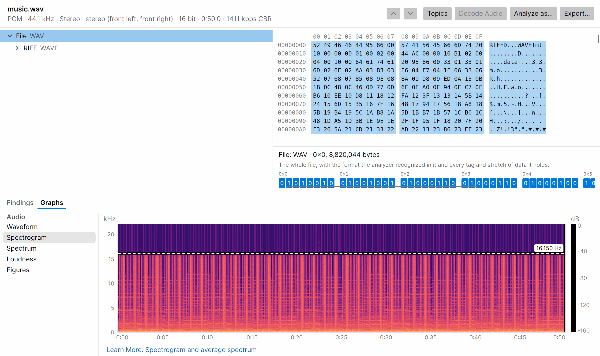
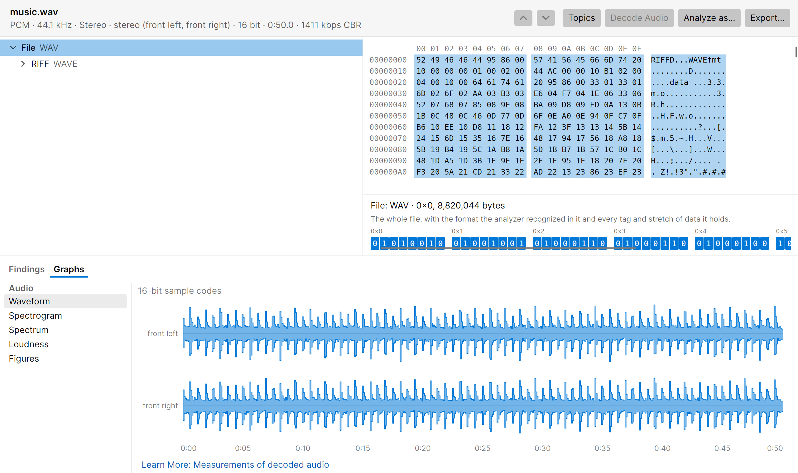
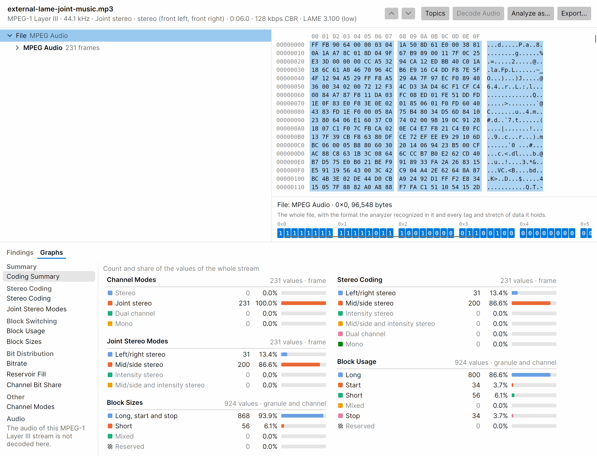

# Encspect

[](https://github.com/smares/encspect/actions/workflows/ci.yml?query=branch%3Amain+event%3Apush)
[](https://github.com/smares/encspect/actions/workflows/ci.yml?query=branch%3Amain+event%3Aschedule)

A cross-platform GUI and CLI tool that reports everything technically knowable about an audio file's structure: encoder and writer detection, bitrate behavior, bit reservoir usage, VBR headers, tags, and more. Every reported value points back to the bytes it came from.

Think EncSpot, but modern and with many more formats.

## Screenshots

<picture>
  <source media="(prefers-color-scheme: dark)" srcset="docs/images/readme-main-dark.png">
  
</picture>

The main window: folders, a list of analyzed files and their summary columns.

<picture>
  <source media="(prefers-color-scheme: dark)" srcset="docs/images/readme-detail-dark.png">
  
</picture>

The detail window: a file's findings, each pointing to the bytes it was read from in the structure tree and the hex view.

<picture>
  <source media="(prefers-color-scheme: dark)" srcset="docs/images/readme-frame-map-dark.png">
  
</picture>

The Frame Map: one square per frame, here the block types of every granule of a minute of joint stereo audio.

<picture>
  <source media="(prefers-color-scheme: dark)" srcset="docs/images/readme-spectrogram-dark.png">
  
</picture>

The Audio panels: the spectrogram of a decoded file with its spectral cutoff marked at 16,150 Hz.

<picture>
  <source media="(prefers-color-scheme: dark)" srcset="docs/images/readme-waveform-dark.png">
  
</picture>

The waveform of the same file, one lane per channel.

<picture>
  <source media="(prefers-color-scheme: dark)" srcset="docs/images/readme-coding-summary-dark.png">
  
</picture>

The Coding Summary: the count and share of channel modes, stereo coding, block types and block sizes.

## Status

Version 0.2.0, a pre-release in development. Download builds for Windows, macOS and Linux from the [releases page](https://github.com/smares/encspect/releases); they are not signed (see the release notes). The plan is in [docs/plan.md](docs/plan.md).

Formats read so far ([details](docs/formats/README.md)):

- MPEG audio: MP1, MP2 and MP3, with VBR headers, mp3PRO, MP3 Surround and MPEG-2 multichannel; decoded for `--measure` (Layers I to III; the base stereo of multichannel streams)
- MP4, M4A, M4B, 3GP and QuickTime files
- AAC in MP4, ADTS and ADIF, including HE-AAC, HE-AAC v2 and xHE-AAC
- Ogg, with Speex, Vorbis and Opus
- Musepack SV4 to SV8
- AC-3 and E-AC-3, raw and in MP4, with the object audio (JOC) that Dolby Atmos adds
- DTS (core, XCh, X96, XXCH and the DTS-HD extension substreams with the lossless extension's channel sets and the DTS:X signal), raw and in MP4
- DTS-HD files (`.dtshd`)
- WavPack (lossless, hybrid and DSD), `.wv` and `.wvc`, with an optional decode that verifies the CRCs and the MD5 of the audio
- FLAC (`.flac`, and in Ogg), with an optional decode that verifies the MD5 of the audio
- Monkey's Audio (`.ape`), with an optional decode of files of versions 3.80 to 3.99 and 4.11 that verifies the CRC or checksum of every frame
- TTA (`.tta`), verified by the CRC-32s of its header, seek table and frames, and decoded for `--measure` (audio format 1)
- OptimFROG (`.ofr`, `.ofs`, `.ofc`) at header level: its blocks, stored WAV header and encoder settings, verified by the CRC-32 of every data block
- TAK (`.tak`) at header level: its metadata objects with their CRC-24s, stream info, encoder preset and stored WAV header
- Apple Lossless (ALAC) frame by frame in MP4 and M4A and in Matroska, with its elements, filters and residual codes walked, and decoded for `--measure` (ALAC stores no checksum to verify)
- Dolby TrueHD and MLP (`.thd`, `.mlp`), with an optional decode that verifies the lossless checks of the audio
- ASF (`.wma`, `.wmv`, `.asf`) with Windows Media Audio (versions 1 and 2, Professional, Lossless and Voice frame by frame)
- WAV (`.wav`; RIFF, RIFX, RF64 and BW64), Wave64 (`.w64`) and AIFF (`.aif`, `.aiff`, `.aifc`) with all their chunks; PCM, floating-point and compressed formats at header level (PCM, floating-point, A-law and mu-law samples are decoded for `--measure`), and MPEG audio, AC-3, E-AC-3 and DTS in WAV read by their parsers, and AC-3, E-AC-3, DTS and AAC also as IEC 61937 bursts in the samples
- Matroska and WebM (`.mka`, `.mkv`, `.webm`) with AAC, AC-3, E-AC-3, DTS, Vorbis, Opus, FLAC, WavPack, Dolby TrueHD, MLP, Apple Lossless and TTA audio read by their parsers

Tags ([details](docs/tags/README.md)): ID3v1, ID3v2, APE, Lyrics3 and Vorbis comments.

Protection: streams that a container encrypts or locks are reported with their scheme and DRM systems, without decrypting: Common Encryption in MP4, iTunes protection and Audible entries, Windows Media DRM in ASF, and ContentEncryption in Matroska.

Measurements: with `--measure`, the formats that have a decoder (FLAC, WavPack, Monkey's Audio, ALAC, TTA, Dolby TrueHD and MLP, MPEG audio Layers I to III, and the samples of WAV, Wave64 and AIFF) get the average spectrum and the spectral cutoff of their decoded audio, the spectrogram and waveform behind them, the levels (sample peak, RMS level, DC offset, clipping runs, digital silence and bit-depth usage), the loudness (integrated, range, maxima; ITU-R BS.1770-5 and EBU R 128) and the true peak ([details](docs/cli.md)). The GUI's detail window decodes and measures a file with Decode Audio and draws the waveform, the spectrogram, the spectrum and the loudness under the heading Audio of its Graphs tab ([details](docs/gui.md)).

Version 0.2 completes the lossless formats with their decoders and the measurements. Next: 0.3, the lossy decoders (MPEG audio is built; Vorbis, Opus, AC-3 and E-AC-3 follow), so lossy files are measured too ([plan](docs/plan.md#milestones); what each format reads by depth is in [formats](docs/formats/README.md#depth-by-format)).

The decoders exist for analysis only: Encspect does not play or convert audio, and users are responsible for the laws where they live ([details](docs/cli.md#what-the-decoders-are-for)).

## Documentation

- [Command line](docs/cli.md)
- [GUI](docs/gui.md)
- [Formats](docs/formats/README.md) and [tags](docs/tags/README.md)
- [Architecture](docs/architecture.md): the parts, the result model, routes and format detection
- [Development](docs/development.md): building, tests, fixtures and cross-checks
- [Using Encspect from other programs](docs/library.md): the JSON output today, NuGet packages and a native library later
- [Plan](docs/plan.md): goals, decisions, the milestones and what is not planned
- [History](docs/history.md): the phases and gates passed, and what each built
- [Release notes](docs/releases/0.2.0.md)

## Quick start

```sh
dotnet build -c Release
dotnet run -c Release --project src/Encspect.Cli -- song.mp3
dotnet run -c Release --project src/Encspect.Cli -- --as aac damaged.bin   # skip format detection
dotnet run -c Release --project src/Encspect.Gui
```

C# on .NET, with Avalonia UI for the GUI. Windows, macOS and Linux (X11, also under XWayland; native Wayland is experimental and opt-in) on x64 and ARM64.

## License

[MIT](LICENSE)
