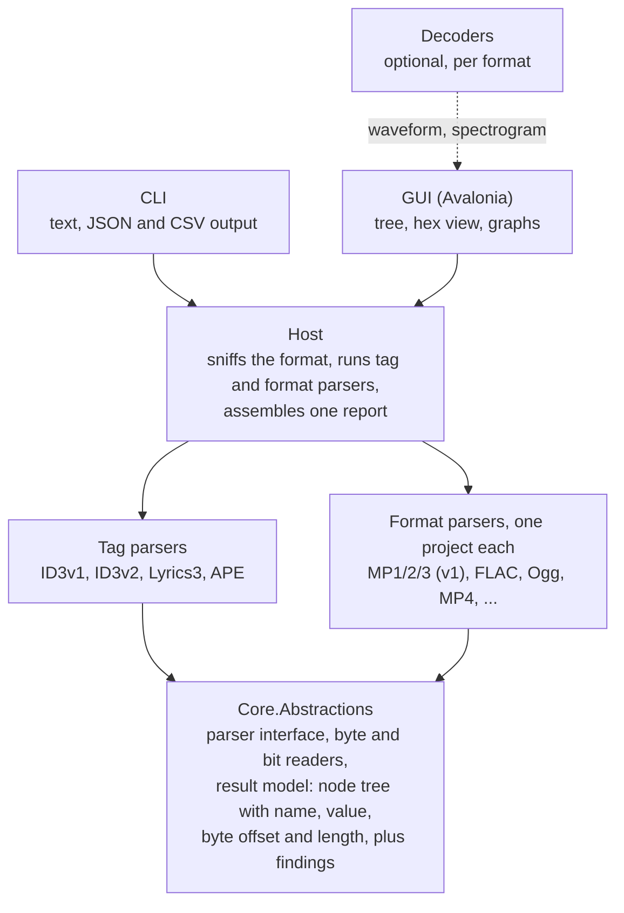

# Encspect: Project Plan

Planning date: 2026-10-10. This file is the canonical copy of the plan; keep it up to date as decisions change.

## Goals and non-goals

The tool tells you everything technically knowable about an audio file's structure, and every value it reports points back to the bytes it came from. It is a GUI and CLI analyzer for people who want EncSpot-level detail, across many more formats.

**Goals**

- Deep header, metadata and structure analysis: encoder detection, bitrate behavior, bit reservoir usage, Xing/Info/LAME/VBRI headers, and all tag formats (ID3v1, ID3v2, Lyrics3, APE and others).
- Every reported value carries its byte offset and length, so the GUI can show a structure tree next to a hex view and the CLI can emit text or JSON from the same data.
- Broad format coverage, with one self-contained parser per format (see the rollout section).
- Damaged or odd files produce findings (warnings, anomalies), never crashes.
- One codebase for Windows, macOS and Linux on x64 and ARM64.

**Non-goals for v1**

- Audio playback.
- Scalefactor and Huffman-table level MP3 analysis. v1 stops at headers, side info and metadata; the deeper pass is a later phase.
- Runtime-loadable plugins. Formats are separate projects, composed at build time.
- Editing or writing tags.
- Bundling external decoders or native libraries.

## Decisions so far

The stack is C# on .NET with Avalonia for the GUI. The code is checked by tests and review agents rather than line by line by a person, which shapes several choices below.

| Decision | Choice | Why |
| --- | --- | --- |
| Language | C# (.NET) | Reads like TypeScript; a malformed file raises a catchable exception instead of corrupting memory; one `dotnet publish` per OS and architecture |
| GUI | Avalonia UI | Native OS dialogs and tree view on Windows, macOS and Linux, x64 and ARM64 |
| CLI | Console app on the same core | Thin front end over the shared library |
| Parsers | Written ourselves, one project per format | Libraries hide the fields this tool exists to show; TagLib# is used only to cross-check |
| Playback | None | Pure analyzer; removes BASS, native binaries and licensing questions |
| Plugins | Build-time modules only | No runtime loading, so no version policy and no publishing restrictions |
| Decoding | Optional, per format | Only for waveform, spectrogram, lowpass and similar; formats without a decoder still get the full structure report |
| Hosting and CI | GitHub, hosted runners | Covers Windows, macOS (Apple Silicon) and Linux on x64 and ARM64 |
| Name | Encspect | Detenc and Framescope were already taken; Encspect was free |
| License | MIT | Default in the .NET ecosystem; each dependency's license is still checked individually |

## Architecture

Every parser depends on one small abstractions library and on nothing else; the front ends reach parsers only through a host.

The host sniffs the format, lets tag parsers claim their regions, then hands the rest to a format parser. Decoders are separate and optional, so no parser ever depends on one.

- **Result model:** every node has a name, value, byte offset, length and children; findings carry a severity and point to the node that caused them.
- **Detection:** each parser reports a confidence from magic bytes; the file extension is only a hint.
- **Tags are separate from formats,** because ID3, APE and Lyrics3 appear in many of them.
- **Containers hand streams to codec parsers,** for example Ogg to Vorbis and Opus, MP4 to AAC and ALAC.
- **The abstractions stay internal** and may change freely until the second format works.

## v1 vertical slice: MP3

v1 is MP1/MP2/MP3 analysis at the header, side-info and metadata level, with no Huffman decoding. It is built first because it forces the shared model and parser interface into shape before any second format exists.

**File layout and tags**

- Leading junk and resync: find the first valid frame, report skipped bytes, and re-sync after damage. A header starts a stream only when two more frames with the same version, layer and sample rate follow at the positions its length predicts, or when its frames end exactly at the end of the data. Everything between frames that is not a frame is a gap: junk before the first frame, lost sync between frames, data after the last one. Each stretch of data between tags is one "MPEG Audio" region, and findings of one kind are reported once per stream with a count, not once per frame.
- ID3v2.2, 2.3 and 2.4: header, flags, extended header, footer, padding, unsynchronization, and every frame with its decoded text encoding.
- Trailing tags: ID3v1 and v1.1, the Enhanced TAG, Lyrics3 v1 and v2, and APEv1 and v2 including every item.
- Any gaps, overlaps or trailing garbage between regions are reported as findings.

**Per-frame data (all layers)**

- Every header field: MPEG version (1, 2, 2.5), layer, CRC protection, bitrate, sampling rate, padding, channel mode and mode extension, copyright, original, emphasis.
- Frame offset, length, and CRC-16 verification when protection is on. A Layer II CRC covers the bit allocation and scfsi, so its length follows from the allocation tables.
- Mid-stream parameter changes (sampling rate, channel mode) and free-format streams.

**Layer III side info**

- `main_data_begin` and the resulting bit reservoir fill for each frame: the free bytes after the previous frame's main data, up to what `main_data_begin` can reach (511 bytes in MPEG-1, 255 in MPEG-2 and 2.5).
- Per granule and channel: `part2_3_length`, `big_values`, `global_gain`, `scalefac_compress`, block type and mixed-block flag, table selects, region counts, `subblock_gain`, `preflag`, `scalefac_scale`, `count1table_select`, plus `scfsi` per channel.
- Joint stereo: MS and intensity usage per frame.
- The bit reservoir: each frame's bytes after the side information are split by owner into its own main data, main data of later frames ("Bit Reservoir") and ancillary data no frame uses, so every byte is accounted for. Main data runs through the data of consecutive frames of one stream, skipping headers and side information, and continues across junk and tags between frames; a stream change starts with an empty reservoir. Main data that begins before the stream (a cut file), overlaps the previous frame's (missing frames), reaches back across a gap (decoders disagree there) or does not fit the frame is reported.
- Side-information checks: big_values above 288, the reserved block type, Huffman tables 4 and 14, scalefactors longer than part2_3_length, scfsi on a channel with short blocks, and MS or intensity stereo with different block types in the two channels (the last two are rejected by libmad).

**Layer II audio data and multichannel**

- Bit allocation per subband and channel from the allocation tables (ISO/IEC 11172-3 Annex B, and ISO/IEC 13818-3 for the lower sampling rates), scfsi and scalefactors, the length of the sample data and where the ancillary data starts. The same tables let Layer II CRCs be verified. Audio data longer than the frame is a warning; scalefactor index 63, which Table B.1 of ISO/IEC 11172-3 leaves undefined, is only noted, because TwoLAME writes it and ffmpeg, mpg123 and libmad decode it.
- The MPEG-2 multichannel extension (ISO/IEC 13818-3), which an MPEG-1 Layer II frame carries in its ancillary data, so the stereo base stays playable: the multichannel header (center, surround and LFE channels, audio mix, dematrix procedure, multilingual channels with their layer and sampling rate, whether an extension bitstream exists), the channel configuration such as 3/2 plus LFE, its CRC, and how many bytes the multichannel data takes. The frame header has no flag for it, so it is detected by structure and consistency across frames, like a tag, never by a single match: a file carries it once the multichannel CRC holds in two frames, which random ancillary data passes once in 65,536 frames, and then each frame whose CRC fails is reported.
- Layers I and III can carry the extension too; the ISO conformance set has one stream of each (tests 22 and 23). They follow later.
- When an extension bitstream exists, the multichannel data continues in it, after the base frame's bits minus `n_ad_bytes` of MPEG-1 ancillary data at its end. The extension bitstream is a separate file, so frames whose multichannel side information does not fit the base frame are reported as continuing there, with their CRC not verified. When no frame's side information fits, no CRC can confirm the extension; if nine in ten candidate frames carry the same multichannel header and continue in an extension bitstream, that is reported as a possible, unverified extension.

**Encoder and VBR headers**

- Xing and Info: flags, frame and byte counts, the seek table, quality. They are read only in Layer III, where the side information would end without a CRC (36, 21 or 13 bytes into the frame, as LAME writes them even into a protected frame), and only when every byte between the frame header, or its CRC, and the header is zero, as mpg123 requires, so audio data that happens to contain "Xing" is not taken for one. A header that does not fit its frame and a TOC that decreases are warnings. The frame decodes as silence in decoders that do not skip it, so it stays in the bit reservoir as a frame without main data.
- LAME extension: encoder string, tag revision, VBR method, lowpass, peak, ReplayGain fields, encoding flags, ATH type, minimum or ABR bitrate, delay and padding, noise shaping, stereo mode, source sample rate, MP3 gain, preset, music length, tag CRC and music CRC (both verified). The tag CRC covers the frame's bytes before it, the music CRC the bytes after the frame up to the music length, which counts from the start of the frame. A failing tag CRC is a warning, except the CRC ffmpeg writes, over the frame's first 190 bytes wherever the tag starts, which is only correct for MPEG-1 stereo; that is noted, since LAME and ffmpeg itself reject it. A failing music CRC is a warning (the audio changed after encoding, as MP3Gain changes it), except in a file that continues a `--nogap` sequence, where LAME continues the previous file's CRC. LAME before 3.90 wrote only a version string, which is reported as such.
- VBRI (Fraunhofer): version, delay, quality, byte and frame counts, seek table, 36 bytes into the frame in every mode.
- A VBR header in the middle of a stream is noted: files were probably joined, and players that only look at the first frame play it as a frame of silence.
- Encoder detection from these tags, with a clearly labeled confidence level when it has to fall back on heuristics for files without tags: a LAME tag names its encoder (high confidence when its CRC holds, medium when not), a VBRI header Fraunhofer (high). ffmpeg's tag names ffmpeg (`Lavc` or `Lavf`), which leaves the encoder behind it to the ancillary data (medium); a remux copies the source's encoder string into the tag ffmpeg writes.
- A strong hint without tags: encoders fill unused bits with their name and version. LAME writes `LAME3.100` (possibly cut short to `LAME`) into ancillary data mid-stream and into the padding of the last frame, even when the Info tag is disabled; TwoLAME writes zeros. The string starts wherever the main data ends, at any bit position, and can run on into the next frame's data, so it is searched at every bit offset in the ancillary data the bit reservoir split identifies, joined across frames, not in raw frame bytes. Found alone, it is low confidence. Which other encoders sign their padding, and how, is established from encoder-written fixtures before it is used.

**Computed statistics**

- Counted frames and duration compared with what the Xing, LAME or VBRI header claims, with mismatches flagged.
- Bitrate distribution, average, minimum and maximum, and bitrate over time for VBR.
- Bit reservoir usage over time.
- Gapless information: encoder delay, padding, and exact sample count when available.

## Tag detection and false positives

Tags are found by structure and byte ownership, never by signature alone, because short signatures collide with each other and with audio data.

**Rules**

1. **Position-anchored search.** Each tag type is looked for only where its spec allows: ID3v1 at exactly EOF-128, APE through its footer at EOF-32 or just before another trailing tag, or through its header at the start or directly after a leading tag (APEv2 only, since APEv1 has no header), ID3v2 at the start or directly after a previous tag. The one guided search: an ID3v2.4 SEEK frame gives the minimum offset of the next tag, and ID3v2.4 section 5 says to search from there, so the host searches at most 1 MiB of unclaimed data from that offset and accepts only a fully validated tag. Signatures are never scanned for across the whole file.
2. **Structural validation decides confidence, not existence.** A candidate is rejected only when its extent cannot be determined: an ID3v2 size that is not syncsafe, an APE size that points outside the file, a Lyrics3 v2 size that does not point at `LYRICSBEGIN`, a footer without a matching header. Everything else that breaks a specification is reported the way a lost MPEG sync is: the tag stays in the report, each violation becomes a finding, and the confidence drops. Full confidence needs everything to check out: for ID3v2, known flags, frames that fit the declared size and padding only at the end; for APE, header and footer that agree and items that end exactly at the footer; for Lyrics3 v2, at least one field, fields that end exactly at the size and field bytes from 01 to 254; for Lyrics3 v1, text without $00 or $FF within 5100 bytes. ID3v1 has almost nothing to validate, so it never rises above medium confidence.
3. **Evaluation order and ownership.** Tags are only looked for at anchors (rule 1). When several candidates claim the same anchor, the one with the strongest evidence wins and the order APE, Lyrics3, ID3v2 found through its footer, ID3v1, Enhanced TAG breaks ties. A tag that its specification places directly before another one (Lyrics3 and the Enhanced TAG before ID3v1) is reported without it too, with a finding and one level less confidence, so a correctly placed competitor wins. The host keeps a claim map, so a signature inside an already claimed region (an image in an ID3v2 tag, an APE item, an ID3v1 field) is rejected.
4. **Confidence and evidence.** Every candidate carries a confidence level and its reasons. Losing and rejected candidates become findings, such as "TAG at EOF-128 rejected: part of an APE tag header".
5. **MPEG sync.** A frame header counts only when a chain of consecutive, consistent frames follows it. Stretches that do not fit are reported as gaps, not guessed.

**The APE and ID3v1 collision.** `APETAGEX` contains `TAG` at offset 3. An APE tag with a header that totals 131 bytes (32 header, 67 items, 32 footer) and ends the file places that `TAG` at EOF-128, exactly where ID3v1 is expected. A reader that trusts the signature reports a garbage ID3v1 tag made of the APE header, items and footer. Rule 3 prevents this: the APE tag validates fully, its evidence outweighs the bare `TAG`, and it claims the bytes.

**Fixtures that prove it**

- The 131-byte APE tag above with no ID3v1 tag: expect the APE tag only, plus a near-miss finding.
- A real ID3v1 tag directly after an APE tag, and an APE tag after an ID3v1 tag.
- Lyrics3 v1 and v2 before ID3v1, and every plausible stacking order of ID3v2, APE, Lyrics3 and ID3v1.
- ID3v2.4 tags found through their footer: at EOF, before APE and ID3v1, at both ends of the file, as the whole file, and with `TAG` at EOF-128 inside the tag. A tag appended without a footer cannot be found from the end (ID3v2.4 section 3.4) and stays data.
- Tags embedded inside cover art in an ID3v2 tag.
- Random data seeded with `TAG`, `ID3` and `APETAGEX` at random offsets: nothing is detected outside validated positions.
- User text that spells another tag's identifier exactly where a probe looks for it: ID3v1 fields, APE text items, Lyrics3 lyrics and fields, and appended ID3v2 frames, each holding every identifier at every probe distance. The real tags must come out unchanged, without warnings.
- Truncated tags and concatenated files.

The first fixture needs no external tool; a script writes the exact bytes.

## Verification strategy

Nobody will read the code line by line, so correctness comes from automated checks that do not depend on the author's judgment. The weak spot to guard against is spec details written from memory, such as field offsets and odd edge cases.

1. **Known-input fixtures.** Scripts in `scripts/fixtures` write two kinds of fixture, each with a manifest of the expected result. Hand-built ones (standard library only, regenerated and compared in CI) control every byte. Encoder-written ones (LAME, TwoLAME, mutagen, ffmpeg, pinned versions) are committed, because their bytes depend on the tool version. Tests assert that the analyzer reports exactly what was built or encoded.
2. **Cross-checks against other tools.** Where results overlap, compare with `ffprobe` and TagLib#. Disagreements fail the build until explained. For MPEG audio, a CI job checks every fixture manifest against ffprobe (frame positions and lengths), libmad through madplay (CRC verdicts, and frame counts where ffmpeg resyncs differently) and mpg123 (frame counts of free-format streams, which ffmpeg cannot read), so the expectations are confirmed by independent decoders before the parser is. For Layer III, minimp3 (a pinned commit, built in CI) confirms every side-information field and the bit reservoir before each frame, mp3guessenc confirms block usage, stereo modes, global gain, the largest main_data_begin and the ancillary data, and the hand-built frames carry main data that ffmpeg, mpg123 and libmad must decode to pure silence, which they only do when every granule's bits sit where the side information and the reservoir say. For Layer II, minimp3 confirms every allocation, scfsi and scalefactor, the hand-built frames decode to silence in the same decoders, and mctoolamed and mp3guessenc confirm the multichannel extension; the analyzer's report on all 35 ISO/IEC 13818-4 audio conformance streams must match their manifest. For the Xing, Info, LAME and VBRI headers, mp3guessenc confirms nearly every field and both CRC verdicts, mpg123 the counts, encoder string, VBR method, ReplayGain, delay and padding, and ffprobe the duration, start time, and the encoder string and ReplayGain it only accepts when the tag CRC holds; the peak is the one field no tool reports. mp3guessenc also confirms the encoder string in ancillary data, where it finds it on a byte boundary.
3. **Golden reports.** Each fixture has a stored expected report; any output change shows up as a diff that has to be approved.
4. **Corrupt-file tests and fuzzing.** Truncated, bit-flipped and garbage-prefixed files must never crash or hang the tool; they must yield findings. The tag-collision cases are listed under tag detection.
5. **Spec references in the code.** Each parsed field cites the spec section it implements, so a reviewer can check it quickly.
6. **Independent review.** After each milestone, a separate review agent gets the code and the spec without the author's conclusions; its findings are recorded in the pull request.

Nothing merges with a red pipeline, and nothing is pushed to GitHub unless the owner says so for that push.

## GitHub and CI

GitHub Actions is the single source of truth for "does it build and pass on every platform", so the work can be verified without anyone's computer being on. The repository is `smares/encspect` (public, which keeps hosted-runner minutes free).

**Matrix.** Windows, macOS and Linux, each on x64 and ARM64 where a hosted runner exists. Exact runner labels are checked when the workflow is written, since GitHub changes them from time to time.

**Pipeline stages**

1. Restore and build with warnings treated as errors.
2. Formatting check (`dotnet format --verify-no-changes`).
3. Unit tests for every parser.
4. Install `lame`, `ffmpeg` and `flac`, generate fixtures, run integration tests and the cross-checks.
5. Corrupt-file and fuzz smoke tests.
6. Headless GUI tests using Avalonia's headless mode.
7. Publish self-contained CLI and GUI builds for each target (`win-x64`, `win-arm64`, `linux-x64`, `linux-arm64`, `osx-arm64`, and `osx-x64` if a runner or cross-build is available) and attach them to the run.
8. On a version tag, create a release with those builds.

**Local checks.** Cloud sessions install the .NET SDK through a SessionStart hook (`scripts/install-dotnet.sh`), so the CI steps can be mirrored locally before pushing. CI still covers the platforms a session cannot run.

## Format rollout

MP3 comes first, and each later phase starts only after the previous one passes its gate.

| Phase | Scope |
| --- | --- |
| 1 (v1) | MP1/2/3 and tags: all tags, side info, Xing, LAME, VBRI, reference tests |
| Gate 1 | Pipeline green everywhere, review findings fixed, abstractions settled |
| 2 | FLAC, WAV, AIFF, Ogg with Vorbis and Opus (Ogg hands streams to codec parsers) |
| Gate 2 | Pipeline green everywhere, review findings fixed |
| 3 | MP4 with AAC and ALAC, WavPack, Monkey's Audio, TTA |
| Gate 3 | Pipeline green everywhere, review findings fixed |
| 4 | Long tail: Musepack, WMA, AC-3; TAK and OptimFROG at header level only |
| Later, order not fixed | MP3 scalefactor and Huffman analysis; decoders for waveform and spectrogram, format by format |

A gate means the pipeline is green on every platform and the review agent's findings are resolved; the first gate also requires the shared contract to have settled. TAK and OptimFROG are poorly documented, so they stay at header level. The deeper MP3 pass and the decoders are not tied to a phase yet.

## CLI and GUI

Both front ends are thin views over the same result model, so neither can show something the other cannot.

**CLI**

- Analyze one file, several files or a whole folder tree (recursive, with a format filter).
- Output as readable text, JSON, or CSV for batch summaries; exit codes reflect whether findings of a given severity were found.
- Options to include or hide sections (tags, frames, side info, statistics) and to print byte offsets.

**GUI**

- Folder tree and file list using native OS dialogs; drag and drop; batch analysis in the background.
- Report view with the structure tree, where selecting a node highlights its bytes in a hex view.
- Findings list with severity, filterable and linked to the node that caused them.
- Graphs: bitrate over time, bitrate distribution, bit reservoir fill, all from header-level data and available in v1.
- Waveform and spectrogram panels that need decoded audio. These appear only for formats that have a decoder and otherwise say so.
- Export of the report as text or JSON.

## Risks and open questions

The largest risks are a wrong core contract and spec details that no reviewer will catch by eye; both are addressed by building MP3 first and by the verification stages above.

**Risks**

- **Core model reworked late.** If the result model or reader APIs are wrong, every format pays. MP3 goes first and the contract stays internal and changeable until the second format works.
- **Spec details wrong.** Field offsets and edge cases written from memory can be off; known-input fixtures and tool cross-checks are the safety net.
- **Decoders.** Quality, license and upkeep of managed decoders vary, and some formats (AAC, Musepack, Monkey's Audio) may have none. Waveform and spectrum are therefore optional per format.
- **Closed formats.** TAK and OptimFROG are poorly documented, so they get only what their headers reveal.
- **Heuristic encoder detection.** Files without LAME or Xing tags can be misidentified; results carry a confidence label.
- **References for MPEG-2 multichannel.** No tool in Ubuntu encodes or fully decodes it. The ISO/IEC 13818-4 conformance streams (22 multichannel Layer II streams covering every configuration, LFE, phantom center, prediction, dynamic crosstalk, multilingual channels and extension bitstreams) may not be redistributed, so CI downloads them at pinned hashes; mctoolamed, a decoder derived from the ISO reference software that reproduces their reference output, and mp3guessenc, which verifies the multichannel CRC, check them and the hand-built fixtures.
- **Large inputs.** Multi-gigabyte files and 100,000-frame reports need streaming reads and a lazily loaded, virtualized tree in the GUI. Parsers keep repeated parts such as audio frames as compact records and give their nodes a build function, so a node's children exist only while something reads them; reports are written as they are read.

**Open questions**

- Whether an optional, not bundled `ffmpeg` fallback for decoding is acceptable.
