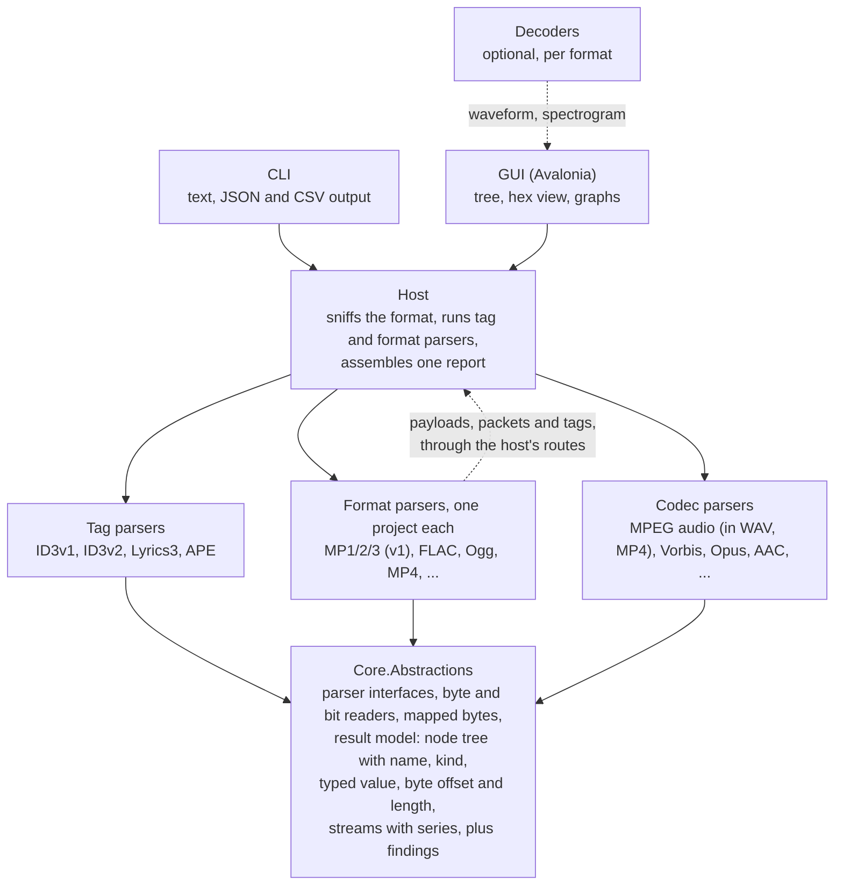

# Encspect: Project Plan

Planning date: 2026-10-10. This file is the canonical copy of the plan; keep it up to date as decisions change.

## Goals and non-goals

The tool tells you everything technically knowable about an audio file's structure, and every value it reports points back to the bytes it came from. It is a GUI and CLI analyzer for people who want EncSpot-level detail, across many more formats.

**Goals**

- Deep header, metadata and structure analysis: encoder detection, bitrate behavior, bit reservoir usage, Xing/Info/LAME/VBRI headers, and all tag formats (ID3v1, ID3v2, Lyrics3, APE and others).
- Every reported value carries its byte offset and length, so the GUI can show a structure tree next to a hex view and the CLI can emit text or JSON from the same data.
- Broad format coverage, with one self-contained parser per format (see the rollout section).
- Damaged or odd files produce findings (warnings, anomalies), never crashes.
- One codebase for Windows, macOS and Linux on x64 and ARM64.

**Non-goals for v1**

- Audio playback.
- Scalefactor and Huffman-table level MP3 analysis. v1 stops at headers, side info and metadata; the deeper pass is a later phase.
- Runtime-loadable plugins. Formats are separate projects, composed at build time.
- Editing or writing tags.
- Bundling external decoders or native libraries.

## Decisions so far

The stack is C# on .NET with Avalonia for the GUI. The code is checked by tests and review agents rather than line by line by a person, which shapes several choices below.

| Decision | Choice | Why |
| --- | --- | --- |
| Language | C# (.NET) | Reads like TypeScript; a malformed file raises a catchable exception instead of corrupting memory; one `dotnet publish` per OS and architecture |
| GUI | Avalonia UI | Native OS dialogs and tree view on Windows, macOS and Linux, x64 and ARM64 |
| CLI | Console app on the same core | Thin front end over the shared library |
| Parsers | Written ourselves, one project per format | Libraries hide the fields this tool exists to show; TagLib# is used only to cross-check |
| Playback | None | Pure analyzer; removes BASS, native binaries and licensing questions |
| Plugins | Build-time modules only | No runtime loading, so no version policy and no publishing restrictions |
| Decoding | Optional, per format | Only for waveform, spectrogram, lowpass and similar; formats without a decoder still get the full structure report |
| Hosting and CI | GitHub, hosted runners | Covers Windows, macOS (Apple Silicon) and Linux on x64 and ARM64 |
| Name | Encspect | Detenc and Framescope were already taken; Encspect was free |
| License | MIT | Default in the .NET ecosystem; each dependency's license is still checked individually |

## Architecture

Every parser depends on one small abstractions library and on nothing else; the front ends reach parsers only through a host.

The host sniffs the format, lets tag parsers claim their regions, then hands the rest to a format parser. A container format hands what it holds back to the host, which passes it on to a codec or tag parser. Decoders are separate and optional, so no parser ever depends on one.

- **Result model:** every node has a name, a kind, a value, byte offset, length and children; findings carry a severity and point to the node that caused them. A finding is a warning when the file breaks a specification or holds something wrong or damaged, whoever caused it and however well decoders cope, above all where readers then show or play something different; an info when what it reports is valid but worth knowing, or when the analyzer cannot check something whose cause is reported separately; an error when parsing itself fails.
- **Typed values:** a node's value is a `NodeValue`: text, an integer, a decimal with the decimals it is shown with, a boolean, or an integer shown in hexadecimal with its digits (a CRC, a flags field); integers and decimals carry their unit ("kbps", "Hz", "s", "bytes", "samples", "dB"). Its text is what the report shows ("128 kbps", "0.261 s", "0x1A2B", "true"); a string converts to a text value, so names, descriptions and mixed text ("255 (none)", a frame's summary) stay text. A list of numbers ("1, 5, 12") is text too. JSON writes numbers and booleans as such, with `unit` beside them, so `"value": 128, "unit": "kbps"`.
- **Node kinds:** `NodeKind` says what a node stands for: a Tag (wherever it sits), a Stream (a stretch of a format's audio data, such as an MPEG Audio region), a Frame, its SideInfo, Statistics, or, by default, a Detail. Front ends find sections by kind, never by name: `--hide` and the summary's tags read kinds, so an APE item named "Frame" is tag content and a Monkey's Audio stream named "APE" is no tag.
- **Streams and series:** a format parser reports each audio stream as a `StreamInfo` (`ParseContext.AddStream`): the nodes that hold it, codec, sample rate, channels, channel mode, bits per sample where the coding has them, samples, duration in seconds, average bitrate in kbps, whether the bitrate varies, the encoder and the confidence in it. A stream is what the format says it is: an MPEG stream continues across a tag embedded in it and ends where the version, layer, sample rate or free format changes, so one stream may span several regions and one region hold several streams. The summary and the CSV read streams only: they count real streams, add up durations and samples, and weigh the average bitrate by duration. A stream carries `Series` for graphs, numbers with a unit over an x axis of frame offsets or seconds; a series may name the node it belongs with, after which the text tree prints it in one line.
- **Findings linked to nodes:** a finding's node is a node of the tree, matched by name, offset and length, so a parser may point at a field of a frame it has not built by building an equal node. After parsing, the host finds each finding's node by descending only into children whose bytes contain it, so of a stream's frames only the one on the way has its children built, and sets `Finding.Path`, the child indexes from the root; the same for each stream's nodes. `Finding.Count` is the number of cases a finding reported once per stream stands for.
- **JSON schema:** each report carries `schemaVersion` (1) and the tool's name and version; the version changes when a field changes meaning or type or goes away, not when one is added.
- **Bit positions:** a field that does not cover whole bytes (an MPEG header field, a side-information or bit-allocation field) also carries its bit offset within its first byte, counted from the most significant bit, and its width in bits (`Node.FromBits`), so the hex view can mark the exact bits; its byte offset and length still cover every byte it touches. JSON writes `bitOffset` and `bitLength` where they exist, and the text tree with `--offsets` shows `[0x1+3, 2 bits]`. Formats that pack bits least significant first (Vorbis) settle their numbering when they arrive.
- **Nesting limit:** a tree nests at most `Node.MaxDepth` (64) levels below its root. The writers stop there and say so (`hasOmittedChildren` in JSON, a line in the text tree), so a container that a damaged file nests thousands deep cannot overflow their stack; a parser that would nest deeper reports a finding instead.
- **Children built on demand:** repeated parts such as frames give their node a build function; the children are built when first read, held weakly, and built under a compare-and-swap, so threads that read a node at the same time get the same children. A list of a million children may itself build its nodes in blocks, each held weakly the same way, as an MPEG region does with its frames. `Node.HasChildren` answers without building them. A build function that throws yields a single "Error" child instead of an exception in a writer or the GUI.
- **Parser contract:** `IFormatParser.Sniff(SniffContext)` sees the reader, the file name's extension as a hint (lower case without the dot, or null) and the cancellation token, and returns a confidence from the bytes; the extension may only break ties between formats without a signature, never make a parser accept. Tag parsers probe through a `TagProbeContext` (reader and token): `ProbeAt`, `ProbeBefore` and `FindFrom`. One instance of each parser serves every analysis, also on several threads at once, so parsers keep no per-call state in fields.
- **Exception boundary:** a reader position or slice outside its range throws `EndOfStreamException`, so a corrupt size field reads as truncation (`parse.truncated`); `InvalidDataException` carries a message for the report (`parse.invalid`). The host wraps every parser entry point: any other exception from a sniff or a parse becomes an error `parse.failed` that names the parser and the exception, and a probe that throws is a rejected candidate with that error. The host never changes a parser's node: an accepted tag is shown as a node with the same name, value and bytes whose children are the parser's and the host's Detection. Only cancellation and running out of memory pass through.
- **Cancellation and progress:** `Analyzer.Analyze` and `AnalyzeFile` take `AnalysisOptions` with a cancellation token and an `IProgress<long>` of bytes read. Every read through `ByteReader` checks the token, and loops that only compute (the MPEG passes over all frames) check `ParseContext.CancellationToken` every few thousand frames; cancellation surfaces as `OperationCanceledException`. Progress is the furthest file offset the format parser has read, which only grows, and the file length once the analysis is done.
- **Readers:** `ByteReader` reads a stream, never the whole file, with absolute file offsets also in a slice: `Read(Span<byte>)` without allocating, 16-, 32- and 64-bit unsigned integers in either byte order and 24-bit big-endian ones. `BitReader` reads up to 64 bits at a time from a byte array or `ReadOnlyMemory<byte>`, most significant bit first (MPEG, FLAC) or least significant bit first (Vorbis), and yields zero bits past the end with `IsOverrun` set.
- **Tags are separate from formats,** because ID3, APE and Lyrics3 appear in many of them.
- **Containers hand streams to codec parsers,** for example Ogg to Vorbis and Opus, MP4 to AAC and ALAC, WAV and MP4 to MPEG audio. Parsers never reference each other; they reach other parsers only through routes on their context, which the host serves. `ParseStream(codecId, parent, payload)` hands a payload that is one byte range (a WAV data chunk) to the `ICodecParser` with that ID, and `ParsePackets(codecId, parent, packets)` hands packets as mapped bytes (Ogg pages, MP4 samples), enumerated while the codec parser runs, so a container reads them lazily. `ParseTag(tagName, slice, parent)` hands a tag that a container holds whole (an ID3v2 tag in a RIFF or AIFF chunk, later a Vorbis comment) to the tag parser of that name, through `ITagParser.ParseWhole`. The routed parser adds its nodes under the container's node; its findings, streams and encoder claims join the container's, a tag is shown as top-level tags are, with its Detection, and its encoder claims reach the codecs routed after it. The routes keep the exception boundary: truncation, invalid data or a parser bug inside the routed data become findings on the container's node (`parse.truncated`, `parse.invalid`, `parse.failed`) and the container carries on; cancellation passes through. Routes nest a few levels at most (`parse.too-deep`). The MPEG parser is the codec `mpeg-audio` for one payload, which it analyzes as it would the same bytes as a file, at their file offsets. `DefaultParsers.Codecs` lists the codecs.
- **Mapped bytes:** `MappedBytes` holds bytes that a container or tag took apart (a packet put together from its pages, ID3v2 data with unsynchronization undone) with a map of segments back to the file: `OffsetOf`, `FileLength`, `FileRanges`, `Slice`, and opaque bytes (decompressed data) that map to their whole source. A `BitReader` over them maps bit positions to file offsets (`FileOffsetOf`), and `Node.FromMapped` and `Node.FromBits` over mapped bytes build nodes at the file bytes the fields came from.
- **Node ranges:** a node whose bytes are not contiguous in the file, such as a packet that spans Ogg pages or a field that a page header splits, carries `Ranges`, its file ranges in order; its offset and length cover them from first to last, so containment, finding paths and the writers' nesting work on the covering range. JSON writes `ranges` as offset and length pairs; the text tree with `--offsets` adds them as `[0x1A, 40 bytes in 0x1A 2 bytes, 0x40 2 bytes]`.
- **Declared end:** a container that states its own size (RIFF, FORM, a run of top-level MP4 boxes) says where it ends through `IFormatParser.DeclaredEnd`. Before it looks for trailing tags, the host asks the parser that sniffs best on the data after the leading tags; a trailing candidate that starts before that end is the container's own chunk, reported as a near miss naming the container, and the container hands it to the tag parser itself (an AIFF file's `ID3 ` chunk, which taggers write last). A tag after the declared end is the file's, as before. A parser returns null for a size it cannot trust, such as a placeholder.
- **The abstractions stay internal** and may change freely until the second format works.

## v1 vertical slice: MP3

v1 is MP1/MP2/MP3 analysis at the header, side-info and metadata level, with no Huffman decoding. It is built first because it forces the shared model and parser interface into shape before any second format exists.

**File layout and tags**

- Leading junk and resync: find the first valid frame, report skipped bytes, and re-sync after damage. A header starts a stream only when two more frames with the same version, layer and sample rate follow at the positions its length predicts, or when its one or two frames end exactly at the end of the data and each passes the structural checks: in Layers I and II the audio data fits the frame and uses no forbidden bit allocation, in Layer III the side information fits the frame and passes the side-information checks below, with no more main data than the frame and its main_data_begin hold. So a file of one or two frames still parses, while a single 4-byte match in other data is not taken for audio. Everything between frames that is not a frame is a gap: junk before the first frame, lost sync between frames, data after the last one. Each stretch of data between tags is one "MPEG Audio" region, and findings of one kind are reported once per stream with a count, not once per frame.
- ID3v2.2, 2.3 and 2.4: header, flags, extended header, footer, padding, unsynchronization, and every frame with its decoded text encoding. Compressed frames are decompressed (zlib, which .NET provides) up to the same 1 MiB limit as other decoded data, and the declared size and the zlib checksum are checked. Two writer bugs are read the way mutagen reads them, with a finding: frame sizes that old iTunes versions wrote into ID3v2.4 as plain integers (the frames are walked both ways, and the reading that finds more declared frame IDs wins), and an extended header flag with a frame where the extended header should be. Data after the terminator of an ID3v2.3 text is information, since section 4.2 says to ignore it.
- Trailing tags: ID3v1 and v1.1, the Enhanced TAG, Lyrics3 v1 and v2, and APEv1 and v2 including every item.
- Any gaps, overlaps or trailing garbage between regions are reported as findings.

**Per-frame data (all layers)**

- Every header field: MPEG version (1, 2, 2.5), layer, CRC protection, bitrate, sampling rate, padding, channel mode and mode extension, copyright, original, emphasis.
- Frame offset, length, and CRC-16 verification when protection is on. A Layer II CRC covers the bit allocation and scfsi, so its length follows from the allocation tables.
- Mid-stream parameter changes (sampling rate, channel mode) and free-format streams. A stream change is reported both where frames of two streams touch and where sync is found again after a gap. A free-format frame's length is the distance to the next header of the same stream, as mpg123 finds it; one too short for the header, CRC and side information or bit allocation is no frame, so data with a header every few bytes does not sync. A free-format stream whose frame length changes breaks the fixed bitrate ISO/IEC 11172-3 requires and is a warning.
- Once in sync, a frame is only taken on its header while a frame follows it. Where none does, a stream that starts inside the frame, after its header and CRC, cuts it short there, reported as a frame that was cut or whose header is damaged, so the next frame is not swallowed and the damage is located; a free-format stream may instead have changed its frame length.
- MPEG 2.5 extends only Layer III, so Layer I or II frames at its rates are a warning; decoders play them.
- Leading junk is searched for the first frame within 1 MiB after any leading zero bytes, which are common padding and cheap to skip.

**Layer I audio data**

- Bit allocation per subband and channel, one above the joint stereo bound, scalefactors, the length of the samples and the ancillary data after them (ISO/IEC 11172-3 2.4.1.5). The forbidden allocation 15 is a warning (libmad rejects the frame, mpg123 reads 16-bit samples, as the report does), and so are scalefactor index 63 and audio data longer than the frame.

**Layer III side info**

- `main_data_begin` and the resulting bit reservoir fill for each frame: the free bytes after the previous frame's main data, up to what `main_data_begin` can reach (511 bytes in MPEG-1, 255 in MPEG-2 and 2.5).
- Per granule and channel: `part2_3_length`, `big_values`, `global_gain`, `scalefac_compress`, block type and mixed-block flag, table selects, region counts, `subblock_gain`, `preflag`, `scalefac_scale`, `count1table_select`, plus `scfsi` per channel.
- Joint stereo: mid/side and intensity stereo usage per frame.
- The bit reservoir: each frame's bytes after the side information are split by owner into its own main data, main data of later frames ("Bit Reservoir") and ancillary data no frame uses, so every byte is accounted for. Main data runs through the data of consecutive frames of one stream, skipping headers and side information, and continues across junk and tags between frames; a stream change, including a switch to or from free format, starts with an empty reservoir. Main data that begins before the stream (a cut file), overlaps the previous frame's (missing frames), reaches back across a gap (decoders disagree there) or does not fit the frame is reported. A Xing, Info or VBRI header frame stays in the reservoir as a frame without main data, as minimp3 and mp3guessenc keep it; mpg123 and ffmpeg skip it, so main data that begins in it is a warning, as after `ffmpeg -ss -c copy`, and the header frame's unused bytes show which frame's main data they hold. The header frame does not count as the stream's first frame, so main data that reaches back past it begins before the stream.
- Side-information checks: big_values above 288, the reserved block type, Huffman tables 4 and 14, scalefactors longer than part2_3_length, scfsi on a channel with short blocks, and mid/side or intensity stereo with different block types in the two channels (the last two are rejected by libmad).
- The decoder buffer of ISO/IEC 11172-3 holds one frame at the highest bitrate (bitrate_index 14) at the stream's sample rate, so main_data_begin plus the frame's length may not exceed that frame's length, and main_data_begin is 0 at 320 kbps. Only MPEG-1 is checked: LAME's `--strictly-enforce-ISO` applies the rule to MPEG-2 with its top bitrate of 160 kbps, but that reading of ISO/IEC 13818-3 has not been confirmed against its text. Breaking it is a warning, which says that LAME has not enforced the limit by default since 3.81 and that decoders accept it.

**Layer II audio data and multichannel**

- Bit allocation per subband and channel from the allocation tables (ISO/IEC 11172-3 Annex B, and ISO/IEC 13818-3 for the lower sampling rates; free format takes Table B.2a at 48 kHz and B.2b at the other rates, as their captions say and libmad reads it, while mpg123 takes B.2a at every rate), scfsi and scalefactors, the length of the sample data and where the ancillary data starts. The same tables let Layer II CRCs be verified. Audio data longer than the frame is a warning, also where the allocation, scfsi or scalefactors already run past it, and the CRC is still verified wherever the allocation and scfsi it covers fit; scalefactor index 63, which Table B.1 of ISO/IEC 11172-3 leaves undefined, is a warning too, although TwoLAME writes it and ffmpeg, mpg123 and libmad decode it.
- The MPEG-2 multichannel extension (ISO/IEC 13818-3), which an MPEG-1 Layer II frame carries in its ancillary data, so the stereo base stays playable: the multichannel header (center, surround and LFE channels, audio mix, dematrix procedure, multilingual channels with their layer and sampling rate, whether an extension bitstream exists), the channel configuration such as 3/2 plus LFE, its CRC, and how many bytes the multichannel data takes. The frame header has no flag for it, so it is detected by structure and consistency across frames, like a tag, never by a single match: a file carries it once the multichannel CRC holds in at least two frames and in at least half of the frames whose multichannel side information fits the frame. Random ancillary data passes the 16-bit CRC about once in 65,536 frames, so a long recording passes it a few times by chance; mp3guessenc likewise wants a share of the stream. Then each frame whose CRC fails is reported, and so is the reserved center value, which is read as no center, and an `n_ad_bytes` that declares more ancillary data than the frame holds after the multichannel header and CRC, a warning; the multichannel data of such a frame ends after its CRC.
- Layers I and III can carry the extension too; the ISO conformance set has one stream of each (tests 22 and 23). They follow later.
- When an extension bitstream exists, the multichannel data continues in it, after the base frame's bits minus `n_ad_bytes` of MPEG-1 ancillary data at its end. The extension bitstream is a separate file, so frames whose multichannel side information does not fit the base frame are reported as continuing there, with their CRC not verified. When no frame's side information fits, no CRC can confirm the extension; if nine in ten candidate frames carry the same multichannel header and continue in an extension bitstream, that is reported as a possible, unverified extension.

**Encoder and VBR headers**

- Xing and Info: flags, frame and byte counts, the seek table, quality. They are read only in Layer III, where the side information would end without a CRC (36, 21 or 13 bytes into the frame, as LAME writes them even into a protected frame), and only when every byte between the frame header, or its CRC, and the header is zero, as mpg123 requires, so audio data that happens to contain "Xing" is not taken for one. A header that does not fit its frame and a TOC that decreases are warnings. The frame decodes as silence in decoders that do not skip it, so it stays in the bit reservoir as a frame without main data (see the bit reservoir above).
- LAME extension, read only after an encoder string that starts `LAME`, `L` and a version (`L3.99a12`) or ffmpeg's `Lavc` or `Lavf`, as mp3guessenc and ffmpeg require; other text there is shown as a string and names nothing: encoder string, tag revision, VBR method, lowpass, peak, ReplayGain fields, encoding flags, ATH type, minimum or ABR bitrate, delay and padding, noise shaping, stereo mode, source sample rate, MP3 gain (a sign bit and seven bits of 1.5 dB steps), preset, music length (0 means not set, an info), tag CRC and music CRC (both verified). The tag CRC covers the frame's bytes before it, the music CRC the bytes after the frame up to the music length, which counts from the start of the frame. A failing tag CRC or music CRC is a warning, also where the encoder is to blame: the field breaks the tag's specification and readers act on it. Two such causes get their own finding, which names them: ffmpeg writes the tag CRC over the frame's first 190 bytes wherever the tag starts, which is only correct for MPEG-1 stereo, so LAME and ffmpeg itself reject it and ignore the tag's encoder string and ReplayGain; and in a file that continues a `--nogap` sequence LAME continues the previous file's music CRC, so it cannot confirm that the audio is unchanged, which an edit such as MP3Gain's would look no different from. Otherwise a failing music CRC means the audio changed after encoding. A music length shorter than the tag's own frame leaves the music CRC unverified, with its own finding; so does one that runs past the end of the file, an info where the stream is cut short, which its own findings report, and a warning where the stream holds every frame its header counts. LAME before 3.90 wrote only a version string, which is reported as such. LAME 3.90 to 3.92 have Dibrom's `--alt-preset` modes and the older `--preset` names but leave the preset field empty, which 3.93 added; where the VBR method, Xing quality, noise shaping, stereo mode, ATH type, lowpass and (but for VBR) bitrate field are those a preset sets, the report names it next to the empty field. The settings come from encodes with every preset by 3.90 and 3.92 built from source and by the Windows builds of 3.91 and of HydrogenAudio's 3.90.3, the 3.90 line it recommended for years, keyed as getID3 keys them: those two write some lowpasses 100 Hz higher (getID3 lists the same for 3.91), and 3.90.3 shapes noise differently in standard and extreme. getID3's other 3.90.3 values (and its medium presets) belong to a modified build of it and are not used. 3.90.3's version, "LAME3.90.3", does not fit the tag's nine bytes, which hold "LAME3.90."; LAME writes it whole into the padding of the frames, where the analyzer completes it from, as getID3 and mp3guessenc do. LAME before 3.95 computed ReplayGain against 83 dB instead of 89 dB, so a gain it determined itself reads 6 dB lower than a later version's; the report says so next to the value, which it keeps as stored (mpg123 adds the 6 dB).
- VBRI (Fraunhofer): version, delay, quality, byte and frame counts, seek table, 36 bytes into the frame in every mode. A version other than 1, which ffmpeg ignores, and a seek table entry size outside 1 to 4 bytes, which leaves the table unread, are warnings.
- A VBR header in the middle of a stream, after any earlier frame of it, across gaps and tags, is a warning: files were probably joined, so the first header's counts and TOC cover only part of the stream, and players that only look at the first frame play the second as a frame of silence.
- Encoder detection from these tags, with a clearly labeled confidence level when it has to fall back on heuristics for files without tags: a LAME tag names its encoder (high confidence when its CRC holds, medium when not), a VBRI header Fraunhofer (high), or Fraunhofer's MP3 Surround or mp3PRO encoder when the ancillary data carries their signature. ffmpeg writes a LAME tag into every MP3 it muxes, with the encoder string of the stream it copies (a remux of a LAME file keeps `LAME3.100`) or its own: `Lavc` where libavcodec encoded, which it does only with libmp3lame or libshine, so LAME's version in the ancillary data or Shine's traits behind it are medium confidence, and other evidence keeps its own; without any, `Lavc` names ffmpeg (medium). `Lavf` marks a remux of a stream whose encoder ffmpeg did not know and names no encoder: the stream's evidence names it as it would alone, with the tag as support.
- A header names the encoder of the frames it describes, from its frame to the next header or a change of stream. Only a header in a region's first frame names the region's encoder from its tag; where the region also holds frames it does not describe, or headers that name another encoder, files were joined and that name is at most medium confidence. A header further on names no more than the frames after it: the stream's other evidence names the region's encoder, which such a header supports where it names the same, and without any the header names it with low confidence. Each header's counts and gapless figures cover its own frames and say so where those are not all of the region's.
- LAME writes its version twice (libmp3lame/version.c): into the tag's nine bytes, `LAME`, major.minor and a marker (`a` alpha, `b` beta, `r` a release with a patch level above 0 that does not fit, a space otherwise; 3.99 alphas wrote `L3.99a12`, 3.100 and later have no room for a marker), and whole into the padding it drains into ancillary data (`3.98 (beta)`, `3.99 (alpha 12)`, `3.99.5`). The report spells the version out (`LAME 3.98 (beta)`, `LAME 3.99 (alpha 12)`, `LAME 3.99.x` for an `r` without a patch level) and keeps the raw text in the tag's node. Where the two agree on major.minor and marker, the name takes the more specific one and lists both as evidence when the ancillary one carries a marker; where they disagree, the tag's is shown and a warning says the frames and the tag may come from different encoders.
- The maintained Helix encoder (hmp3 5.2.4) writes a LAME tag whose encoder string is `LAMEH5.24`; it names Helix, not LAME, with the tag's confidence.
- Without a tag or signature, an encoder's habits are low-confidence evidence, used only where encodes of known signals with that encoder show them every time and the other encoders available for testing do not, over at least 20 frames: Shine never uses the bit reservoir, short blocks, scalefactor scaling or ancillary data (behind ffmpeg's `Lavc` tag, which only libmp3lame and libshine encodes carry, that is medium confidence); Helix without its tag (5.2.4 and 5.0 r11) sets the copyright and original bits in every frame and uses scfsi and scalefactor scaling; Xing's encoder (tompg 3.0) never switches to short blocks, not even at a tone's onset where every other encoder does, never uses scfsi, and sets the original bit in every frame; BladeEnc switches to short blocks without scalefactor scaling, codes plain stereo or mono at one bitrate in MPEG-1, and from 0.82 on leaves ancillary data at most in its last frame (checked on every surviving source release from 0.80 to 0.94.2 and the Windows builds of 0.82, 0.90 and 0.91; 0.80 and 0.81 drain an overflowing bit reservoir into ancillary data mid-stream, as the ISO dist10 encoder does, and mp3guessenc does not name them either); Fraunhofer's encoders use scalefactor scaling and short blocks but never scfsi (MPEG-1 only, since MPEG-2 has no scfsi); TwoLAME and Xing both write scalefactor index 63 into Layer II, which names them together. mp3guessenc agrees on every Layer III encode of these encoders; its rules for encoders that cannot be run here (older releases) are not used, since on encoders that can, it names Shine "Xing" and Helix "Lame". Silence gives an encoder nothing to decide, so its traits do not show there, and a silent stream may match another encoder's habits.
- A strong hint without tags: encoders fill unused bits with their name and version. LAME writes `LAME3.100` (possibly cut short to `LAME`) into ancillary data mid-stream and into the padding of the last frame, even when the Info tag is disabled; TwoLAME writes zeros. A version that runs to the end of the ancillary data may be cut short there (`LAME3.10`), so a whole one elsewhere is preferred and a cut one names only LAME. The string starts wherever the main data ends, at any bit position, and can run on into the next frame's data, so it is searched at every bit offset in the ancillary data the bit reservoir split identifies, joined across frames, not in raw frame bytes. Found alone, it is low confidence. Which other encoders sign their padding, and how, is established from encoder-written fixtures before it is used: Gogo-no-coda (3.12) fills the bits no frame uses with `GOGO` over and over, found at any bit position as two in a row (low confidence alone), and in VBR writes `GOGO` where its Xing header's quality belongs, which names it with medium confidence and is shown as such instead of a number.
- An ID3v2 TSSE frame (TSS in ID3v2.2) is the weakest evidence: whatever software writes the tag fills it in, which may be the encoder (LAME's front end writes `LAME 64bits version 3.100 (http://lame.sf.net)`), a later tagger, or ffmpeg's muxer, and it is kept when the audio is re-encoded. The tag parser hands the text to the host, which passes the claims of every accepted tag, in file order, to the format parser. Alone, a claim names the encoder with low confidence; naming the same encoder as low-confidence evidence from the stream, it raises that to medium (names match on whole words, so `Flame` does not name LAME nor `Remixing` Xing), and it never lowers or overrides a LAME tag or VBRI header. ffmpeg writes its own version (`Lavf60.16.100`) whatever encoder it used, so its claim supports the stream's encoder without naming one, and alone names none. A claim that names another encoder than the stream points to is an info finding on the tag frame, not a change of encoder.
- mp3PRO and MP3 Surround keep their extension in the ancillary data of every Layer III frame: mp3PRO its spectral band replication data, from which an mp3PRO decoder restores the high frequencies of an MPEG-2 or 2.5 core, and MP3 Surround the spatial data that turns an MPEG-1 stereo downmix at 44.1 or 48 kHz back into 5.1 channels. No specification is public, so detection follows mp3guessenc: each frame's ancillary segment runs from the end of its main data, rounded up to a byte, to where the next frame's main data starts in the reservoir, and the bits that the first two bytes of every segment share must include 0xC0 and 0x08 (mp3PRO) or 0xCF and 0x30 (MP3 Surround). An empty segment rules both out, and unlike mp3guessenc at least eight segments are needed, so a short stream does not match by chance. The region gets an Enhancement node with the ancillary bytes and their data rate, and an info finding says that decoders without support play only the core or the downmix. Both name the encoder with medium confidence: Fraunhofer's MP3 Surround encoder, or an mp3PRO encoder, since several licensees wrote those.
- Fraunhofer's encoders may write an Original File Length (OFL) block at the start of the first frame's ancillary data: 0xB4, a 16-bit delay and a 32-bit original length in samples, recognized by mp3guessenc's rule (MPEG-1, the delay's high byte 0x04 or 0x08; in MP3 Surround the signature follows at bytes 10 and 11). The delay counts the samples before the audio in a plain decoder's output, the decoder's 529 included, which ffmpeg's output of encoder-written fixtures confirms; mp3guessenc adds 576 for MP3 Surround, the report keeps the stored value. The block names Fraunhofer with medium confidence, and a delay and length longer than the stream are a warning. A VBRI header still decides the encoder, with high confidence. In mp3PRO (MPEG-2 and 2.5), mp3guessenc's rule reads a different block: more than 20 bytes starting 0xE0 0xBA, the delay at byte 14 and the length at byte 16, counted at twice the core's sample rate, the rate an mp3PRO decoder outputs; a real encode by Thomson's mp3PRO encoder stores 88200 samples for two seconds at 44100 Hz in a 22050 Hz stream.

**Computed statistics**

- A Statistics node in each MPEG Audio region, over its complete audio frames (not a frame holding a VBR header, not a truncated last frame): frames, samples and duration, whether the bitrate varies, the average, minimum and maximum bitrate, and the bitrate distribution. Time runs on a clock of 1/14,112,000 s (ffmpeg's time base for MP3, which every MPEG sample rate divides), so frames of different sample rates add up exactly, and figures are rounded half to even.
- Each stream's series: the bitrate and the bit reservoir fill (Layer III only) of every complete audio frame, at its offset, and per second of audio the bitrate of the frames that start in that second, in kbps, and their mean reservoir fill, in bytes. A stream that an embedded tag splits into regions has one series over all its frames; the text tree prints the per-second series after the statistics of the stream's first region.
- Counted frames and bytes compared with what the Xing or VBRI header claims, over the frames from the header to the end of its stream (the next header or a change of version, layer or sample rate, across gaps and tags). A truncated last frame was written whole, so it counts there and in the gapless sample count. Xing's and Fraunhofer's encoders count the header's own frame and LAME does not, so either count holds; a mismatch is a warning. Behind a LAME tag the count also sets where the music ends, since the delay and padding count from the frames after the header: LAME 3.94 beta 1 counts the header frame too, so ffmpeg and mpg123, which take the length from the count, play one frame more than was encoded. That is a warning, and the report's own sample count follows the frames.
- Gapless information from a LAME tag: encoder delay, padding, and the exact sample count, the frames' samples minus both, which is what ffmpeg and mpg123 output with their gapless trimming when the padding covers their own 529-sample decoder delay. Delay and padding longer than the stream are a warning.
- Cross-checked with mp3guessenc (frame count, length, average bitrate, bitrate histogram), where it takes the same frames as audio, and with the samples ffmpeg and mpg123 decode; at an exact tie their floating-point rounding may differ from ours by one in the last digit.

## Tag detection and false positives

Tags are found by structure and byte ownership, never by signature alone, because short signatures collide with each other and with audio data.

**Rules**

1. **Position-anchored search.** Each tag type is looked for only where its spec allows: ID3v1 at exactly EOF-128, APE through its footer at EOF-32 or just before another trailing tag, or through its header at the start or directly after a leading tag (APEv2 only, since APEv1 has no header), ID3v2 at the start or directly after a previous tag. The one guided search: an ID3v2.4 SEEK frame gives the minimum offset of the next tag, and ID3v2.4 section 5 says to search from there, so the host searches at most 1 MiB of unclaimed data from that offset and accepts only a fully validated tag. Signatures are never scanned for across the whole file.
2. **Structural validation decides confidence, not existence.** A candidate is rejected only when its extent cannot be determined: an ID3v2 size that is not syncsafe, an APE size that points outside the file, a Lyrics3 v2 size that does not point at `LYRICSBEGIN`, a footer without a matching header. Everything else that breaks a specification is reported the way a lost MPEG sync is: the tag stays in the report, each violation becomes a finding, and the confidence drops; the host enforces it, so a tag with any warning is at most medium. An ID3v2 size that runs past the end of the file does not say where the tag ends either, so such a tag ends where its frames and the zero padding after them stop, and what follows is left to the other parsers. Full confidence needs everything to check out: for ID3v2, known flags, an extended header laid out as its version defines it, at least one frame, frames that fit the declared size and padding only at the end, frames of a kind the specification allows once only once (text and URL frames other than the user-defined ones, WCOM and WOAR, a picture of type 1 or 2, and frames such as MCDI or PCNT), a data length indicator with every compressed ID3v2.4 frame, and a byte order mark on every UTF-16 string; for APE, header and footer that agree in everything but the is-header flag, a footer that does not claim to be missing, items that end exactly at the footer and text items in UTF-8; for Lyrics3 v2, at least one field, fields that end exactly at the size and field bytes from 01 to 254; for Lyrics3 v1, text without $00 or $FF within 5100 bytes. Lyrics may mention `LYRICSBEGIN`, so a Lyrics3 v1 tag starts at the earliest one in those 5100 bytes after which only text follows, and a later one is noted. ID3v1 has almost nothing to validate, so it never rises above medium confidence.
3. **Evaluation order and ownership.** Tags are only looked for at anchors (rule 1). When several candidates claim the same anchor, the one with the strongest evidence wins. Between equally confident candidates, the longer one wins: they all end at the anchor, so the shorter one's signature lies inside the longer one's structure, which owns those bytes (a `TAG` in an Enhanced TAG's artist field). The order APE, Lyrics3, ID3v2 found through its footer, ID3v1, Enhanced TAG breaks the remaining ties. A tag that its specification places directly before another one (Lyrics3 and the Enhanced TAG before ID3v1) is reported without it too, with a finding and one level less confidence, so a correctly placed competitor wins. The host keeps a claim map, so a signature inside an already claimed region (an image in an ID3v2 tag, an APE item, an ID3v1 field) is rejected. A container that states its size owns its bytes the same way: a trailing candidate that starts before the end it declares is one of its chunks, a near miss, which the container parser hands to the tag parser itself.
4. **Confidence and evidence.** Every candidate carries a confidence level and its reasons. Losing and rejected candidates become findings, such as "TAG at EOF-128 rejected: part of an APE tag header".
5. **MPEG sync.** A frame header counts only when a chain of consecutive, consistent frames follows it. Stretches that do not fit are reported as gaps, not guessed.

**The APE and ID3v1 collision.** `APETAGEX` contains `TAG` at offset 3. An APE tag with a header that totals 131 bytes (32 header, 67 items, 32 footer) and ends the file places that `TAG` at EOF-128, exactly where ID3v1 is expected. A reader that trusts the signature reports a garbage ID3v1 tag made of the APE header, items and footer. Rule 3 prevents this: the APE tag validates fully, its evidence outweighs the bare `TAG`, and it claims the bytes.

**Fixtures that prove it**

- The 131-byte APE tag above with no ID3v1 tag: expect the APE tag only, plus a near-miss finding.
- A real ID3v1 tag directly after an APE tag, and an APE tag after an ID3v1 tag.
- Lyrics3 v1 and v2 before ID3v1, and every plausible stacking order of ID3v2, APE, Lyrics3 and ID3v1.
- ID3v2.4 tags found through their footer: at EOF, before APE and ID3v1, at both ends of the file, as the whole file, and with `TAG` at EOF-128 inside the tag. A tag appended without a footer cannot be found from the end (ID3v2.4 section 3.4) and stays data.
- Tags embedded inside cover art in an ID3v2 tag.
- Random data seeded with `TAG`, `ID3` and `APETAGEX` at random offsets: nothing is detected outside validated positions.
- User text that spells another tag's identifier exactly where a probe looks for it: ID3v1 fields, APE text items, Lyrics3 lyrics and fields, and appended ID3v2 frames, each holding every identifier at every probe distance. The real tags must come out unchanged, without warnings. The one exception is what a specification forbids in that text: Lyrics3 v1 lyrics must not contain `LYRICSBEGIN` or `LYRICSEND`, so those two are tested as violations, with a warning.
- Truncated tags and concatenated files.

The first fixture needs no external tool; a script writes the exact bytes.

## Verification strategy

Nobody will read the code line by line, so correctness comes from automated checks that do not depend on the author's judgment. The weak spot to guard against is spec details written from memory, such as field offsets and odd edge cases.

1. **Known-input fixtures.** Scripts in `scripts/fixtures` write two kinds of fixture, each with a manifest of the expected result. Hand-built ones (standard library only, regenerated and compared in CI) control every byte. Encoder-written ones (LAME, TwoLAME, mutagen, ffmpeg, pinned versions) are committed, because their bytes depend on the tool version. Tests assert that the analyzer reports exactly what was built or encoded.
2. **Cross-checks against other tools.** Where results overlap, compare with `ffprobe` and TagLib#. Disagreements fail the build until explained. For MPEG audio, a CI job checks every fixture manifest against ffprobe (frame positions and lengths), libmad through madplay (CRC verdicts, and frame counts where ffmpeg resyncs differently) and mpg123 (frame counts of free-format streams, which ffmpeg cannot read), so the expectations are confirmed by independent decoders before the parser is. For Layer III, minimp3 (a pinned commit, built in CI) confirms every side-information field and the bit reservoir before each frame, mp3guessenc confirms block usage, stereo modes, global gain, the largest main_data_begin and the ancillary data, and the hand-built frames carry main data that ffmpeg, mpg123 and libmad must decode to pure silence, which they only do when every granule's bits sit where the side information and the reservoir say. For Layer II, minimp3 confirms every allocation, scfsi and scalefactor, the hand-built frames decode to silence in the same decoders, and mctoolamed and mp3guessenc confirm the multichannel extension; the analyzer's report on all 35 ISO/IEC 13818-4 audio conformance streams must match their manifest. For the Xing, Info, LAME and VBRI headers, mp3guessenc confirms nearly every field and both CRC verdicts, mpg123 the counts, encoder string, VBR method, ReplayGain, delay and padding, and ffprobe the duration, start time, and the encoder string and ReplayGain it only accepts when the tag CRC holds; the peak is the one field no tool reports. getID3 (a pinned commit, run with PHP in CI) confirms the version and preset of every fixture by LAME 3.90 to 3.92. mp3guessenc also confirms the encoder string in ancillary data, where it finds it on a byte boundary, the mp3PRO and MP3 Surround signatures and the OFL block in hand-built and Fraunhofer-encoded fixtures, and the ancillary bytes and rate of three mp3PRO files from the FFmpeg sample archive, which CI downloads at pinned hashes because they are commercial music. Encoder-written fixtures come from LAME, TwoLAME, Shine, ffmpeg, Fraunhofer's MP3 Surround encoder, the Helix encoder (5.2.4 and 5.0 r11 from source), BladeEnc 0.80, 0.82, 0.84, 0.92.0, 0.92.7, 0.93.6 and 0.94.2 (built from source, one release per group that writes the same bytes; those before 0.92 as 32-bit programs, as they assume a 32-bit long), LAME 3.90.1, 3.91, 3.92, 3.93.1, 3.94 beta 1, 3.98 beta 8, 3.99 alpha 12, 3.99.5, 3.101 and 4.0 (built from source, the betas, the alpha and 3.99.5 from tags of LAME's Subversion repository; 3.101 writes "LAME3.101" with no room for the release marker, 4.0 writes "LAME4.0 " and a NUL byte), the Windows builds of LAME 3.91 and 3.90.3 (under Wine; the project's private repository keeps 3.90.3, which only a download site still serves), Gogo-no-coda 3.12 (its Windows release under Wine) and Xing's tompg 3.0 under Wine, the only source of encoder-written Layer I, whose forbidden bit allocations libmad rejects as the analyzer reports them. Encoders whose licences allow private evaluation only (Fraunhofer's l3enc 2.60 and 2.61, the mp3enc 3.0 and 3.1 demos, Thomson's mp3PRO encoder) are run by hand with check_restricted_encoders.py, which keeps nothing they write: the Fraunhofer trait rule, mp3guessenc and the mp3PRO OFL block are checked on their output.
3. **Golden reports.** Each fixture has a stored expected report; any output change shows up as a diff that has to be approved.
4. **Corrupt-file tests and fuzzing.** Truncated, bit-flipped and garbage-prefixed files must never crash or hang the tool; they must yield findings. The host turns a parser's exception into a `parse.failed` error rather than a crash, so the fuzzer fails on that finding and on children that could not be built, just as on an escaping exception. The tag-collision cases are listed under tag detection.
5. **Spec references in the code.** Each parsed field cites the spec section it implements, so a reviewer can check it quickly.
6. **Independent review.** After each milestone, a separate review agent gets the code and the spec without the author's conclusions; its findings are recorded in the pull request.

Nothing merges with a red pipeline, and nothing is pushed to GitHub unless the owner says so for that push.

## GitHub and CI

GitHub Actions is the single source of truth for "does it build and pass on every platform", so the work can be verified without anyone's computer being on. The repository is `smares/encspect` (public, which keeps hosted-runner minutes free).

**Matrix.** Windows, macOS and Linux, each on x64 and ARM64 where a hosted runner exists. Exact runner labels are checked when the workflow is written, since GitHub changes them from time to time.

**Pipeline stages**

1. Restore and build with warnings treated as errors.
2. Formatting check (`dotnet format --verify-no-changes`).
3. Unit tests for every parser.
4. Install `lame`, `ffmpeg` and `flac`, generate fixtures, run integration tests and the cross-checks.
5. Corrupt-file and fuzz smoke tests.
6. Headless GUI tests using Avalonia's headless mode.
7. Publish self-contained CLI and GUI builds for each target (`win-x64`, `win-arm64`, `linux-x64`, `linux-arm64`, `osx-arm64`, and `osx-x64`), each on a runner of its own platform, and run them there.
8. No public version until development ends: the repository is public, so builds are not attached to runs, and there is no release on a version tag yet. Both are added at the end.

**Local checks.** Cloud sessions install the .NET SDK through a SessionStart hook (`scripts/install-dotnet.sh`), so the CI steps can be mirrored locally before pushing. CI still covers the platforms a session cannot run.

## Format rollout

MP3 comes first, and each later phase starts only after the previous one passes its gate.

| Phase | Scope |
| --- | --- |
| 1 (v1) | MP1/2/3 and tags: all tags, side info, Xing, LAME, VBRI, reference tests |
| Gate 1 (passed) | Pipeline green everywhere, review findings fixed, abstractions settled |
| 2 | FLAC, WAV, AIFF, Ogg with Vorbis and Opus (Ogg hands streams to codec parsers) |
| Gate 2 | Pipeline green everywhere, review findings fixed |
| 3 | MP4 with AAC and ALAC, WavPack, Monkey's Audio, TTA |
| Gate 3 | Pipeline green everywhere, review findings fixed |
| 4 | Long tail: Musepack, WMA, AC-3; TAK and OptimFROG at header level only |
| Later, order not fixed | MP3 scalefactor and Huffman analysis; decoders for waveform and spectrogram, format by format |

A gate means the pipeline is green on every platform and the review agent's findings are resolved; the first gate also requires the shared contract to have settled. Gate 1 passed in October 2026: six independent reviews (ID3v2; the other tags and tag detection; MPEG framing and Layers I and II; Layer III and ancillary data; VBR headers, encoder detection and statistics; the contract, host and CLI) found 56 problems and the fuzzer 2 more, all fixed (#26 to #31, and three host defects with the contract); the contract review's 12 gaps closed in four steps (#32 to #35): exception boundary, cancellation and parser contexts; typed data with node kinds, streams, series and linked findings; routes from containers to codec and tag parsers; compact MPEG frame records. TAK and OptimFROG are poorly documented, so they stay at header level. The deeper MP3 pass and the decoders are not tied to a phase yet.

## CLI and GUI

Both front ends are thin views over the same result model, so neither can show something the other cannot.

**CLI**

- Analyze one file, several files or a whole folder tree (recursive, with a format filter).
- Output as readable text, JSON, or CSV for batch summaries; exit codes reflect whether findings of a given severity were found.
- Options to include or hide sections (tags, frames, side info, statistics) and to print byte offsets.

**GUI**

- An Explorer-like main window: a folder tree on the left (drives or volumes, subfolders loaded on demand, quick links to the home, music and desktop folders) and a sortable details list of the files on the right. Its columns are the per-file summary: name, format, codec, duration, bitrate with VBR or CBR, sample rate, channel mode, encoder with its confidence, tags, and finding counts by severity. Rows fill in as the background analysis gets to them, with progress and cancellation; an "include subfolders" toggle analyzes a whole tree; files and folders can be dropped onto the window.
- Details in one reusable, non-modal window, so nothing piles up: Enter or a double-click opens it, opening another file reuses it, and while it is open it follows the list's selection, with Previous and Next to step through the folder. It first opens centered over the main window, remembers its placement, and closes with Esc. A second window only comes from the context menu's "Open in new window", for comparing two files.
- A summary cache for folder views, per user: the per-file summary and finding counts, keyed by path, size, last-write time, file ID, analyzer version and schema version, plus a hash of the first and last 64 KiB, which catches taggers that rewrite tags and keep the time. No hash of the whole file, which would cost as much reading as the analysis. Opening a file always analyzes it again, so the detail window never shows a cached report; the CLI keeps no cache.
- Native where it matters, on an Avalonia Fluent theme that looks the same on every platform: the operating system's file and folder dialogs, the macOS menu bar with the standard app menu and window menu, shortcuts with Cmd on macOS and Ctrl elsewhere, light and dark mode and the accent color following the system, the system UI font, and drag and drop from the file manager.
- Report view with the structure tree, where selecting a node highlights its bytes (and bits) in a hex view.
- Findings list with severity, filterable and linked to the node that caused them.
- Graphs: bitrate over time, bitrate distribution, bit reservoir fill, all from header-level data and available in v1.
- Waveform and spectrogram panels that need decoded audio. These appear only for formats that have a decoder and otherwise say so.
- Export of the report as text or JSON.

## Risks and open questions

The largest risks are a wrong core contract and spec details that no reviewer will catch by eye; both are addressed by building MP3 first and by the verification stages above.

**Risks**

- **Core model reworked late.** If the result model or reader APIs are wrong, every format pays. MP3 goes first and the contract stays internal and changeable until the second format works.
- **Spec details wrong.** Field offsets and edge cases written from memory can be off; known-input fixtures and tool cross-checks are the safety net.
- **Decoders.** Quality, license and upkeep of managed decoders vary, and some formats (AAC, Musepack, Monkey's Audio) may have none. Waveform and spectrum are therefore optional per format.
- **Closed formats.** TAK and OptimFROG are poorly documented, so they get only what their headers reveal.
- **Heuristic encoder detection.** Files without LAME or Xing tags can be misidentified; results carry a confidence label. Encoder habits are only trusted where encodes with that encoder confirm them, which leaves out encoders that no longer run.
- **Tools and references disappearing.** The checks rely on old tools and on files the repository may not hold. minimp3 and mp3guessenc are committed as source in `third_party` and built in CI. The ISO streams, the mp3PRO samples, mctoolamed and Fraunhofer's encoder are downloaded at pinned hashes, with the Wayback Machine's copy as a fallback where it serves one (the ISO streams and the mp3PRO samples; mctoolamed only SourceForge serves, and Fraunhofer's encoder only Rarewares); the ISO streams and the mp3PRO samples have a last copy in the project's private repository, which CI reads with a read-only token, and a weekly workflow downloads each from every address, so a vanished source is noticed while a copy remains. The encoders only regenerate committed fixtures, so losing one stops new fixtures, not the checks.
- **References for mp3PRO and MP3 Surround.** Neither has a public specification, and no mp3PRO encoder runs today; detection follows mp3guessenc and is checked against three downloaded mp3PRO files and against fixtures from Fraunhofer's MP3 Surround encoder 1.5 (`fhg_tool.py`), whose limited-use licence the project's owner accepted for this non-commercial project. What the extension data holds is not read.
- **References for MPEG-2 multichannel.** No tool in Ubuntu encodes or fully decodes it. The ISO/IEC 13818-4 conformance streams (22 multichannel Layer II streams covering every configuration, LFE, phantom center, prediction, dynamic crosstalk, multilingual channels and extension bitstreams) may not be redistributed, so CI downloads them at pinned hashes; mctoolamed, a decoder derived from the ISO reference software that reproduces their reference output, and mp3guessenc, which verifies the multichannel CRC, check them and the hand-built fixtures.
- **Large inputs.** Multi-gigabyte files and 100,000-frame reports need streaming reads and a lazily loaded, virtualized tree in the GUI. Parsers keep repeated parts such as audio frames as compact records and give their nodes a build function, so a node's children exist only while something reads them; reports are written as they are read. A report outlives the stream it was read from, so the MPEG parser keeps a 48-byte record per frame (offset, length, header, CRC pair, main-data and reservoir values, and where its bytes are kept) and copies only the bytes its nodes are built from, the Layer III side information, Layer I and II audio data up to the samples and VBR header frames, one after another into shared blocks. With the main-data runs and the per-frame series that comes to about 130 bytes per frame: a 523 MB file of 500,000 frames peaks at about 240 MB and also analyzes in a 96 MB heap. Its passes over the frames (statistics, streams and series, encoder traits, the ancillary scan, VBR header counts, the multichannel decision) read the records one at a time, and a region's frame nodes are built in blocks of 1,024 when read. A memory test holds the parser to a bound per frame.

**Open questions**

- Whether an optional, not bundled `ffmpeg` fallback for decoding is acceptable.
