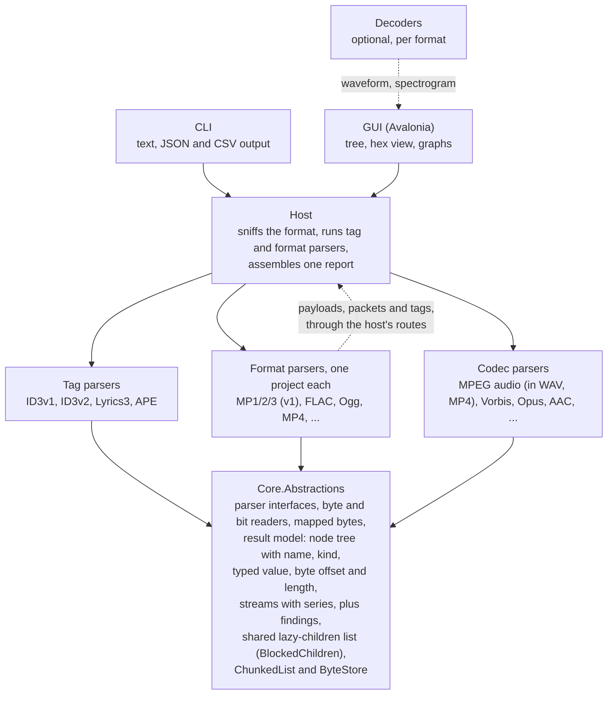

# Encspect: Project Plan

Planning date: 2026-10-10. This file is the canonical copy of the plan; keep it up to date as decisions change.

## Goals and non-goals

The tool tells you everything technically knowable about an audio file's structure, and every value it reports points back to the bytes it came from. It is a GUI and CLI analyzer for people who want EncSpot-level detail, across many more formats.

**Goals**

- Deep header, metadata and structure analysis: encoder detection, bitrate behavior, bit reservoir usage, Xing/Info/LAME/VBRI headers, and all tag formats (ID3v1, ID3v2, Lyrics3, APE and others).
- Every reported value carries its byte offset and length, so the GUI can show a structure tree next to a hex view and the CLI can emit text or JSON from the same data.
- Broad format coverage, with one self-contained parser per format (see the rollout section).
- Damaged or odd files produce findings (warnings, anomalies), never crashes.
- One codebase for Windows, macOS and Linux on x64 and ARM64.

**Non-goals for v1**

- Audio playback.
- Scalefactor and Huffman-table level MP3 analysis. v1 stops at headers, side info and metadata; the deeper pass is a later phase.
- Runtime-loadable plugins. Formats are separate projects, composed at build time.
- Editing or writing tags.
- Bundling external decoders or native audio libraries. The native libraries the GUI framework itself needs are the exception: Skia and HarfBuzz on every platform, and Avalonia's platform backends, ANGLE (`av_libglesv2`) on Windows and Avalonia.Native (`libAvaloniaNative`) on macOS. Linux needs none beyond Skia and HarfBuzz: its windowing backends, X11 (the default, also under Wayland through XWayland) and Wayland (Avalonia.Wayland, experimental in Avalonia 12.1, opt-in with `ENCSPECT_GUI_BACKEND=wayland`), are managed code over the system's own libraries.
- Quality verdicts. The report says what the file shows, never whether it sounds good: no rating from an encoder's reputation or the bitrate, such as EncSpot's good, ok or bad.

## Decisions so far

The stack is C# on .NET with Avalonia for the GUI. The code is checked by tests and review agents rather than line by line by a person, which shapes several choices below.

| Decision | Choice | Why |
| --- | --- | --- |
| Language | C# (.NET) | Reads like TypeScript; a malformed file raises a catchable exception instead of corrupting memory; one `dotnet publish` per OS and architecture |
| GUI | Avalonia UI (12.1, Fluent theme, the MIT DataGrid; no TreeDataGrid, which moved to a commercial license) | Native OS dialogs and tree view on Windows, macOS and Linux (X11 by default, native Wayland opt-in), x64 and ARM64 |
| CLI | Console app on the same core | Thin front end over the shared library |
| Parsers | Written ourselves, one project per format | Libraries hide the fields this tool exists to show; TagLib# is used only to cross-check |
| Playback | None | Pure analyzer; removes BASS, native binaries and licensing questions |
| Plugins | Build-time modules only | No runtime loading, so no version policy and no publishing restrictions |
| Decoding | Optional, per format | Only for waveform, spectrogram, lowpass and similar; formats without a decoder still get the full structure report |
| Hosting and CI | GitHub, hosted runners | Covers Windows, macOS (Apple Silicon) and Linux on x64 and ARM64 |
| Name | Encspect | Detenc and Framescope were already taken; Encspect was free |
| License | MIT | Default in the .NET ecosystem; each dependency's license is still checked individually |

## Architecture

Every parser depends on one small abstractions library and on nothing else; the front ends reach parsers only through a host.

**A library others could use.** The core, the host and the parsers stay a front-end-agnostic library, so a third party could one day build its own GUI on them or analyze files from its own program, and the CLI and GUI are only two front ends of it. Nothing that belongs to one front end goes below it: no UI types, dialogs, settings, caches or console output in the host, Core.Abstractions or a parser; front ends reach the analysis only through the host's public API (`Analyzer`, `Report`, the writers, the topic library) and add nothing to it that another front end could not use. Offering the library is not planned; doing it later means NuGet packages, a deliberately public API under semantic versioning with an API-compatibility check in CI, and a contract declared stable once the format phases stop extending it. Programs in other languages can already use the CLI's versioned JSON; a C-compatible native library through NativeAOT and a WebAssembly build are possible later, since the analysis has no native dependencies.

The host sniffs the format, lets tag parsers claim their regions, then hands the rest to a format parser. A container format hands what it holds back to the host, which passes it on to a codec or tag parser. Decoders are separate and optional, so no parser ever depends on one.

- **Result model:** every node has a name, a kind, a value, byte offset, length and children; findings carry a severity and point to the node that caused them. A finding is a warning when the file breaks a specification or holds something wrong or damaged, whoever caused it and however well decoders cope, above all where readers then show or play something different; an info when what it reports is valid but worth knowing, or when the analyzer cannot check something whose cause is reported separately; an error when parsing itself fails.
- **Typed values:** a node's value is a `NodeValue`: text, an integer, a decimal with the decimals it is shown with, a boolean, or an integer shown in hexadecimal with its digits (a CRC, a flags field); integers and decimals carry their unit ("kbps", "Hz", "s", "bytes", "samples", "dB"). Its text is what the report shows ("128 kbps", "0.261 s", "0x1A2B", "true"); a string converts to a text value, so names, descriptions and mixed text ("255 (none)", a frame's summary) stay text. A list of numbers ("1, 5, 12") is text too. JSON writes numbers and booleans as such, with `unit` beside them, so `"value": 128, "unit": "kbps"`.
- **Node kinds:** `NodeKind` says what a node stands for: a Tag (wherever it sits), a Stream (a stretch of a format's audio data, such as an MPEG Audio region), a Frame, its SideInfo, Statistics, or, by default, a Detail. Front ends find sections by kind, never by name: `--hide` and the summary's tags read kinds, so an APE item named "Frame" is tag content and a Monkey's Audio stream named "APE" is no tag.
- **Streams and series:** a format parser reports each audio stream as a `StreamInfo` (`ParseContext.AddStream`): the nodes that hold it, codec, sample rate, channels, channel mode, channel layout, bits per sample where the coding has them, samples, duration in seconds, average bitrate in kbps, whether the bitrate varies, the encoder and the writer, each with the confidence in it. A stream is what the format says it is: an MPEG stream continues across a tag embedded in it and ends where the version, layer, sample rate or free format changes, so one stream may span several regions and one region hold several streams. The summary and the CSV read streams only (the CSV's Channel Layout column is the first stream's described layout, next to its channel mode): they count real streams, add up durations and samples, and weigh the average bitrate by duration. The channel layout (`ChannelLayout`) is the speaker each channel feeds, one `Speaker` per channel in the stream's channel order, which stays the format's (AAC's 5.1 starts with the center, MPEG-2 multichannel's with the left and right of its stereo base); `Speaker` names the positions as the WAVE channel mask does (front left, front right, front center, LFE, back left and right, front left and right of center, back center, side left and right, the top positions) plus the wide, second LFE, top side and bottom positions of ISO/IEC 23091-3 that 22.2 needs, and `Discrete` for a channel without a position, such as either program of MPEG dual channel or a second stereo program. A format's only surround pair is the back pair, as in the WAVE channel mask's 5.1; where it also has a rear pair, the surround pair is the side pair and the rear pair the back pair, as in the 7.1 of ISO/IEC 14496-3 Table 1.19. `ChannelLayoutName` follows from the speakers, never their order: mono, stereo, 2.1, 3.0, 3.1, 4.0, 4.1, quadraphonic, 5.0, 5.1, 6.0, 6.1, 7.0, 7.1, 7.1 (wide), 5.1.2, 5.1.4, 7.1.2, 7.1.4 and 22.2, null for any other set, a discrete channel or a speaker twice; `ChannelLayouts` writes the speakers out ("front left", never "FL") and describes a layout as "5.1 (front center, front left, …)". Where a layout is set, `Channels` is its count. `MultilingualChannels` counts channels that carry other programs next to the layout, which a decoder plays in place of a speaker channel (MPEG-2 multilingual channels); neither `Channels` nor the layout includes them. A format without speaker positions leaves the layout null. Vorbis sets it from its channel count and Opus from its channel mapping family, 0 or 1, in the order of section 4.3.9 of the Vorbis I specification, which RFC 7845 section 5.1.1.2 shares; Opus's ambisonics (families 2 and 3) and family 255 name no speakers and leave it null. A container that states a layout of its own (MP4's chan and chnl) completes a stream its codec reports without one, through `AnalysisContext.UpdateStream`, and reports a finding where the two name other speakers; the codec's statement counts. **Encoder and writer.** The encoder is the software that turned the audio into the coded stream; the writer is the software that put the stream into the file: a muxer, a container writer, a tagger. They are two fields of a stream (`Encoder` and `Writer`, shown as "Written by" in the GUI) with a confidence and evidence of their own, because a file can be remuxed or tagged without its audio being touched, and a container layout or a muxer tag says nothing about the encoder. Every `EncoderClaim` carries a `ClaimRole`, `Encoder` or `Writer`, given by the parser that makes it, with no default. Each format parser resolves each role from its own claims: the encoder from the stream's evidence (signatures, encoder-specific header fields, coding habits) and the claims of the encoder role, the writer from the claims of the writer role (`WriterDetection`). A writer that differs from the encoder is a fact and no finding; only two claims of one role that name different software are (`<format>.encoder-claim-differs`, `<format>.writer-claim-differs`). The role of a tag is where its specification puts it, and the writer's where the specification leaves it open: ID3v2 TSSE is the encoder's (ID3v2.3 section 4.2.1 and ID3v2.4 frames section 4.2.5 define it as the used audio encoder and its settings); a Vorbis comment's vendor string is the encoder's and its ENCODER field the writer's (section 5.2.2 of the Vorbis I specification lists no such field; RFC 7845 section 5.2 has applications use it to identify themselves); the APEv2 Encoder item, MP4's ©too and QuickTime's ©swr, ASF's attributes (WMFSDKVersion, MediaFoundationVersion, WM/ToolName, WM/EncodingSettings) are the writer's (WM/ToolName is "the application used to create the file"; the APEv2 key list and WMFSDKVersion could not be verified), and DTS-HD's BUILDVER the encoder's, as A/103:2014 Table E.1 names it "DTS-HD Encoder Version Identification"; the version text of ffmpeg's muxer (`Lavf60.16.100`) is the writer's in whichever tag holds it, and its libavcodec encoder ID (`Lavc60.31.102 libvorbis`, which ffmpeg writes only when it encodes: fftools/ffmpeg_enc.c set_encoder_id, mp3enc.c, oggenc.c of n6.1.1) is the encoder's. Container layouts (the Windows Media Format SDK's and Media Foundation's headers, Apple's MP4 and ADTS layouts) are claims of the writer role. Apple's sbtd box, which records the PCM source of an encode, is a claim of the encoder role of its own; the writer comes from the padding and stream type byte separately, so a file with an sbtd box and no page-aligned data has an encoder and no writer. A claim that names software known to write another format (`KnownWriters`: LAME, FAAC, fdkaac, exhale, opusenc, oggenc, speexenc and WavPack, each from what the project's fixtures show it writes) is an information finding, `<format>.writer-other-format`; unknown software, FFmpeg and GPAC, which write many formats, and a writer that merely differs from the encoder raise none. A libavcodec encoder ID in an ENCODER field that names another codec's encoder never becomes the encoder: it is evidence only under an Encoder that other evidence names (a vendor string, the header version), and it raises `<format>.encoder-other-format`. An ffmpeg-style LAME tag (an encoder string of `Lavc…` or `Lavf…`, or ffmpeg's tag CRC) is the layout of its mp3 muxer, which writes the whole tag (libavformat/mp3enc.c): it names the writer "FFmpeg" without a version, with low confidence, beside the encoder. The one exchange between the roles: an encoder the stream named without a version takes the version of a writer claim that is the encoder's name followed by white space and a version (FAAC 2.x's layout names "FAAC", its ©too reads "FAAC 2.2.0 (6acbe23)"); a writer of another name, such as ffmpeg's or GPAC's, lends none, and a writer claim never creates an encoder or raises its confidence (`ClaimRoles.CompleteVersion`). The CLI writes `Writer` and `Writer Confidence` next to the encoder's columns and `writer`, `writerConfidence` next to `encoder` in JSON; the GUI has a "Written by" column and names the writer after the encoder in a stream's line (summary cache format version 4). The articles are `encoder-detection` and `writer-detection`.

A stream carries `Series` for graphs, numbers with a unit over an x axis of frame offsets or seconds; a series may name the node it belongs with, after which the text tree prints it in one line.
- **Findings linked to nodes:** a finding's node is a node of the tree, matched by name, offset and length, so a parser may point at a field of a frame it has not built by building an equal node. After parsing, the host finds each finding's node by descending only into children whose bytes contain it, so of a stream's frames only the one on the way has its children built, and sets `Finding.Path`, the child indexes from the root; the same for each stream's nodes. `Finding.Count` is the number of cases a finding reported once per stream stands for.
- **JSON schema:** each report carries `schemaVersion` (1) and the tool's name and version; the version changes when a field changes meaning or type or goes away, not when one is added.
- **Bit positions:** a field that does not cover whole bytes (an MPEG header field, a side-information or bit-allocation field) also carries its bit offset within its first byte, counted from the most significant bit, and its width in bits (`Node.FromBits`), so the hex view can mark the exact bits; its byte offset and length still cover every byte it touches. JSON writes `bitOffset` and `bitLength` where they exist, and the text tree with `--offsets` shows `[0x1+3, 2 bits]`. Formats that pack bits least significant first (Vorbis) number them from the least significant bit instead: `Node.FromBits` takes a `BitOrder`, `Node.BitOrder` says how `BitOffset` counts, and such a field's bits run on from the top of one byte into the bottom of the next, contiguous within each byte either way, so the hex view and bit strip mark the same bits mirrored. The order takes one bit of the int that holds the bit position, so nodes keep their size. JSON adds `bitOrder` (`leastSignificantFirst`) where it applies, the text tree `[0x1+3, 2 bits, LSB first]`.
- **Nesting limit:** a tree nests at most `Node.MaxDepth` (64) levels below its root. The writers stop there and say so (`hasOmittedChildren` in JSON, a line in the text tree), so a container that a damaged file nests thousands deep cannot overflow their stack; a parser that would nest deeper reports a finding instead.
- **Descriptions and topics:** every node a parser or the host makes carries a `Description`, one or two sentences on what the field is and, where it helps, what its value means, with the spec section where there is one and no verdicts; the parser that knows the field writes it, as a constant string shared by every node of its kind (per value, one of a few constants), so frames built by the hundred thousand allocate none. Name, kind and value stay as they are. A node may name a background article by ID (`Topic`); a node without one belongs to its nearest ancestor's. Articles are Markdown with front matter (ID, title, related topics, specifications) embedded in the host (`TopicLibrary`), shared by every format that uses the concept, since mid/side stereo is the same idea in MP3, AAC and Opus; parsers name them by ID only. Each article says what problem a coding tool solves, how it works in principle, what seeing it in a file means and where it is specified, in about 100 to 300 words; going somewhat over is fine where the information is valuable or the text reads more naturally, but an article stays well under 400. A `Series` carries a `Description` too. The two references take a node from 80 to 96 bytes; frame records are unchanged. A test walks the tree of every fixture, sampling each region's frames and following every finding's path, and fails on a node without a description or with a topic that does not exist, so a new format meets it with its first fixtures.
- **Children built on demand:** repeated parts such as frames give their node a build function; the children are built when first read, held weakly, and built under a compare-and-swap, so threads that read a node at the same time get the same children. A list of a million children may itself build its nodes in blocks, each held weakly the same way, as an MPEG region does with its frames. `Node.HasChildren` answers without building them. A build function that throws yields a single "Error" child instead of an exception in a writer or the GUI.
- **Parser contract:** `IFormatParser.Sniff(SniffContext)` sees the reader, the file name's extension as a hint (lower case without the dot, or null) and the cancellation token, and returns a `SniffResult`: the evidence class, where the matched structure starts, how many consistent and how many checksum-verified frames it found, and optionally a note (see "Format detection"); the extension may only break ties between formats without a signature, never make a parser accept. Tag parsers probe through a `TagProbeContext` (reader and token): `ProbeAt`, `ProbeBefore` and `FindFrom`. One instance of each parser serves every analysis, also on several threads at once, so parsers keep no per-call state in fields.
- **Exception boundary:** a reader position or slice outside its range throws `EndOfStreamException`, so a corrupt size field reads as truncation (`parse.truncated`); `InvalidDataException` carries a message for the report (`parse.invalid`). The host wraps every parser entry point: any other exception from a sniff or a parse becomes an error `parse.failed` that names the parser and the exception, and a probe that throws is a rejected candidate with that error. The host never changes a parser's node: an accepted tag is shown as a node with the same name, value and bytes whose children are the parser's and the host's Detection. Only cancellation and running out of memory pass through.
- **Cancellation and progress:** `Analyzer.Analyze` and `AnalyzeFile` take `AnalysisOptions` with a cancellation token and an `IProgress<long>` of bytes read. Every read through `ByteReader` checks the token, and loops that only compute (the MPEG passes over all frames) check `ParseContext.CancellationToken` every few thousand frames; cancellation surfaces as `OperationCanceledException`. Progress is the furthest file offset the format parser has read, which only grows, and the file length once the analysis is done.
- **Readers:** `ByteReader` reads a stream, never the whole file, with absolute file offsets also in a slice: `Read(Span<byte>)` without allocating, 16-, 32- and 64-bit unsigned integers in either byte order and 24-bit big-endian ones. `BitReader` reads up to 64 bits at a time from a byte array or `ReadOnlyMemory<byte>`, most significant bit first (MPEG, FLAC) or least significant bit first (Vorbis), and yields zero bits past the end with `IsOverrun` set.
- **Tags are separate from formats,** because ID3, APE and Lyrics3 appear in many of them.
- **Containers hand streams to codec parsers,** for example Ogg to Vorbis and Opus, MP4 to AAC and ALAC, WAV and MP4 to MPEG audio. Parsers never reference each other; they reach other parsers only through routes on their context, which the host serves. `ParseStream(codecId, parent, payload)` hands a payload that is one byte range (a WAV data chunk) to the `ICodecParser` with that ID, and `ParsePackets(codecId, parent, packets)` hands packets as mapped bytes (Ogg pages, MP4 samples), enumerated while the codec parser runs, so a container reads them lazily. `ParseTag(tagName, slice, parent)` hands a tag that a container holds whole (an ID3v2 tag in a RIFF or AIFF chunk, a FLAC Vorbis comment block) to the tag parser of that name, through `ITagParser.ParseWhole`, and `ParseTag(tagName, tag, parent)` with mapped bytes a tag a container or codec took apart (a Speex, Vorbis or Opus comment packet, which may span Ogg pages), through `ITagParser.ParseWhole(MappedBytes, CancellationToken)`; a tag parser that does not read mapped bytes finds no tag there. The routed parser adds its nodes under the container's node; its findings, streams and encoder claims join the container's, a tag is shown as top-level tags are, with its Detection, and its encoder claims reach the codecs routed after it. Both codec routes take an optional `CodecConfiguration`: what the container stores about the coding apart from its data, as mapped bytes with the container's node that holds them (MP4 keeps AAC's AudioSpecificConfig in the esds box inside moov, far from the samples in mdat, so the codec parser builds its configuration nodes there and its other nodes under the data's node), and whether the container states a variable or a constant bitrate. The routes keep the exception boundary: truncation, invalid data or a parser bug inside the routed data become findings on the container's node (`parse.truncated`, `parse.invalid`, `parse.failed`) and the container carries on; cancellation passes through. Routes nest a few levels at most (`parse.too-deep`). The MPEG parser is the codec `mpeg-audio` for one payload, which it analyzes as it would the same bytes as a file, at their file offsets. `DefaultParsers.Codecs` lists the codecs. Both routes also take optional `claims`, with or without a configuration: `CodecConfiguration.Claims` are what the container read about the coding (MP4's sample-entry layout), the route's `claims` what it states about the stream (a Matroska Segment's WritingApp and MuxingApp); the codec parser weighs both after the file's. What a codec parser claims itself (the comment of a Vorbis stream) stays with its stream and is not handed to the codec parsers that run after it. `CodecConfiguration.Claims` carries encoder claims that hold for that one stream (MP4's layout of one track): the routed codec parser sees them in `EncoderClaims` after the file's claims, they never go back to the caller, and they take effect only through the host's router.
- **Mapped bytes:** `MappedBytes` holds bytes that a container or tag took apart (a packet put together from its pages, ID3v2 data with unsynchronization undone) with a map of segments back to the file: `OffsetOf`, `FileLength`, `FileRanges`, `Slice`, and opaque bytes (decompressed data) that map to their whole source. A `BitReader` over them maps bit positions to file offsets (`FileOffsetOf`), and `Node.FromMapped` and `Node.FromBits` over mapped bytes build nodes at the file bytes the fields came from. A packet a container hands to a codec also carries what the container knows about its place in the stream: `EndPosition`, the container's position at its end in the codec's units where it records one (Ogg's granule position, on the last packet a page completes), with `EndPositionField`, the node of that field, for findings; `IsEndOfStream` on the last packet of a stream the container says has ended; and `FollowsGap` on the first packet after packets the container lost, so a codec does not count positions across the gap.
- **Node ranges:** a node whose bytes are not contiguous in the file, such as a packet that spans Ogg pages or a field that a page header splits, carries `Ranges`, its file ranges in order; its offset and length cover them from first to last, so containment, finding paths and the writers' nesting work on the covering range. JSON writes `ranges` as offset and length pairs; the text tree with `--offsets` adds them as `[0x1A, 40 bytes in 0x1A 2 bytes, 0x40 2 bytes]`.
- **Declared end:** a container that states its own size (RIFF, FORM, a run of top-level MP4 boxes) says where it ends through `IFormatParser.DeclaredEnd`. Before it looks for trailing tags, the host asks the parser that sniffs best on the data after the leading tags; a trailing candidate that starts before that end is the container's own chunk, reported as a near miss naming the container, and the container hands it to the tag parser itself (an AIFF file's `ID3 ` chunk, which taggers write last). A tag after the declared end is the file's, as before. A parser returns null for a size it cannot trust, such as a placeholder.
- **The abstractions stay internal** and may change freely until the second format works.

## v1 vertical slice: MP3

v1 is MP1/MP2/MP3 analysis at the header, side-info and metadata level, with no Huffman decoding. It is built first because it forces the shared model and parser interface into shape before any second format exists.

**File layout and tags**

- Leading junk and resync: find the first valid frame, report skipped bytes, and re-sync after damage. A header starts a stream only when two more frames with the same version, layer and sample rate follow at the positions its length predicts, or when its one or two frames end exactly at the end of the data and each passes the structural checks: in Layers I and II the audio data fits the frame and uses no forbidden bit allocation, in Layer III the side information fits the frame and passes the side-information checks below, with no more main data than the frame and its main_data_begin hold. So a file of one or two frames still parses, while a single 4-byte match in other data is not taken for audio. Everything between frames that is not a frame is a gap: junk before the first frame, lost sync between frames, data after the last one. Each stretch of data between tags is one "MPEG Audio" region, and findings of one kind are reported once per stream with a count, not once per frame.
- ID3v2.2, 2.3 and 2.4: header, flags, extended header, footer, padding, unsynchronization, and every frame with its decoded text encoding. Compressed frames are decompressed (zlib, which .NET provides) up to the same 1 MiB limit as other decoded data, and the declared size and the zlib checksum are checked. Two writer bugs are read the way mutagen reads them, with a finding: frame sizes that old iTunes versions wrote into ID3v2.4 as plain integers (the frames are walked both ways, and the reading that finds more declared frame IDs wins), and an extended header flag with a frame where the extended header should be. Data after the terminator of an ID3v2.3 text is information, since section 4.2 says to ignore it.
- Trailing tags: ID3v1 and v1.1, the Enhanced TAG, Lyrics3 v1 and v2, and APEv1 and v2 including every item.
- Any gaps, overlaps or trailing garbage between regions are reported as findings.

**Per-frame data (all layers)**

- Every header field: MPEG version (1, 2, 2.5), layer, CRC protection, bitrate, sampling rate, padding, channel mode and mode extension, copyright, original, emphasis.
- Frame offset, length, and CRC-16 verification when protection is on. A Layer II CRC covers the bit allocation and scfsi, so its length follows from the allocation tables.
- Mid-stream parameter changes (sampling rate, channel mode) and free-format streams. A stream change is reported both where frames of two streams touch and where sync is found again after a gap. A free-format frame's length is the distance to the next header of the same stream, as mpg123 finds it; one too short for the header, CRC and side information or bit allocation is no frame, so data with a header every few bytes does not sync. A free-format stream whose frame length changes breaks the fixed bitrate ISO/IEC 11172-3 requires and is a warning. Parsing never asks more of a free-format chain than of any other: a stream that starts at a chain of frames is read, protected or not. A chain of frames with a CRC (protection bit 0) found further in than the start of the data is held to the same standard in the sniff: if none of its whole frames, counted up to 16, has the CRC its header gives, it is likely another format's bytes (an AC-3 frame of 768 bytes holds the header of a protected MPEG-2.5 Layer I frame of 768 bytes at a fixed offset, which chains from frame to frame), and it is class 30 like a free-format chain that is not credible. A chain at the start of the data and one whose frames are not protected are class 90 as before. Only the sniff's class does: a free-format chain is only four bytes of header repeating at one distance, which data of another format with a header-like word at a fixed period (the 0xFFFF that ends a DTS subframe) makes as well, so the sniff gives the first chain whose frames are credible class 90 and, where none is, the first chain class 30. A chain is credible when it is no free-format chain, or when its first three frames that fit in the data are well-formed (audio data and, in Layer III, side information that fit the frame, without the forbidden Layer I allocation 15) and, in Layers I and II, where an all-zero frame is valid and free format is a curiosity, one of them is protected and has the CRC its header and bit allocation give (ISO/IEC 11172-3 2.4.1.4). A genuine unprotected free-format Layer I or II stream, or one whose CRCs are damaged in its first frames, is therefore still MPEG audio, as the only candidate or when the parser is forced, and only ranks low against other formats.
- Once in sync, a frame is only taken on its header while a frame follows it. Where none does, a stream that starts inside the frame, after its header and CRC, cuts it short there, reported as a frame that was cut or whose header is damaged, so the next frame is not swallowed and the damage is located; a free-format stream may instead have changed its frame length.
- MPEG 2.5 extends only Layer III, so Layer I or II frames at its rates are a warning; decoders play them.
- Leading junk is searched for the first frame within 1 MiB after any leading zero bytes, which are common padding and cheap to skip.

**Layer I audio data**

- Bit allocation per subband and channel, one above the joint stereo bound, scalefactors, the length of the samples and the ancillary data after them (ISO/IEC 11172-3 2.4.1.5). The forbidden allocation 15 is a warning (libmad rejects the frame, mpg123 reads 16-bit samples, as the report does), and so are scalefactor index 63 and audio data longer than the frame.

**Layer III side info**

- `main_data_begin` and the resulting bit reservoir fill for each frame: the free bytes after the previous frame's main data, up to what `main_data_begin` can reach (511 bytes in MPEG-1, 255 in MPEG-2 and 2.5).
- Per granule and channel: `part2_3_length`, `big_values`, `global_gain`, `scalefac_compress`, block type and mixed-block flag, table selects, region counts, `subblock_gain`, `preflag`, `scalefac_scale`, `count1table_select`, plus `scfsi` per channel.
- Joint stereo: mid/side and intensity stereo usage per frame.
- The bit reservoir: each frame's bytes after the side information are split by owner into its own main data, main data of later frames ("Bit Reservoir") and ancillary data no frame uses, so every byte is accounted for. Main data runs through the data of consecutive frames of one stream, skipping headers and side information, and continues across junk and tags between frames; a stream change, including a switch to or from free format, starts with an empty reservoir. Main data that begins before the stream (a cut file), overlaps the previous frame's (missing frames), reaches back across a gap (decoders disagree there) or does not fit the frame is reported. A Xing, Info or VBRI header frame stays in the reservoir as a frame without main data, as minimp3 and mp3guessenc keep it; mpg123 and ffmpeg skip it, so main data that begins in it is a warning, as after `ffmpeg -ss -c copy`, and the header frame's unused bytes show which frame's main data they hold. The header frame does not count as the stream's first frame, so main data that reaches back past it begins before the stream.
- Side-information checks: big_values above 288, the reserved block type, Huffman tables 4 and 14, scalefactors longer than part2_3_length, scfsi on a channel with short blocks, and mid/side or intensity stereo with different block types in the two channels (the last two are rejected by libmad).
- The decoder buffer of ISO/IEC 11172-3 holds one frame at the highest bitrate (bitrate_index 14) at the stream's sample rate, so main_data_begin plus the frame's length may not exceed that frame's length, and main_data_begin is 0 at 320 kbps. Only MPEG-1 is checked: LAME's `--strictly-enforce-ISO` applies the rule to MPEG-2 with its top bitrate of 160 kbps, but that reading of ISO/IEC 13818-3 has not been confirmed against its text. Breaking it is a warning, which says that LAME has not enforced the limit by default since 3.81 and that decoders accept it.

**Layer II audio data and multichannel**

- Bit allocation per subband and channel from the allocation tables (ISO/IEC 11172-3 Annex B, and ISO/IEC 13818-3 for the lower sampling rates; free format takes Table B.2a at 48 kHz and B.2b at the other rates, as their captions say and libmad reads it, while mpg123 takes B.2a at every rate), scfsi and scalefactors, the length of the sample data and where the ancillary data starts. The same tables let Layer II CRCs be verified. Audio data longer than the frame is a warning, also where the allocation, scfsi or scalefactors already run past it, and the CRC is still verified wherever the allocation and scfsi it covers fit; scalefactor index 63, which Table B.1 of ISO/IEC 11172-3 leaves undefined, is a warning too, although TwoLAME writes it and ffmpeg, mpg123 and libmad decode it.
- The MPEG-2 multichannel extension (ISO/IEC 13818-3), which an MPEG-1 Layer II frame carries in its ancillary data, so the stereo base stays playable: the multichannel header (center, surround and LFE channels, audio mix, dematrix procedure, multilingual channels with their layer and sampling rate, whether an extension bitstream exists), the channel configuration such as 3/2 plus LFE, its CRC, and how many bytes the multichannel data takes. The frame header has no flag for it, so it is detected by structure and consistency across frames, like a tag, never by a single match: a file carries it once the multichannel CRC holds in at least two frames and in at least half of the frames whose multichannel side information fits the frame. Random ancillary data passes the 16-bit CRC about once in 65,536 frames, so a long recording passes it a few times by chance; mp3guessenc likewise wants a share of the stream. Then each frame whose CRC fails is reported, and so is the reserved center value, which is read as no center, and an `n_ad_bytes` that declares more ancillary data than the frame holds after the multichannel header and CRC, a warning; the multichannel data of such a frame ends after its CRC.
- The stream's channels follow the extension where the file carries it and every frame of the stream whose multichannel CRC holds, or whose side information continues in the extension bitstream, states the same speakers: left and right from the base, then the center (phantom coded or not), the mono surround as the back center, the surround pair as the back pair or a second stereo program's two discrete channels, then the LFE, which is the order of mctoolamed's output channels. 3/2 + LFE is 5.1 in six channels; multilingual channels are counted apart. A possible, unverified extension keeps the stereo base, and so does a stream whose configuration changes, with an info finding. The conformance manifest records each stream's channels and layout, and mctoolamed's channel files and multilingual channels confirm them; without the extension a stream is mono, stereo, or for dual channel two discrete channels.
- Layers I and III can carry the extension too; the ISO conformance set has one stream of each (tests 22 and 23). They follow later.
- When an extension bitstream exists, the multichannel data continues in it, after the base frame's bits minus `n_ad_bytes` of MPEG-1 ancillary data at its end. The extension bitstream is a separate file, so frames whose multichannel side information does not fit the base frame are reported as continuing there, with their CRC not verified. When no frame's side information fits, no CRC can confirm the extension; if nine in ten candidate frames carry the same multichannel header and continue in an extension bitstream, that is reported as a possible, unverified extension.

**Encoder and VBR headers**

- Xing and Info: flags, frame and byte counts, the seek table, quality. They are read only in Layer III, where the side information would end without a CRC (36, 21 or 13 bytes into the frame, as LAME writes them even into a protected frame), and only when every byte between the frame header, or its CRC, and the header is zero, as mpg123 requires, so audio data that happens to contain "Xing" is not taken for one. A header that does not fit its frame and a TOC that decreases are warnings. The frame decodes as silence in decoders that do not skip it, so it stays in the bit reservoir as a frame without main data (see the bit reservoir above).
- LAME extension, read only after an encoder string that starts `LAME`, `L` and a version (`L3.99a12`) or ffmpeg's `Lavc` or `Lavf`, as mp3guessenc and ffmpeg require; other text there is shown as a string and names nothing: encoder string, tag revision, VBR method, lowpass, peak, ReplayGain fields, encoding flags, ATH type, minimum or ABR bitrate, delay and padding, noise shaping, stereo mode, source sample rate, MP3 gain (a sign bit and seven bits of 1.5 dB steps), preset, music length (0 means not set, an info), tag CRC and music CRC (both verified). The tag CRC covers the frame's bytes before it, the music CRC the bytes after the frame up to the music length, which counts from the start of the frame. A failing tag CRC or music CRC is a warning, also where the encoder is to blame: the field breaks the tag's specification and readers act on it. Two such causes get their own finding, which names them: ffmpeg writes the tag CRC over the frame's first 190 bytes wherever the tag starts, which is only correct for MPEG-1 stereo, so LAME and ffmpeg itself reject it and ignore the tag's encoder string and ReplayGain; and in a file that continues a `--nogap` sequence LAME continues the previous file's music CRC, so it cannot confirm that the audio is unchanged, which an edit such as MP3Gain's would look no different from. Otherwise a failing music CRC means the audio changed after encoding. A music length shorter than the tag's own frame leaves the music CRC unverified, with its own finding; so does one that runs past the end of the file, an info where the stream is cut short, which its own findings report, and a warning where the stream holds every frame its header counts. LAME before 3.90 wrote only a version string, which is reported as such. LAME 3.90 to 3.92 have Dibrom's `--alt-preset` modes and the older `--preset` names but leave the preset field empty, which 3.93 added; where the VBR method, Xing quality, noise shaping, stereo mode, ATH type, lowpass and (but for VBR) bitrate field are those a preset sets, the report names it next to the empty field. The settings come from encodes with every preset by 3.90 and 3.92 built from source and by the Windows builds of 3.91 and of HydrogenAudio's 3.90.3, the 3.90 line it recommended for years, keyed as getID3 keys them: those two write some lowpasses 100 Hz higher (getID3 lists the same for 3.91), and 3.90.3 shapes noise differently in standard and extreme. getID3's other 3.90.3 values (and its medium presets) belong to a modified build of it and are not used. 3.90.3's version, "LAME3.90.3", does not fit the tag's nine bytes, which hold "LAME3.90."; LAME writes it whole into the padding of the frames, where the analyzer completes it from, as getID3 and mp3guessenc do. LAME before 3.95 computed ReplayGain against 83 dB instead of 89 dB, so a gain it determined itself reads 6 dB lower than a later version's; the report says so next to the value, which it keeps as stored (mpg123 adds the 6 dB).
- VBRI (Fraunhofer): version, delay, quality, byte and frame counts, seek table, 36 bytes into the frame in every mode. A version other than 1, which ffmpeg ignores, and a seek table entry size outside 1 to 4 bytes, which leaves the table unread, are warnings.
- A VBR header in the middle of a stream, after any earlier frame of it, across gaps and tags, is a warning: files were probably joined, so the first header's counts and TOC cover only part of the stream, and players that only look at the first frame play the second as a frame of silence.
- Encoder detection from these tags, with a clearly labeled confidence level when it has to fall back on heuristics for files without tags: a LAME tag names its encoder (high confidence when its CRC holds, medium when not), a VBRI header Fraunhofer (high), or Fraunhofer's MP3 Surround or mp3PRO encoder when the ancillary data carries their signature. ffmpeg writes a LAME tag into every MP3 it muxes, with the encoder string of the stream it copies (a remux of a LAME file keeps `LAME3.100`) or its own: `Lavc` where libavcodec encoded, which it does only with libmp3lame or libshine, so LAME's version in the ancillary data or Shine's traits behind it are medium confidence, and other evidence keeps its own; without any, `Lavc` names ffmpeg (medium). `Lavf` marks a remux of a stream whose encoder ffmpeg did not know and names no encoder: the stream's evidence names it as it would alone, with the tag as support.
- A header names the encoder of the frames it describes, from its frame to the next header or a change of stream. Only a header in a region's first frame names the region's encoder from its tag; where the region also holds frames it does not describe, or headers that name another encoder, files were joined and that name is at most medium confidence. A header further on names no more than the frames after it: the stream's other evidence names the region's encoder, which such a header supports where it names the same, and without any the header names it with low confidence. Each header's counts and gapless figures cover its own frames and say so where those are not all of the region's.
- LAME writes its version twice (libmp3lame/version.c): into the tag's nine bytes, `LAME`, major.minor and a marker (`a` alpha, `b` beta, `r` a release with a patch level above 0 that does not fit, a space otherwise; 3.99 alphas wrote `L3.99a12`, 3.100 and later have no room for a marker), and whole into the padding it drains into ancillary data (`3.98 (beta)`, `3.99 (alpha 12)`, `3.99.5`). The report spells the version out (`LAME 3.98 (beta)`, `LAME 3.99 (alpha 12)`, `LAME 3.99.x` for an `r` without a patch level) and keeps the raw text in the tag's node. Where the two agree on major.minor and marker, the name takes the more specific one and lists both as evidence when the ancillary one carries a marker; where they disagree, the tag's is shown and a warning says the frames and the tag may come from different encoders.
- The maintained Helix encoder (hmp3 5.2.4) writes a LAME tag whose encoder string is `LAMEH5.24`; it names Helix, not LAME, with the tag's confidence.
- Without a tag or signature, an encoder's habits are low-confidence evidence, used only where encodes of known signals with that encoder show them every time and the other encoders available for testing do not, over at least 20 frames: Shine never uses the bit reservoir, short blocks, scalefactor scaling or ancillary data (behind ffmpeg's `Lavc` tag, which only libmp3lame and libshine encodes carry, that is medium confidence); Helix without its tag (5.2.4 and 5.0 r11) sets the copyright and original bits in every frame and uses scfsi and scalefactor scaling; Xing's encoder (tompg 3.0) never switches to short blocks, not even at a tone's onset where every other encoder does, never uses scfsi, and sets the original bit in every frame; BladeEnc switches to short blocks without scalefactor scaling, codes plain stereo or mono at one bitrate in MPEG-1, and from 0.82 on leaves ancillary data at most in its last frame (checked on every surviving source release from 0.80 to 0.94.2 and the Windows builds of 0.82, 0.90 and 0.91; 0.80 and 0.81 drain an overflowing bit reservoir into ancillary data mid-stream, as the ISO dist10 encoder does, and mp3guessenc does not name them either); Fraunhofer's encoders use scalefactor scaling and short blocks but never scfsi (MPEG-1 only, since MPEG-2 has no scfsi); TwoLAME and Xing both write scalefactor index 63 into Layer II, which names them together. mp3guessenc agrees on every Layer III encode of these encoders; its rules for encoders that cannot be run here (older releases) are not used, since on encoders that can, it names Shine "Xing" and Helix "Lame". Silence gives an encoder nothing to decide, so its traits do not show there, and a silent stream may match another encoder's habits.
- A strong hint without tags: encoders fill unused bits with their name and version. LAME writes `LAME3.100` (possibly cut short to `LAME`) into ancillary data mid-stream and into the padding of the last frame, even when the Info tag is disabled; TwoLAME writes zeros. A version that runs to the end of the ancillary data may be cut short there (`LAME3.10`), so a whole one elsewhere is preferred and a cut one names only LAME. The string starts wherever the main data ends, at any bit position, and can run on into the next frame's data, so it is searched at every bit offset in the ancillary data the bit reservoir split identifies, joined across frames, not in raw frame bytes. Found alone, it is low confidence. Which other encoders sign their padding, and how, is established from encoder-written fixtures before it is used: Gogo-no-coda (3.12) fills the bits no frame uses with `GOGO` over and over, found at any bit position as two in a row (low confidence alone), and in VBR writes `GOGO` where its Xing header's quality belongs, which names it with medium confidence and is shown as such instead of a number.
- An ID3v2 TSSE frame (TSS in ID3v2.2) is the weakest evidence of the encoder: whatever software writes the tag fills it in, which may be the encoder (LAME's front end writes `LAME 64bits version 3.100 (http://lame.sf.net)`), a later tagger, or ffmpeg's muxer, and it is kept when the audio is re-encoded. The tag parser hands the text to the host, which passes the claims of every accepted tag, in file order, to the format parser. Alone, a claim names the encoder with low confidence; naming the same encoder as low-confidence evidence from the stream, it raises that to medium (names match on whole words, so `Flame` does not name LAME nor `Remixing` Xing), and it never lowers or overrides a LAME tag or VBRI header. ffmpeg writes its own version (`Lavf60.16.100`) whatever encoder it used, so that text is a claim of the writer role (also in an APEv2 item or the LAME tag ffmpeg writes), shown as the writer "FFmpeg (Lavf60.16.100)" and never as evidence of the encoder. A claim of the encoder role that names another encoder than the stream points to is an info finding on the tag frame, not a change of encoder.
- mp3PRO and MP3 Surround keep their extension in the ancillary data of every Layer III frame: mp3PRO its spectral band replication data, from which an mp3PRO decoder restores the high frequencies of an MPEG-2 or 2.5 core, and MP3 Surround the spatial data that turns an MPEG-1 stereo downmix at 44.1 or 48 kHz back into 5.1 channels. No specification is public, so detection follows mp3guessenc: each frame's ancillary segment runs from the end of its main data, rounded up to a byte, to where the next frame's main data starts in the reservoir, and the bits that the first two bytes of every segment share must include 0xC0 and 0x08 (mp3PRO) or 0xCF and 0x30 (MP3 Surround). An empty segment rules both out, and unlike mp3guessenc at least eight segments are needed, so a short stream does not match by chance. The region gets an Enhancement node with the ancillary bytes and their data rate, and an info finding says that decoders without support play only the core or the downmix. Both name the encoder with medium confidence: Fraunhofer's MP3 Surround encoder, or an mp3PRO encoder, since several licensees wrote those.
- Fraunhofer's encoders may write an Original File Length (OFL) block at the start of the first frame's ancillary data: 0xB4, a 16-bit delay and a 32-bit original length in samples, recognized by mp3guessenc's rule (MPEG-1, the delay's high byte 0x04 or 0x08; in MP3 Surround the signature follows at bytes 10 and 11). The delay counts the samples before the audio in a plain decoder's output, the decoder's 529 included, which ffmpeg's output of encoder-written fixtures confirms; mp3guessenc adds 576 for MP3 Surround, the report keeps the stored value. The block names Fraunhofer with medium confidence, and a delay and length longer than the stream are a warning. A VBRI header still decides the encoder, with high confidence. In mp3PRO (MPEG-2 and 2.5), mp3guessenc's rule reads a different block: more than 20 bytes starting 0xE0 0xBA, the delay at byte 14 and the length at byte 16, counted at twice the core's sample rate, the rate an mp3PRO decoder outputs; a real encode by Thomson's mp3PRO encoder stores 88200 samples for two seconds at 44100 Hz in a 22050 Hz stream.

**Computed statistics**

- A Statistics node in each MPEG Audio region, over its complete audio frames (not a frame holding a VBR header, not a truncated last frame): frames, samples and duration, whether the bitrate varies, the average, minimum and maximum bitrate, and the bitrate distribution. Time runs on a clock of 1/14,112,000 s (ffmpeg's time base for MP3, which every MPEG sample rate divides), so frames of different sample rates add up exactly, and figures are rounded half to even.
- The coding statistics mp3guessenc and EncSpot print, in the same Statistics node and over the same frames, counted while the frames are read, so nothing is kept per frame:
  - Channel modes: the frames of each channel mode with their share, always listed, as the bitrate distribution is for a single bitrate, so a reader finds them in every report.
  - Stereo coding of joint stereo frames, with each share of the joint stereo frames: in Layer III the frames coded left/right, mid/side, intensity stereo, or mid/side and intensity stereo (mp3guessenc's "stereo mode frame count"); in Layers I and II the frames of each intensity stereo bound, bands 4, 8, 12 or 16 to 31.
  - Frame sizes: under each bitrate of the distribution, its frames without and with padding and their length (mp3guessenc's "size distr").
  - Layer III block usage: granules counted per channel, as both tools count them, by block type: long (normal), start, short, mixed (short with mixed_block_flag), stop and the reserved type. mp3guessenc's "switch" granules are start, stop and reserved ones, which EncSpot counts as long.
  - Layer III global gain: the smallest and largest global_gain of each channel.
  - Ancillary data as mp3guessenc counts it: in Layer III each frame's segment from the end of its main data to where the next frame's main data starts in the bit reservoir (the segments the mp3PRO detection reads), without a truncated frame's; in Layers I and II the whole bytes after the audio data, without the padding slot, in frames whose audio data fits. Its share of the frames' bytes, its data rate, and the smallest and largest amount of a frame that has any.
  - Whether any frame uses padding, scfsi or scalefactor scaling (mp3guessenc), and the share of granules per channel with scalefactor scaling (EncSpot's "Scalefac").
  - The mean and the largest main_data_begin, named as such so that they are not taken for the reservoir fill above: EncSpot's "Av. Reservoir", which it truncates to whole bytes, and "Max. Reservoir", mp3guessenc's "Max reservoir".
- Each stream's series: the bitrate and the bit reservoir fill (Layer III only) of every complete audio frame, at its offset, and per second of audio the bitrate of the frames that start in that second, in kbps, and their mean reservoir fill, in bytes. A stream that an embedded tag splits into regions has one series over all its frames; the text tree prints the per-second series after the statistics of the stream's first region.
- Counted frames and bytes compared with what the Xing or VBRI header claims, over the frames from the header to the end of its stream (the next header or a change of version, layer or sample rate, across gaps and tags). A truncated last frame was written whole, so it counts there and in the gapless sample count. Xing's and Fraunhofer's encoders count the header's own frame and LAME does not, so either count holds; a mismatch is a warning. Behind a LAME tag the count also sets where the music ends, since the delay and padding count from the frames after the header: LAME 3.94 beta 1 counts the header frame too, so ffmpeg and mpg123, which take the length from the count, play one frame more than was encoded. That is a warning, and the report's own sample count follows the frames.
- Gapless information from a LAME tag: encoder delay, padding, and the exact sample count, the frames' samples minus both, which is what ffmpeg and mpg123 output with their gapless trimming when the padding covers their own 529-sample decoder delay. Delay and padding longer than the stream are a warning.
- Cross-checked with mp3guessenc (frame count, length, average bitrate, bitrate histogram, and every coding statistic above), where it takes the same frames as audio, and with the samples ffmpeg and mpg123 decode; at an exact tie their floating-point rounding may differ from ours by one in the last digit. EncSpot confirms the mean and largest main_data_begin, the scalefactor scaling share, the bitrate histogram, frame count and mode where it reads the statistics' frames; it skips the first frame it finds and, without a VBR header, starts 2000 bytes into the stream, so elsewhere the check compares it with an emulation of how it reads the file. Its tagless encoder guesses, which follow the encoders of 2002, are compared with the analyzer's encoder for encoder-written fixtures, and where they differ the cross-check lists EncSpot's name and why.

## Phase 2, first slice: MP4 and AAC

The lossy formats come first in phase 2, and MP4 with AAC first among them. This slice reads the container, AAC's configuration and the framing of its access units; the second slice reads each raw data block's section data, scalefactors and spectral data, which the fill elements that may carry implicit SBR and PS signaling follow, and with them AAC's coding statistics.

**MP4 boxes** (ISO/IEC 14496-12 and 14496-14, the QuickTime File Format, Apple's iTunes metadata)

- Every box with its header at its bytes: the 32-bit size, the 64-bit size after a size of 1, size 0 to the end of its parent, a uuid box's user type, and a full box's version and flags. A box that declares more bytes than its parent holds is read up to the parent's end with a warning, one whose size is smaller than its header ends the reading of its parent's boxes, and boxes nest at most 40 deep (a warning), so the tree stays within `Node.MaxDepth` with the fields and the codec's nodes under the deepest box. The file's boxes sit under one MP4 node; bytes after the last box are trailing data.
- The run of top-level boxes ends at the first type ISO/IEC 14496-12 does not place at the top level, which is also the end `DeclaredEnd` gives: a trailing ID3v1 or APE tag after the boxes is the file's, a `TAG` inside the last box is the container's (a near miss). A last box of size 0 declares no end. Sniffing is certain of an ftyp box at the start (100) and sure of a run of top-level boxes that holds moov, mdat or moof (95), above MPEG audio's 90, since an mdat may hold MPEG frames.
- The boxes read field by field: ftyp and styp; moov, mvhd, trak, tkhd, edts and elst, mdia, mdhd (with its packed language), hdlr (QuickTime's component type and Pascal string name too), minf, smhd, dinf and dref; stbl with stsd and its sample entries, stts, ctts, stsc, stsz, stz2, stco, co64, stss, sgpd (roll and pre-roll distances) and sbgp; the audio sample entry with esds and its ES_Descriptor, DecoderConfigDescriptor (object type, bitrates) and DecoderSpecificInfo, QuickTime's sound sample descriptions of version 1 and 2 with their wave box (where the file is QuickTime's, without ftyp or with the brand `qt  `, or the stsd box is of version 0, as ffmpeg reads them; ISO/IEC 14496-12's own version 1 keeps version 0's layout), and btrt; the channel layouts: QuickTime's chan atom (Core Audio's AudioChannelLayout: a layout tag named and decoded from Apple's constants in CoreAudioBaseTypes.h, a channel bitmap in the WAVE channel mask's order, or a description per channel with its label, flags and coordinates) and ISO/IEC 14496-12's chnl box of version 0 (stream structure, a ChannelConfiguration of ISO/IEC 23091-3 with its omitted channels, or a speaker position per channel of the sample entry, with azimuth and elevation for an explicit one, and the object count); in both, Ls and Rs are the back pair unless the layout also has rear surrounds. The track's codec states its own layout; the container's completes a stream whose codec states none, where the channel counts agree, and a container layout that names other speakers is a warning (`mp4.channel-layout-differs`), an info where a mono AAC core meets a stereo container, since implicit parametric stereo is not checked yet. udta with QuickTime's text atoms, meta (a full box, or QuickTime's plain container), keys, ilst, ID32 and Nero's chpl; mvex, mehd, trex, moof, mfhd, traf, tfhd, tfdt, trun, sidx, mfra, tfra and mfro. Sample tables are read a block at a time into arrays of the entries the box holds, never more, whatever count it declares, and list at most 1,000 entries as nodes, since every sample also gets its node from the codec that reads it.
- Metadata: an item list is a tag of the container, a Tag node named "iTunes Metadata" ("QuickTime Metadata" under an mdta handler, whose items are named by their keys). Each item is named for what it is ("Title", "Track Number"), a freeform item ("----") by its name atom; each data atom's value is typed by its well-known type (UTF-8, UTF-16, S/JIS, signed and unsigned integers of every width, floats, point, rectangle, images), and the implicit type of track and disc numbers and the ID3v1 genre is decoded. iTunSMPB's hexadecimal words are read into the encoder delay, padding and samples, each a node at its characters; Encoding Params into its pairs of key and value (vers, acbf with Core Audio's bitrate control modes CBR, ABR, constrained VBR and VBR, brat, cdcv). An ID32 box's ID3v2 tag goes to the ID3v2 tag parser through `ParseTag`, so its TSSE frame reaches the codec as a claim.
- Samples: each audio track's samples, from the sample tables (a chunk's samples lie one after another from its offset) and then its fragments (8.8: a run's data offset counts from the base the fragment header states, the moof, or the end of the previous fragment's data; sizes from the run, the fragment header or the track's defaults; at most 4,194,304 per track), go to the codec as packets: "aac" for the object types 0x40 and 0x66 to 0x68, with the DecoderSpecificInfo as the `CodecConfiguration` and whether the bitrate varies from Encoding Params, else from an avgBitrate of 0 (ISO/IEC 14496-1 7.2.6.6.2); MPEG audio (0x69, 0x6B, QuickTime's `.mp3`) as one payload where its samples lie in one stretch, which the MPEG parser reads as the same bytes in a file would be. The track's samples node goes into the mdat box that holds them all, or with its ranges into the MP4 node where they span boxes. Samples outside the file are left out with a warning, samples outside every mdat box are read with a warning, empty ones are counted and left out.
- Checks: required boxes missing or present twice, ftyp not first, no moov, moov after mdat (an info: the file does not start playing before it is read to the end), stts and stsz counting different samples, stsc's order and sample description indexes, chunks that hold fewer or more samples than stsz sizes, mdhd's duration against the sum of stts's durations, tkhd's against the edit list or the media (8.3.2.3), and edit lists with empty edits, more than one media edit, a rate other than 1, a media time below -1 or media past its end.
- Gapless information: what the edit list (the first media edit's media time, the presented samples and the padding after them), the roll and pre-roll groups and iTunSMPB say, in a Gapless node under the trak box, counted in the media's timescale, which is the sample rate for AAC LC and the core's rate as fdkaac writes HE-AAC; a warning where iTunSMPB's words do not add up to the samples' durations, and where the edit list and iTunSMPB disagree.

**AAC** (ISO/IEC 14496-3; ISO/IEC 13818-7 for MPEG-2 ADTS; ISO/IEC 23003-3 for USAC)

- Channels: the channel configurations 1 to 7 and 11 to 14 of Table 1.19 (amendment 4 of the 2009 edition adds 11 to 14) give their speakers in the order of their elements, as ffmpeg's decoder maps them; a program config element gives its front, side, back and LFE lists in its own order, the front from the center outward (a single channel element first is the center, two or more pairs start beside the center), the back from the sides to the center (a last single channel element is the back center, two back pairs without side elements are the side and back pairs); USAC's channelConfigurationIndex is ISO/IEC 23091-3's, and its output channel positions are mapped as MP4's chnl box maps them. Parametric stereo gives left and right from a mono core.
- AudioSpecificConfig (1.6.2.1): the object type with its escape, the sampling frequency index or explicit rate, the channel configuration, GASpecificConfig with a program config element (4.4.1.1) where the channel configuration is 0, ELDSpecificConfig with its low-delay SBR headers and extensions, and of UsacConfig its rate, coreSbrFrameLengthIndex, channel configuration, elements with their core and SBR defaults, and configuration extensions, with a channel pair element's Mps212Config (MPEG Surround 2-1-2 stereo, read as ffmpeg and fdk-aac read it); a fill or audio pre-roll element reads no configuration, as Table 17 says and ffmpeg and libxaac read it, and a configuration length it declares anyway is a warning (fdk-aac skips the bytes).
- Explicit SBR and PS: hierarchical (object type 5 or 29 first) and backward compatible (the sync extensions 0x2B7 and 0x548). With SBR the output rate is the extension rate and an access unit's samples double; with PS a mono core gives two channels. Implicit signaling is read from the raw data blocks by the second slice (below); for the object types whose blocks it does not read (scalable, TwinVQ), a GA core that signals nothing about SBR stays "AAC LC (no SBR signaled explicitly)" and an SBR stream over a mono core that signals nothing about PS "HE-AAC (no PS signaled explicitly)", each with an info finding. A configuration that signals SBR absent (ffmpeg writes 0x2B7 with the flag clear) is plain "AAC LC".
- Per access unit, a 16-byte record: offset, length and the first syntax element of the raw_data_block (4.4.2.1) with its instance tag, or for a fill or data stream element its count, extension type and any printable text in its payload; USAC's usacIndependencyFlag; nothing for the error resilient object types, whose access units hold no element IDs. Statistics count the access units, samples, duration, the average, smallest and largest bitrate and size, and the first elements; the series give each access unit's bitrate at its offset and each second's. The access units' nodes are built 1,024 at a time when read.
- ADTS (1.A.2.2): a header only counts as sync when two more frames with the same fixed header (but the private bit) follow at the offsets its length gives, or its frames end exactly at the end of the data; then frames are followed by their lengths, a frame in which a new chain starts is cut short there as damaged, and anything else is a gap (junk, lost sync, trailing data). A change of the fixed header starts a new stream. Sniffing gives 91 for a chain at the start of the data (after zero bytes), one above MPEG audio, and 50 for one further in, below it, if that chain holds eight consistent frames or frames to the end of the data (other formats' frames repeat ADTS-looking header bytes in chains of three, E-AC-3's among them, so the sniff asks more of a chain among junk than the parser does when it follows one; the fixed header fields of the frames are what the chain compares), so ADTS-looking bytes inside an MP3 stay a gap; ADTS's layer bits are 00, which no MPEG audio header has, so neither takes the other's headers. A buffer fullness of 0x7FF signals a variable bitrate. The CRC covers what fdk-aac's decoder checks (its element lists, `libFDK/src/FDK_tools_rom.cpp`): the header, with several raw data blocks also their positions, and in each block, after the element IDs, the first 192 bits of a single channel, LFE or coupling element and of a channel pair's first channel, the first 128 of its second channel, and all of a program config or data stream element, filled up with zero bits where an element is shorter; with several blocks each ends in its own CRC. The second slice knows every element's end, so each CRC is verified or fails; only a block that cannot be read to its end leaves it unverified (an info finding). ADIF's header and its program config elements are read, and the second slice delimits its raw data blocks.
- Encoder: ffmpeg's AAC encoder writes its version ("Lavc60.31.102") into a fill element at the start of an access unit (every 256th, unless bit-exact), which names it with high confidence. A TSSE frame names the encoder as written with low confidence, as it does for MPEG audio; the container's metadata (©too, QuickTime's ©swr) names the writer, with low confidence (fdkaac's tool string reads "fdkaac 1.0.0 (libfdk-aac 4.0.1)", FAAC 2.x's "FAAC 2.2.0 (6acbe23)"); ffmpeg's muxer version ("Lavf") names the writer "FFmpeg (Lavf60.16.100)"; a claim of the encoder role that names another encoder than the stream's evidence is an info finding (`aac.encoder-claim-differs`), as is a second writer claim that names other software (`aac.writer-claim-differs`). Encoding Params and iTunSMPB are shown but name no encoder: afconvert (macOS 15.7) writes iTunSMPB and no Encoding Params, and no encode by iTunes, Nero or qaac was at hand. Apple's encoder is named from its files' layout, not from metadata: an MP4 stream type byte of 0x14 with an sbtd box names the encoder (medium); the byte with page-aligned audio data, with or without the sbtd box, and ADTS headers with the original/copy bit set and buffer fullness 0, name the writer, "Apple AudioToolbox" (low). It names 118 and 16 Apple files and none of the 142 other fixtures. FAAC's "libfaac <version>" in a fill element of the first access unit is read by the second slice: 1.30, 1.31.1, 1.40 ("libfaac 1.40.0") and 1.50 ("libfaac 1.50.0") are named with high confidence, and fixtures of each confirm it. FAAC 2.0 removed that text, so 2.x has the front end's MP4 ©too claim ("FAAC 2.2.0 (6acbe23)") as its writer, with low confidence (it completes the version of the encoder the layout names), and its HE-AAC streams are named as the encoder by the layout its SBR writer fixes (`FaacSbr`): headers with bs_header_extra_1 and not bs_header_extra_2, bs_noise_bands 0, a start frequency of 15, a crossover band of 0 and a stop frequency of 10 to 13 (2.2 also a frequency scale of 1 to 3, alter scale 0, 3 dB amplitude resolution and a header every 30 access units; 2.0 and 2.1 a linear scale and stop frequency 10), and plain sbr_data (no coupling, no envelope or noise floor coded across time, no sinusoids, no extended data), medium confidence without a version (the ©too claim names the writer, and completes the version). The rule names every mono and stereo HE-AAC file of FAAC 2.0, 2.1 and 2.2 in a sweep and none of 450 fdkaac files, 432 HE-AAC and HE-AAC v2 and 18 low complexity (`check_faac_sbr.py`), and none of the 13 SBR conformance and aacPlus decoder check streams of FFmpeg's FATE suite (`check_sbr_samples.py`, downloaded in CI), a cross-encoder basis thinner than exhale's; Nero's and Dolby's HE-AAC encoders were not at hand; Apple's stereo HE-AAC headers vary too much to give a layout, and the rule names none of its files. With more than two channels, FAAC 2.0 and 2.1 write one SBR payload typed as a channel pair element after the whole frame, so their 5.1 HE-AAC streams are reported with `aac.sbr-without-channel-element` and are not named (an M4A file's writer only by its claim); 2.2 writes the data of each channel element after it, and its 5.1 stream is named. At least 20 payloads are needed, as for any behavior. No layout of 2.x low complexity streams was found that 1.x or ffmpeg do not share (no text, no fill element in the default average bitrate mode), so an ADTS file of 2.x LC is not named, and an MP4 file only by its writer claim. exhale writes no text into the stream, but from release 1.1.2 on, which added the audio pre-roll element, its UsacConfig has a layout of its own (exhale 1.2.2, `bitStreamWriter.cpp`, `createAudioConfig`, and `exhaleApp.cpp`): coreSbrFrameLengthIndex 1 or 3; an audio pre-roll element first with no configuration, default length or fragmentation; then only channel elements, without time-warped MDCT and, with SBR, without harmonic SBR or PVC, with a default start frequency of 15, a stop frequency of 8 to 10, no second header extra and stereoConfigIndex 0; no fill element; and one loudness info configuration extension of 7 to 9 bytes with one loudnessInfo and one measurement, or none for 7 or more channels. bs_interTes is not checked, since a build with ENABLE_INTERTES sets it. Fraunhofer's four demonstration files checked and libxaac's output end the element list with a fill element (the newer Fraunhofer files and libxaac also add a stream ID extension), and the eight ISO/IEC 23003-3 conformance streams checked have a fill element and no pre-roll element, so the layout names exhale with medium confidence; it carries no version; a ©too claim that names exhale names the writer and completes the version. exhale's MP4 writer also leaves traces in the container (the handler name "crh", its bitrate mode in mdhd's quality field, a version byte and its CRC-8 at the start of mdat), which are not used, since they are the container's and a remux drops them. Apple's container traces are used (medium) because Apple's encoder leaves nothing in the stream to name it by, where exhale's UsacConfig layout is in the stream; the padding and the stream type byte name the file's writer, which takes Apple's encoder unless afconvert is told to copy packets (`-d 0`), and a remux by other software drops it the same way.

**Descriptions and topics.** Every node of the MP4 and AAC parsers carries a description from their `Explain` classes: boxes and iTunes metadata items by their four-character code, with general text for codes they do not know, fields per box, and values where the meaning depends on them, citing ISO/IEC 14496-12, 14496-14, 14496-1, 14496-3 and 23003-3, the QuickTime File Format and Apple's metadata conventions. They point to the articles iso-base-media-format, mp4-sample-tables, fragmented-mp4, edit-lists-and-priming, itunes-metadata, aac-object-types, audio-specific-config, aac-raw-data-blocks, sbr, parametric-stereo, adts and usac, and reuse gapless-playback, encoder-detection, bitrate-modes, crc and id3v2, which now mention AAC where the concept is shared. The article `channel-layouts` (speaker positions, why formats fix a channel order, 5.1 and 7.1, the LFE as the ".1", dual channel and multilingual channels as channels without a speaker) is shared by MPEG audio, AAC and MP4; the channel configuration fields, program config elements and the chan and chnl boxes point to it, and `channel-modes` and `mpeg-multichannel` link to it. The articles are written from those specifications, Apple's appendix on AAC priming, the vendored fdk-aac and exhale sources and what the fixtures show; what none of them confirms is left out.

## Phase 2, second slice: AAC raw data blocks

The second slice reads every raw data block of AAC Main, LC, SSR and LTP (object types 1 to 4, at frame lengths of 1024 and 960) element by element (ISO/IEC 14496-3 4.4.2), in MP4, ADTS and ADIF, without dequantizing or transforming anything. Implicit SBR and PS, the ADTS CRC of every element, ADIF's block boundaries, FAAC's signature and AAC's coding statistics follow from it.

- Elements: single channel, channel pair (common_window, ms_mask_present, ms_used per group and band), coupling channel (its targets, domain, gain element sign and scale, and the gain element lists), LFE, data stream (byte alignment, the escape count, printable text), program config, fill (the count with its escape, and its extension payloads) and END with the byte alignment after it.
- individual_channel_stream: global_gain; ics_info (window sequence and shape, max_sfb, scale_factor_grouping, AAC Main's prediction data with the reset group and prediction_used per band, LTP data for each channel of a pair); section_data, with codebook escapes; scale_factor_data, through the scalefactor codebook, with intensity stereo positions and noise energies, the first a 9-bit value; pulse_data; tns_data, whose coefficient resolution is the window's; gain_control_data (SSR, whose location fields differ in width per window sequence); spectral_data through codebooks 1 to 11 with their sign bits and escapes of at most 8 leading ones. Codebooks 13 to 15 code no spectral data.
- Fill payloads: EXT_SBR_DATA and EXT_SBR_DATA_CRC with sbr_header and, where an element's header has been read, sbr_data far enough to find the parametric stereo extension (EXT_ID_PS), with the frequency band tables derived from the header (4.6.18.3); EXT_FILL_DATA (fill nibble and 0xA5 bytes checked), EXT_DATA_ELEMENT (ancillary data), EXT_DYNAMIC_RANGE (dynamic_range_info with its PCE tag, excluded channels, bands and reference level) and EXT_FILL's other bits. A payload is read only within its fill element's count; one that needs more is a finding, and the next element is read where the count ends, as decoders do.
- Implicit SBR and PS: where SBR data is in the blocks and the configuration signals nothing about it, the stream is HE-AAC (with the PS extension, HE-AAC v2), with an info finding; its output rate and samples double, as fdk-aac ("assume dual rate SBR") and ffmpeg decode it; faad2 doubles only a core rate of up to 24 kHz, which the finding says for a higher one. ffmpeg takes implicit SBR only where it starts with the stream, which the finding says where it starts later. SBR data in a stream that signals SBR absent is a warning. ADTS can signal neither explicitly.
- Findings: what stops a block's reading (an element or field past the end of its access unit, a section past max_sfb, max_sfb above the window's bands, a reserved codebook, an escape of more than 8 ones, prediction in an object type without it) is a warning at the node it stopped in, and the rest of the block is not read; what only breaks the specification (reserved bits and the reserved mid/side mask, a scalefactor outside 0 to 255, a TNS order above the window's limit, pulses past the last band or in short windows, an invalid predictor reset group, invalid fill data, a fill payload longer than its element, SBR data before an SBR header or with tables its header cannot build, a coupling element the configuration has no place for, elements other than the channel configuration's, bytes after END) is a warning too, and the block is read on. Each kind is reported once per stream with a count.
- Intensity stereo under ms_mask_present 2: the references differ on whether every band's sign is inverted. ffmpeg and fdk-aac invert it, since that mask marks every band, and faad2's invert_intensity inverts only under ms_mask_present 1; the report follows ffmpeg and fdk-aac for the bands it shows out of phase.
- Statistics, per stream: raw data blocks and elements of each type; window sequences and shapes per channel stream; channel pairs with a common window, mid/side masks (none, per band, all bands) and the share of bands coded mid/side, intensity stereo (elements and bands, in and out of phase); noise substitution (channel streams and bands); TNS per window sequence, with the filters; pulse data; gain control; AAC Main's prediction and its resets, and LTP; the bands of each codebook; max_sfb for long and short windows and the bandwidth the highest coded band reaches; global gain per channel; SBR (blocks, headers, start and stop frequency, crossover band, amplitude resolution, header changes) with parametric stereo; fill elements per extension type with their bytes; data stream elements; ancillary data.
- Encoder: FAAC 1.30, 1.31.1, 1.40 and 1.50 write "libfaac <version>" ("libfaac 1.40.0" and "libfaac 1.50.0" for the two built with meson) into a fill element of the first access unit, which names them with high confidence, confirmed by the FAAC fixtures in M4A and ADTS. FAAC 2.x is named by its HE-AAC SBR layout (medium); the MP4 ©too claim names the writer (low); see "Phase 2, continued".
- Storage: a report keeps each block's bits without the Huffman-coded scalefactors and spectral data, the SBR data and long payloads (UnitStore), with the length of each part it leaves out, and rebuilds the block's nodes from that when they are read, so the fields lie at their bits. A test holds the nodes rebuilt from what is kept equal to the nodes read from the block's own bytes. Each access unit keeps a 24-byte record. On ffmpeg's frames at 96 kbit/s the report keeps 116 bytes per frame; a 195 MB M4A of 533,066 access units at 128 kbit/s analyzes in 4.3 seconds (1.3 seconds before this slice) with a peak of 221 MB (194 MB), and also in an 80 MB heap, keeping 91 bytes per access unit. Its JSON report with every node is 13.4 GB; without the side information (`--hide side-info`) 2.1 GB.
- Tables: the Huffman codebooks of Annex 4.A and SBR's and the scalefactor band tables are transcribed as ffmpeg 6.1.1 reproduces them (`aactab.c`, `aacsbrdata.h`) and checked against faad2 2.11.1's decoding tables by `check_aac_tables.py`, whose standard-library part (the C# copy, completeness and the specification's entries) runs in CI; an independent review also decoded every codeword through fdk-aac's decoding trees; tests check that each codebook is a complete prefix code (its Kraft sum is 1), that the lookup decodes every codeword, and entries of the specification's tables.
- Verification: `aac_model.py` writes raw data blocks bit by bit from the syntax, and `aac_block_fixtures.py` builds from it ADTS and MP4 fixtures for every window sequence and shape, every codebook with escapes, noise substitution, TNS, pulses, mid/side masks, intensity stereo in and out of phase, coupling, AAC Main prediction, LTP, SSR gain control, every fill payload, data stream elements, CRCs over pairs and short elements, implicit SBR and PS in ADTS and MP4, and malformed blocks; their manifests list the fields the analyzer must show. `faad_trace_tool.py` builds faad2 2.11.1 with a trace of what its parser reads, and the cross-check compares every raw data block the analyzer reads with it: elements and their bits, windows, max_sfb, groups, global gain, tool flags, TNS filters, every band's codebook, mid/side flags, extension types, SBR header fields and the PS extension, and the block's length. ffmpeg must decode the hand-built fixtures without an error, and fdk-aac's decoder confirms their CRC verdicts. Where decoders differ from the specification the check skips with the reason: faad2 2.11 returns from an ancillary data element after its first byte, ffmpeg decodes bytes after END as a further block and finds no channel for a coupling element under a channel configuration.

## Phase 2: Ogg, Speex, Vorbis and Opus

Ogg is the second container, after MP4: it hands each logical stream's packets to the codec parser its first packet names, through `ParsePackets`, so Vorbis and Opus arrive as codec parsers by ID ("vorbis", "opus") without changes to the container.

**Ogg (RFC 3533)**

- Pages: capture pattern, version, header type flags (continued packet, beginning and end of stream), granule position, serial number, sequence number, CRC-32 (polynomial 0x04C11DB7, initial value 0, unreflected, over the page with the CRC field zeroed) with its computed value, the segment table with each lacing value, and the body as the packets' bytes on the page.
- Sync as for MPEG frames: at the start of the data and after damage a page counts only when it passes its CRC and the next page or the end of the data follows it; once in sync, the next page is read where the previous ends. A page whose CRC fails but whose length the next page confirms is shown as a damaged page, one that another page starts inside or the data ends inside as cut short; anything else up to the next chain is a gap. Sniffing needs the same chain, so "OggS" inside other data is not taken for Ogg; a chain that starts after up to 64 KiB of other data sniffs weaker (60) than MPEG audio (90).
- Logical streams by serial number. A beginning-of-stream page after other pages, or after every stream of the current link has ended, starts the next link of a chain; streams of one link are multiplexed. Findings: a stream without a beginning- or end-of-stream page (at the end of the data, before the next link, or a damaged end-of-stream page, which decoders drop), pages after the end of stream, a stream that goes on after the next link's beginning-of-stream pages, a serial number reused within a link, sequence gaps and repeats, granule positions that go back, a granule position on a page that completes no packet or -1 on one that does, a page that starts a fresh packet while one is unfinished (the packet is dropped, as the flag says; libogg joins them instead), a continued-packet flag with nothing unfinished (the bytes are skipped, as libogg skips them), a stream that ends inside a packet, packets over 64 MiB (not read), and gaps. Findings of one kind are reported once per stream with a count. A page cannot exceed RFC 3533's 65,307 bytes, since its segment count and lacing values are bytes.
- The data is read twice: the scan keeps a 64-byte record and the segment table of each page and follows each stream's packets through their lacing values, reporting what breaks the specification, and builds no node; then each stream's packets are read again page by page and handed on, so the packets a codec gets are the ones the scan counted. Pages that fail their CRC or are cut short are not read for packets, as decoders drop them. Page nodes are built in blocks of 1,024 when read.
- The codec comes from the first packet: Speex ("Speex   "), Vorbis, Opus, FLAC, Theora, Skeleton, CELT, Kate, Dirac, PCM and VP8 by their identification headers. A stream whose codec has no parser yet gets its node with the pages' figures and an info finding; an unknown first packet gets one too.
- Declared end: Ogg states no size, but each page states its own length, so the chain of pages from the start of the data ends where the next bytes are not a page that fits, and the last page passes its CRC; that is `DeclaredEnd`. A trailing tag signature before it lies inside the last pages and is a near miss; ID3v2 before the Ogg data and APE and ID3v1 after it, which taggers write, are the file's tags as everywhere else.

**Vorbis comments**

A tag parser, "Vorbis Comment", reached through `ParseTag`, since Speex, Vorbis, Opus and FLAC all carry the same format and parsers may not reference each other: Speex hands it its second packet as mapped bytes, Vorbis and Opus will hand it the packet after their prefix, FLAC its block through a slice. It reads the vendor string and the comments (Vorbis I specification, section 5), shows each comment as a node named after its field, and reports text that is not UTF-8, a comment without '=', a field name outside ASCII 0x20 to 0x7D, and lengths that run past the data, without rejecting the tag, since the container says where it is. It ends after its last comment, so the codec checks what follows: the framing bit is Vorbis', and Speex has none. The vendor string and any ENCODER field become encoder claims, which the codec weighs.

**Speex**

- The header (speex_header.h): every field, with findings for a size other than 80, an undefined mode, a frame size that is not the mode's, a bit-stream version other than 4 (speexdec refuses it), channels other than 1 or 2, a sample rate of 0 or less, frames per packet outside 1 to 10, a version ID other than 1 and reserved fields that are not 0. The comment packet goes to the Vorbis comment parser; extra headers are shown.
- Audio packets: each frame's submodes are read where their bits say how long each layer is, as libspeex decodes them (narrowband submode, in-band and user requests, the wideband and ultra-wideband layers, the terminator), without decoding the audio; the tables come from `speex_mode_query` in libspeex 1.2.1. Each packet keeps an 8-byte record (its length and first frame) and each frame 4 bytes. Findings: undefined submodes and frames that run past the packet (decoders stop there), fewer or more frames than the header gives, empty packets, wideband layers in a narrowband stream.
- Granule positions: speexenc and ffmpeg write the samples coded up to a page's last packet less the encoder's lookahead (40, 143 and 349 samples in narrowband, wideband and ultra-wideband), and the last page's may be smaller, where the input ended. The first position gives the delay (libspeex's lookahead is assumed where the last page holds the only one), every later one must agree with it, and the last gives the end trimming; the samples are the coded samples less both, which equals the last granule position, and a gap re-anchors. speexdec writes a different count where its trimming, which uses the decoder's lookahead, does not cancel out; the cross-check models it.
- Channels: one is mono, two intensity-coded stereo, which decodes to left and right.
- Statistics: packets, frames, coded samples, delay, end trimming, samples, duration, whether the bitrate varies, the average, smallest and largest bitrate from the packets' bytes over the samples they code, the packet sizes, the frames of each submode per layer, and in-band requests. The stream's series are each packet's bitrate and the bitrate per second.
- Encoder: speexenc writes "Encoded with Speex" and the library version as the vendor string, which names "speexenc" with high confidence where the header's version string, written by libspeex, agrees; ffmpeg writes its "Lavf" version as the vendor and, where it encoded, "Lavc… libspeex" as the ENCODER field, of which the "Lavf" vendor names the writer and the ENCODER field, a libavcodec encoder ID, names FFmpeg as the encoder with medium confidence; the header's version names libspeex with low confidence, whatever program encoded.
- Memory: Speex packets are small (70 bytes at 28 kbps), so what is kept per packet matters as much as the audio. A packet keeps its 8-byte record, 4 bytes per frame and its two values of the per-packet bitrate series, whose x values are the packets' offsets, so the records keep no offset of their own: 30 bytes in all, plus its share of the 64-byte page records. The packets' bytes and `MappedBytes` are not kept once the codec has read them. On a 196 MB file of 2.74 million packets the report keeps 81 MB and the heap peaks at 91 MB; the process peaks at 285 MB, of which the collector's allocation budget is about 110 MB on the test machine (174 MB with `DOTNET_GCgen0size` at 16 MB), and the CSV takes 3.5 s. A 202 MB MP3 of 482,000 frames peaks at 247 MB on the same machine. Finding a finding's node no longer sorts a long list of children through its indexer, which rebuilt packet nodes over and over when the collector had taken their blocks (12 s and 21 GB allocated on that file before); lists in file order are read once and bisected. Storing the per-packet series as 32-bit values would save 8 more bytes per packet, but needs `Series` to accept them, a contract change.

**Vorbis**

- Identification header (Vorbis I specification, section 4.2.2): every field, the bitrate hint the three bitrate fields give together as section 4.2.2 reads them, the channel layout of section 4.3.9 for one to eight channels ("5.1: front left, center, front right, rear left, rear right, LFE"), which `StreamInfo.ChannelMode` names ("5.1") until a shared channel-layout field exists, and findings for what libvorbis 1.3.7 refuses (`_vorbis_unpack_info`): a version other than 0, no channels, a sample rate of 0, block sizes outside 64 to 8192 or a short one larger than the long one, no framing bit. The comment header's "\x03vorbis" prefix, the comment through the Vorbis comment parser and the framing bit after it; the page layout and header granule positions of section A.2.
- Setup header (section 4.2.4), walked as a decoder unpacks it, least significant bit first, without building Huffman trees or lookup tables: each codebook's sync pattern, dimensions, entries, ordered and sparse flags, codeword lengths (summarized as used entries and their range) and lookup (minimum, delta, value bits, sequence flag and the multiplicands as one node), the time domain placeholders, each floor of type 0 or 1 with its parameters, classes and X list, each residue with its range, partition size, classifications, cascade and books, each mapping with its submaps, coupling steps, channel mux and floors and residues, and each mode; every field is a node at its bits, and each group's value gives its counts and key parameters. Findings: what breaks the specification (a sync pattern, lookup, floor, residue or mapping type it does not define, references to codebooks, floors, residues or mappings that do not exist, coupling steps that name one channel twice or one beyond the stream, reserved fields, window or transform types other than 0, no framing bit) and what libvorbis 1.3.7 refuses beyond it, from its sources (`ilog(dimensions) + ilog(entries)` above 24, codeword lengths that do not form a complete prefix code except a single entry of length 1, more than 63 or repeated floor 1 X values, floor 0 parameters of 0 and books without lookup, residue classbooks too small for their classifications). A structure that cannot be followed (an undefined type, the end of the packet) stops the walk; what was read stays in the tree.
- Audio packets (section 4.3.1): the packet type bit, the mode number in `ilog(modes - 1)` bits, which gives the block size, and a long block's previous and next window flags; each packet keeps an 8-byte record (length, mode, flags). A block returns a quarter of the previous block and a quarter of its own, the first nothing (section 4.3.8; libvorbis `vorbis_synthesis_blockin` counts the same); the granule positions (section A.2) are checked against that count: the first audio page's may start the stream later (an info) or discard samples at the start, at most what the first two blocks return, which libvorbisfile also discards no more than (oggdec confirms it), and then the second audio packet must end its page; only the last page may end the stream early. Findings: window flags that contradict the neighbors' sizes, empty packets, packets with the type bit set, undefined or missing modes, granule positions that do not match the packets or go beyond them.
- Statistics: packets, long and short blocks with their shares, decoded samples, start offset, start and end trimming, samples and duration, whether the packet sizes vary, the average bitrate over the samples returned, each packet's bitrate over the half block of samples it codes (a block of n samples gives n/2 coefficients), the packet sizes per block size and the packets of each mode. Series: each packet's bitrate and the bitrate per second.
- Encoder: libvorbis writes its vendor string into every comment header it encodes; the tags of its repository give each release's (1.0 to 1.3.7; 1.1.1 and 1.1.2 write the same, 1.2.1 has no tag), which name "libvorbis 1.3.7" with high confidence; aoTuV writes a vendor string of its own in every release, which names it with high confidence: lib/info.c of each source release on aoTuV's site (beta 1a to beta 6.03 and its 2014 and 2015 rebuilds; beta 6.03 of 2011, 2014 and 2015 write the same "AO; aoTuV [20110424] (based on Xiph.Org's libVorbis)"), of the 2018 and 2020 rebuilds ("… (based on libvorbis 1.3.6)" and "… 1.3.7)") and the reference binaries of a1 to a3 and b1, whose sources are gone, give them, and `aotuv_tool.py --vendors` checks the table against the sources; Rarewares' oggenc2.88 on aoTuV b6.03 (2020) writes "AO; aoTuV 6.03 (2020) (based on libVorbis 1.3.7)" and its Lancer SSE2 build "BS; LancerMod(SSE2) (based on aoTuV 6.03 (2020))", both confirmed by fixtures they wrote under Wine; other strings of these forms (Lancer's SSE3 build, whose binary holds its own) name aoTuV or Lancer with medium confidence, and other libvorbis-form strings name libvorbis with their date, with medium confidence. Setup headers do not tell aoTuV from libvorbis where a vendor string was rewritten: at quality 10 aoTuV b5.7, b6.03 and libvorbis 1.3.7 write the same setup header, and at quality 5 b5.7 writes libvorbis 1.3.7's, so no habit is used; ffmpeg writes its "Lavf" version as the vendor and "Lavc… libvorbis" or "Lavc… vorbis" (its native encoder) as ENCODER, of which the "Lavf" vendor names the writer and the ENCODER field, a libavcodec encoder ID, names FFmpeg as the encoder with medium confidence. oggenc writes no ENCODER field.

**Opus**

- OpusHead (RFC 7845, section 5.1): version, channels, pre-skip, input sample rate (information only: Opus always decodes at 48 kHz, so the stream's rate is 48 kHz and the header keeps the input's apart), output gain in 1/256 dB, the mapping family and, for families other than 0, the stream and coupled counts and the channel mapping table, each output channel with the stream it comes from and its place: a speaker of family 1 (Vorbis order, up to 7.1), an ambisonic channel number or the non-diegetic pair of family 2 (RFC 8486), or silence. Family 3 replaces the table with a demixing matrix of C rows by N + M columns of Q15 coefficients, reported by its dimensions; families 0 and 1 also get a Channel Layout node. Findings: an upper version nibble decoders do not know, 0 channels, more than two in family 0 or eight in family 1, channel counts other than (1 + n)² + 2j in families 2 and 3, 0 streams, more coupled streams than streams, more than 255 decoded channels, table entries beyond the decoded channels, a header too short for its table; a reserved family is an info, since RFC 8486 says decoders should not decode it, and the analyzer reads its table in the format RFC 8486 recommends.
- OpusTags (section 5.2): the comment through the Vorbis comment parser, then any data after it, with whether its first byte's least significant bit marks binary data to keep or padding. RFC 7845, section 3: the identification header alone on its page, the comment header ending its page, both on pages of granule position 0.
- Audio packets (RFC 6716, sections 3.1 to 3.4): the TOC byte (configuration, so mode, bandwidth and frame size; stereo flag; frame count code), code 3's frame count byte with its VBR and padding flags, the padding length, the frame lengths, every frame and the padding; findings for packets that break R1 to R7, which decoders reject. In multistream files (families other than 0) every stream but the last uses the self-delimited framing of appendix B, which is read too; a stream's packet that does not fit, and streams of different durations (RFC 7845, section 3), are findings. Each stream of a packet keeps a 20-byte record and 2 bytes per frame.
- Durations: a packet's samples at 48 kHz come from its TOC (and frame count byte), as `opus_packet_get_nb_samples` counts them; granule positions count them with the pre-skip included (section 4). The first audio page's may start the stream later (an info) but not earlier, except on the end-of-stream page (section 4.5); only that page may trim the end, by no more than the last packet (section 4.4); the samples are the decoded samples less the pre-skip and the end trimming, which opusdec writes.
- Statistics: packets, frames, decoded samples, pre-skip, start offset, end trimming, samples and duration, whether the packet sizes vary, average, smallest and largest bitrate, the packet sizes (or "all n bytes, as CBR encoding writes them", which opusinfo's "hard-CBR" confirms), the frames of each mode, bandwidth and frame size, stereo and mono packets, the frame packing codes, frames without data and padding bytes. Series: each packet's bitrate and the bitrate per second.
- Encoder: opusenc writes libopusenc's vendor string, which starts with libopus' version, the vendor string names libopus with medium confidence; "opusenc from opus-tools 0.2" as ENCODER names the writer, "opusenc 0.2"; ffmpeg writes "Lavf" as the vendor, which names the writer "FFmpeg (Lavf…)", and "Lavc… libopus" or "Lavc… opus" as ENCODER, which names the encoder with medium confidence.

**Memory.** A Vorbis packet keeps its 8-byte record and its two values of the per-packet bitrate series, 26 bytes per packet with its share of the page records on linux-x64; an Opus packet 40 (the memory tests allow about twice that). A 198 MB Opus file of 395,000 packets in two chained links gives its CSV in 1.5 s at a peak of 99 MB, its whole JSON report in 3.9 s at 213 MB; a 278 MB Vorbis file of 245,000 packets (libvorbis at quality 10) in 1.9 s at 80 MB and 3.3 s at 202 MB.

**Descriptions and topics.** Every node the three parsers make carries a description from their `Explain` classes, citing RFC 3533's sections, the Speex manual's sections and tables with the fields of speex_header.h, and section 5 of the Vorbis I specification, and the series carry one too. Four articles explain the concepts: `ogg-pages` (pages, lacing, the CRC, multiplexing and chaining), `granule-position` (what it counts, start offset and end trimming), `speex-modes` (CELP, the sub-band layers, submodes, VBR, ABR, VAD and DTX) and `vorbis-comments` (the shared format, the vendor string, NAME=value fields and why there is no fixed list); the nodes also point to `encoder-detection`, `bitrate-modes` and `replaygain`. The existing `crc` article is about the MPEG frame CRC, so the Ogg page CRC points to `ogg-pages`, which `crc` links to. Vorbis and Opus add seven: `vorbis-blocks` (the two block sizes, modes, window flags and the overlap rule), `vorbis-setup-header` (codebooks, floors, residues, mappings and modes, and why Vorbis sends its configuration), `square-polar-coupling`, `opus-modes` (SILK, CELT and hybrid, and why Opus has a speech and a music coder), `opus-toc` (the TOC byte, frame packing and R1 to R7), `opus-pre-skip` (pre-skip, granule positions, end trimming and output gain) and `opus-channel-mapping` (streams, coupling and families 0, 1, 2, 3 and 255), each written from the Vorbis I specification and RFCs 6716, 7845 and 8486; `mid-side-stereo`, `granule-position` and `gapless-playback` link to them.

## Phase 2: Musepack

Musepack is a format parser of its own: a stream starts after any ID3v2 tag with its magic number, and APEv2 and ID3v1 tags after it are the host's. An ID3v2 tag that an ID3v2.4 SEEK frame finds inside the stream breaks it: the stream is read up to it, and the bytes after it are reported as not read. The sources are the SV8 specification (Musepack's, which trac.musepack.net no longer serves; mutagen-specs keeps a copy, pinned at its commit), libmpcdec and libmpcenc of musepack_src r495 (Debian's orig tarball, pinned by SHA-256, the source of Ubuntu's musepack-tools), mppenc 1.16's source, libmpcdec 1.2.6 for stream versions 4 to 6 (with the Portable Musepack decoder, mpc.zip of 2004, pinned by SHA-256 and kept in the private repository, the C++ code libmpcdec 1.2.6 was ported to C from: the same reading in an earlier form, not a second one), and ffmpeg 6.1's mpc and mpc8 demuxers.

- **SV8**: the magic "MPCK", then packets of a key, a size of 1 to 9 bytes that counts the whole packet, and a payload, followed by their sizes. SH (CRC-32 verified, version, sample count, beginning silence, sample rate, max used bands, channels, mid/side, frames per audio packet), RG (version and the Q8.8 loudness and peaks, with the gain mpcdec derives), EI (profile in 4.3 format, PNS, version), SO (checked to point at a seek table), ST (count, distance, the entries decoded from sizes and Golomb codes and each checked against the audio packet it stands for), AP (not read: its frames have no length of their own), CT (sample offset, gain, peak and the APEv2 tag without its preamble, item by item) and SE (3 bytes, last). A key outside A to Z is a warning (the specification allows only A to Z, libmpcdec stops there); a valid key the specification does not reserve is an info, since decoders skip it; the specification says nothing else about letter case. Missing SH, RG or SE, packets after the first audio packet that belong before it, bytes after a packet's fields that are not zero, a packet cut short, data after SE and audio packets that do not match the sample count are findings. `DeclaredEnd` is the end of SE, or none where the packets do not reach one.
- **SV7**: the header word by word in 32-bit little-endian words read from their most significant bit, so a field's bits lie in a word's bytes from the last to the first and a node over bits that cross words carries `Ranges`. Frames start 200 bits in and are followed by their 20-bit lengths; 11 bits after the last counted frame repeat its sample count, and with true gapless and more than 671 samples in it, libmpcdec decodes one more frame, which mppenc writes. Each frame's resolutions and mid/side flags are read as libmpcdec reads them (its HuffHdr table), so each frame reports its used subbands, its mid/side subbands and its noise-filled subband channels, 24 bytes per frame; the scalefactors and samples after them are not read. A cut frame, frames missing against the count, resolutions outside -1 to 17 or longer than the frame, a missing gapless frame and data after the frames are findings. `DeclaredEnd` is the end of the word holding the last frame's last bit, or none where the frames run past the data.
- **Versions 4 to 6** have no magic number, so a header (version, bitrate, intensity and mid/side flags, max band, block size, frame count) is recognized only where its units of block-size frames, followed by their lengths, end where the encoders end them: in SV4 and SV5 at the end of the data or less than 32 bits after it (Rarewares' builds of the SV4 and SV5 encoders write whole words only), in SV6 in the last word, on the assumption that an SV6 encoder wrote the last frame and the 11 bits after it whole (libmpcdec drops the last frame only "up to SV5"), or followed by one zero word where they end on a word boundary, as mppenc 1.16, the SV7 descendant of the old encoders, ends such a stream (encode_sv7.c `FinishBitstream` writes the word it is filling even when it is empty); that word is a node of its own, without a finding. Three units or more outrank MPEG audio (95); fewer rank below it (60). The check runs up to the first tag an ID3v2.4 SEEK frame finds inside the data (`SniffContext.FirstEmbeddedTag`), where the parser stops reading. Frames are read as libmpcdec 1.2.6 reads them, with one function for all three versions (its Region A, B and C tables, the mid/side flag between the channels' codes, no noise substitution), where it decodes them: a variable bitrate, no intensity stereo, one frame per length. In SV4 and SV5, decoders decode all frames but the last ("last frame was invalid for up to SV5"); in SV6 libmpcdec decodes the last too and takes its samples from the 11 bits after it, 0 meaning 1,152, a value past 1,152 being a finding. libmpcdec drops 481 samples at the start, and in SV6 decodes them at the end. The samples count every frame whole; a damaged frame stops the decoder earlier. Other streams stay at the header with a finding that says why. No SV6 encoder was found (every Rarewares mppenc build from 0.90 to 1.15u writes SV7), so the SV6 frame syntax rests on libmpcdec 1.2.6's source and on SV5 encodes relabeled as SV6; mppdec (Buschmann, June 2000), the only separate decoder at hand, confirms that the last counted frame is decoded, not the 11 bits or the sample count, and no encoder output confirms it.
- **Streams and statistics**: "Musepack SV8", "SV7" or "SV4" to "SV6", the sample rate, channels (SV4 to SV7 always two, SV4 to SV6 at 44.1 kHz, SV8 from SH, mono or stereo layouts), the samples decoders output (the synthesis filter's 481 samples and SV8's beginning silence dropped at the start, the gapless end), duration, the average bitrate over the coded samples, always variable since the format has no bitrate field, the smallest and largest frame or packet, minimum and maximum bitrate and a distribution in 32 kbps steps, and for SV7 (and the SV4 to SV6 frames read) the frames and subbands coded mid/side and, in SV7, the noise-filled subband channels; series of each frame's or packet's bitrate and per second. A 227 MB SV7 file of 252,656 frames (110 minutes at --braindead) analyzes in 1.2 s with a peak of 58 MB for the CSV summary and in 3.9 s with 193 MB for the full JSON report; a 169 MB SV8 file in 0.2 s with 42 MB; the memory test holds SV7 to 42 bytes kept and a peak of 59 per frame, and SV5 to the same bounds. Once 4,096 packets are detailed, runs of undetailed packets are one record each, and runs of 4,096 empty audio packets or SV7 frames of length 0 stop the walk, so crafted runs of tiny units cost no record each; the memory tests hold 3 million unknown packets to about 1 byte per packet. Per-frame figures of SV8 are left out: its frames are not delimited, so only decoding the scalefactors and samples of each frame finds the next.
- **Encoder**: the SV7 version byte, with the true gapless flag, Max Level and profile 1 where builds share the byte, names the build from a table that encodes with mppenc 1.16 and every Rarewares Win32 SV7 build confirm (0.90f to 1.15u and Buschmann's MP+ 1.7.8 to 1.7.9c; `sv7-encoders.json` records what each wrote), as ranges that admit the untested builds between the tested ones; Max Level separates Klemm's builds from Buschmann's only where ReplayGain is 0, else both are named with medium confidence; the SV8 version 1.30.1 names mpcenc 1.30.1; all others with high confidence; 1.16.0 in SV8 names mppenc 1.16 converted by mpc2sv8, which writes the SV7 byte that way; other versions follow libmpcdec's reading (release, beta, alpha; stable or unstable) with medium confidence; a tag's claim alone is low.
- **Fixtures and checks**: encoder-written fixtures from mpcenc 1.30.1 (seven profiles, 32, 44.1 and 48 kHz, mono, PNS, packet size and seek distance, no encoder info or seek table, an APEv2 tag, mpcgain's ReplayGain, mpcchap's chapters), mppenc 1.16 built from source and mpc2sv8, one per SV7 encoder table row from Rarewares' builds under Wine, and SV4 and SV5 from Rarewares' builds of their encoders (variable bitrate with and without mid/side, superframes, intensity stereo at 128 kbps); hand-built ones from them, among them SV6 fixtures derived from the SV5 encodes with and without mid/side (the version relabeled, the frame count lowered by one so the frame the SV5 encoder leaves cut short is no longer counted, and 11 bits written after the new last frame, marked as derived in their manifests), and one SV6 stream with a constant bitrate from the header layout. `crosscheck_musepack_fixtures.py`, a CI job, confirms the manifests with mpcdec -i and its decoded samples, ffprobe's codec and packets, mpc2sv8, and every SV7 frame's bits, used subbands, mid/side and noise subbands as libmpcdec reads them (`mpcdec_frames.c`, built from the pinned source); for SV4 to SV6 with libmpcdec 1.2.6's header verdict, frames and samples (the same program, built from its pinned source), the Portable Musepack decoder's (`mpcdec_frames_portable.cpp` and the archive's own driver, built with g++ after turning its 32-bit "long" into "int"), which must agree line for line and so catches build and patch errors, not errors in the shared reading, the frame at which both report a damaged SV5 or SV6 stream invalid, and mppdec's frame count (under Wine where installed, else, recorded and not run, the count or line it printed when the fixture was written).

Articles: `musepack-subband-coding`, `musepack-sv4-to-sv6`, `musepack-sv7-stream`, `musepack-sv8-packets` and `noise-substitution`; `mid-side-stereo`, `intensity-stereo`, `replaygain`, `gapless-playback`, `encoder-detection`, `bitrate-modes`, `crc` and `ape-tag` mention Musepack where the concept is shared.

## Phase 2: AC-3 and E-AC-3

AC-3 (Dolby Digital) and E-AC-3 (Dolby Digital Plus) are one parser, "AC-3" (`src/Encspect.Formats.Ac3`), for raw files, and two codec parsers, "ac-3" and "e-ac-3", which MP4's `ac-3` and `ec-3` sample entries route their samples and their dac3 and dec3 boxes to. It is written from ATSC A/52:2018 (with Annex D, the alternate bit stream syntax, and Annex E, E-AC-3), ETSI TS 102 366 V1.4.1 Annex F (MP4) and Annex H (EMDF) and ETSI TS 103 420 V1.2.1 (object audio, see "Phase 2, continued"); `scripts/fixtures/ac3_specs.py` downloads all three, pinned by their SHA-256, since the repository may not hold them.

**Framing and sync**

- A frame starts with the sync word 0x0B77; a header only counts as sync when two more frames follow it at the lengths their headers give, or its frames end exactly at the end of the data, as for MPEG audio and ADTS. Then frames are followed by their lengths; a frame in which a new chain starts is cut short there, one the data ends inside is truncated, and anything else up to the next chain is a gap (leading junk, lost sync, trailing data). Embedded tags split the data as they do for MPEG audio. An E-AC-3 frame needs 6 words at the least for the fields every frame has (Annex E 2.3.1.3 says the smallest frmsiz values cannot hold a frame); shorter ones are no sync.
- Bit stream IDs 0 to 8 are AC-3 (6 with Annex D's syntax), 11 to 16 E-AC-3; 9 and 10, the half- and quarter-rate AC-3 that ffmpeg and liba52 accept, are read up to the end of the bit stream information with an info finding, and E-AC-3's reduced sample rates (fscod 3), whose blocks are not read.
- Sniffing gives 92 for a chain at the start of the data (after zero bytes) and 50 for one further in. A chain of AC-3 frames is no chain of MPEG audio or ADTS frames, whose sync words (0xFFE, 0xFFF) cannot start with 0x0B, so the 92 cannot take an MPEG or ADTS file and their 90 and 91 cannot take an AC-3 file; the 50 keeps a stray run inside another format's junk from taking the file, below MPEG audio, ADTS, Ogg's 60 and Musepack's 60 and 95 for versions 4 to 6. MP4's 95 and 100 stay above it. The host ranks it against the other formats' chains by where they start and how many frames pass their CRCs (crc1 over the first 5/8 and crc2 over the whole frame in AC-3, the one CRC in E-AC-3; A/52 7.10.1, Annex E 3.2), counted over the first 16 frames of the chain: junk passes a frame about once in 2^16 (E-AC-3) or 2^32, and a bit error or two in the first frames lowers the count only by those frames. This is for other formats' header-like bytes inside AC-3 frames: FFmpeg's `csi_miami_stereo_128_spx.eac3` (352 bytes of junk, then E-AC-3 whose frame headers hold bytes that read as an ADTS header, chaining three frames in several places) was AAC when both further-in chains took 50 and the first parser won the tie; the AC-3 chain starts first, at the end of the junk, so it wins without a class of its own. With the start of that file cut off (`junk-adts-in-frames-cut.eac3`, built the same way) the look-alike in the partial first frame starts before the first whole frame, and the two chains overlap: the AC-3 chain wins because its frames pass their CRCs and the look-alike's do not exist (see "Format detection"). `monsters_inc_2.0_192.ac3` with junk in front was MPEG audio, because every 768-byte AC-3 frame holds a CRC-protected MPEG-2.5 Layer I header of 768 bytes (see the MPEG audio sniff), which MPEG audio ranks 30 when none of its CRCs holds. A side effect: junk, then a real ADTS stream of fewer than eight frames or with data after it, then appended AC-3 frames, is AC-3, the one chain that holds up.

**Frames, field by field**

- syncinfo, and the bit stream information with every field: AC-3's (5.3.2: bsid, bsmod, acmod, the mix levels, Dolby Surround mode, LFE, dialogue normalization, compression gain, language code, mixing level and room type, copyright, original, the time codes, additional information), Annex D's two extended information groups in their place, and E-AC-3's (Annex E 2.3.1: stream type, substream ID, frame size, sample rate codes, number of blocks, channel map, the mixing metadata with its program scales, external program scales, mix definition and the blocks' pan and mix data, the informational metadata, convsync and blkid, additional information).
- audfrm (E-AC-3): exponent and snr offset strategies, the frame's exponent strategies (Table E2.10) or each block's, converter exponent strategies, AHT flags, transient pre-noise processing and spectral extension attenuation, and the block start information.
- Every audio block: block switching, dither, dynamic range gain, spectral extension with its band structure and coordinates (E-AC-3), coupling (strategy, channels in coupling, band structure, phase flags, coordinates), rematrixing with each band's left/right or sum/difference, exponent strategies, bandwidth, the exponents (the groups are checked and not kept), the bit allocation parameters, snr offsets, coupling leak, delta bit allocation, the skip field, and the mantissas as one field. To find where a block's mantissas end, the parser runs the bit allocation of A/52 7.2 itself (masking curve, delta bit allocation, the bap tables) and counts the mantissas by their grouping (7.3.5), without dequantizing or transforming. The checks of 7.10.2 are findings: a block that reuses what no earlier block of the frame set is read on with what it has (a warning), and an undefined value, such as a bandwidth code above 60 or a reserved strategy, stops the reading of the frame's blocks there (also a warning). Checks 1 to 17 and 21 to 28 are made; 18 to 20 concern mantissa values, which are not read. An E-AC-3 block 0 that sends no bit allocation parameters where bamode is 1 breaks check 12 as an AC-3 block does. Fields that run past the frame's end are named by the part they are in: `ac3.block-overrun` for an audio block, `ac3.header-overrun` for the bit stream information or audfrm. Mixing data that runs past its mixdeflen ends where mixdeflen says, with a finding at the group.
- E-AC-3's adaptive hybrid transform and enhanced coupling change how mantissas are coded and grouped, which would need their own quantization and grouping (Annex E). A frame that uses either is read up to that point, with an info finding, and its remaining blocks are not read; the encoders at hand write neither (ffmpeg rejects enhanced coupling), so only hand-built fixtures have them.
- Auxiliary data (auxdatal, auxdatae) is read from the frame's end, and the error check holds crc2 (and crcrsv). AC-3's crc1 covers the first 5/8 of the frame and crc2 the rest (7.10.1); E-AC-3's one CRC the whole frame after the sync word. A mismatch is a warning; the frame is still read.
- Each frame keeps a 16-byte record (its offset, where its kept bits lie in a shared store, their count and the CRC verdicts) and the bits it read, with the exponent groups, skip fields, mantissas and auxiliary data replaced by their lengths; the header is the start of those bits, and only where it is not, or the frame is cut short, does the store hold it or the length before them. The nodes are built again from them 1,024 frames at a time when read. The per-frame bitrate series keeps two values per frame; while the file is read, each frame's point takes 8 bytes. A mono 96 kbps stream keeps 70 bytes per frame (peak 64), and the smallest frames, 12-byte E-AC-3 frames that overrun, 46 (peak 80, MemoryTests), where a frame took 116 and 81 before. On the 4-core test machine a 200 MB file of 3/2 + LFE at 448 kbps (111,616 frames) takes about 4 s and a peak of 191 MB as CSV with the published CLI, one of mono at 96 kbps (520,848 frames) about 4 s and 204 MB. 12 MB of 12-byte frames (a million) peaks at 284 MB: that machine's processor reports a 260 MB cache, from which .NET sizes the collector's first generation, so the peak follows what the analysis allocates and drops, about 1.5 KB per such frame, more than it keeps; with `DOTNET_GCgen0size` at 16 MB it is 172 MB (189 MB before).

**Streams, substreams and MP4**

- An AC-3 stream is one program. In E-AC-3, each independent substream (0 to 7) starts a program and the dependent substreams after it add to it: their channel map (Table E2.5) gives the speakers they carry, which replace the independent substream's where the same position is named and else add to them, so a 5.1 core with a dependent substream carrying back left and back right is 7.1. Ls and Rs are the back pair unless the program also has the rear surrounds Lrs and Rrs; each program is one `StreamInfo` with its layout, samples, duration, bitrates and series (each frame's bitrate and each second's). A dependent substream without its independent one, a dependent substream after an independent substream of stream type 2 (converted from AC-3, which may have none, Annex E 2.3.1.1), independent substreams 1 to 7 with another number of blocks than substream 0 (2.3.1.2), a change of a program's parameters and a dependent substream's layout changing are findings.
- MP4: dac3 (F.4) and dec3 (F.6) are read field by field and compared with the first frames: sample rate code, bit stream ID and mode, coding mode, LFE, bitrate code (dac3) and data rate, substreams, their dependent substreams and the channel locations (dec3); a box that disagrees is a warning, and so is a reserved bit set, which F.4 and F.6 require to be 0, and a dac3 box under an ec-3 sample entry or a dec3 box under ac-3 (the box's type decides how it is read). ffmpeg 6.1's muxer writes dec3 with five reserved bits before num_dep_sub where F.6 has three, so its MP4 E-AC-3 with dependent substreams would read as disagreeing; its encoder writes none, so no fixture shows it.
- Statistics per program: frames, dependent frames, the nominal bitrate (AC-3) or the frame sizes (E-AC-3) and whether they vary, dialogue normalization, bit stream mode, frames with compression gain, frames failing a CRC, audio blocks and blocks read, blocks with block switching, dynamic range gain, coupling, rematrixing, spectral extension and delta bit allocation, the rematrixing bands coded as sum/difference, the exponent strategies used, the skip field bytes and auxiliary data.
- Object audio: the frames' addbsi extension, EMDF containers in the unused bits, the auxiliary data and the skip fields with their JOC and OAMD payloads, and dec3's extension (ETSI TS 103 420); hand-built fixtures (`emdf_model.py`), Dolby's own JOC test files downloaded in CI (`check_eac3_samples.py`), and the ffprobe and MediaInfo cross-check.
- Encoder: neither ffmpeg's nor Aften's streams carry anything that names them, so the parser names no encoder from the frames; an ID3v2 TSSE frame names one with low confidence, and the container's and the other tags' claims name the writer, as for AAC.

**Verification.**

- Encoder fixtures (`make_external_ac3_fixtures.py`): ffmpeg 6.1 (ac3, ac3_fixed, eac3) and Aften write mono, stereo and 3/2 + LFE, 44.1 and 32 kHz, Annex D, block switching (Aften), raw and in MP4.
- Derived fixtures (the same script, with the analyzer): encoder frames rewritten where the report puts their fields, for what the encoders do not write but needs real mantissas: delta bit allocation in the coupling channel and both channels of ffmpeg's 2/0 AC-3, and spectral extension with delta bit allocation in ffmpeg's mono E-AC-3. A block whose allocation changes gets the mantissa length the analyzer gives, which the cross-checks then test.
- Hand-built frames (`make_ac3_fixtures.py`, `ac3_model.py`, reproducible in CI) cover what no encoder at hand writes: every BSI field, damaged CRCs, truncated and cut frames, junk, bsid 9 and 10, reserved values, invalid blocks, substreams and dependent substreams, frame exponent strategies, spectral extension, coupling, AHT, enhanced coupling, reduced sample rates, and dac3 and dec3 that disagree. Their SNR offsets are 0, so their mantissas take no bits: they check the syntax up to the mantissas, not the bit allocation.
- `crosscheck_ac3_fixtures.py` checks the manifests with ffprobe (codec, rate, channels, layout, packets, bitrate) and with ffmpeg decoding each packet with CRC checking (the damaged ones must fail).
- AC-3 block ends: liba52 (`a52_blocks.c`) must end every audio block of every AC-3 frame at the bit the manifest gives, and the tests hold the analyzer to the same bits. This covers the bit allocation with coupling, delta bit allocation in the coupling channel and the channels, block switching, LFE and 44.1 and 32 kHz.
- E-AC-3 block starts: ffmpeg exposes no block positions, so every frame is rewritten with a skip field inserted where the report puts each block's mantissas, and ffmpeg must decode the result to the same samples. As a negative control, moving each skip field of the first frame by one bit either way must change the samples. A block's mantissa length is confirmed by where the next block starts; the last block's end is not checked. The control runs on the encoder fixtures (coupling, LFE, 5.1) and the derived one (spectral extension and delta bit allocation with nonzero allocation); the hand-built ones turn it off, since a moved skip field changes nothing where no mantissa takes a bit.
- Where the parser follows A/52 and ffmpeg 6.1 differs:
  - ffmpeg decodes independent substream 0 only.
  - Where snroffststr is not 0, ffmpeg's E-AC-3 decoder reads a snroffste bit in block 0, which Table E1.4 leaves out there and takes as 1, and never reads it in blocks 1 to 5, where Table E1.4 has it; its encoder writes snroffststr 0 only.
  - Where frmfgaincode is 1 and a block sends no fast gain codes, Table E1.4 resets them to 4; ffmpeg keeps the previous block's.
  - ffmpeg counts the coupling channel's delta bit allocation bands from the coupling's first band (ac3.c, `ff_ac3_bit_alloc_calc_mask`), where A/52 7.2.2.6 and liba52 count from band 0; it rejects the derived AC-3 fixture's coupling segments.

**Descriptions and topics.** Every node carries a description from the parser's `Explain` class, citing A/52's sections and tables, Annex D and E, and TS 102 366 Annex F. New articles: `ac3-frames-and-bsi`, `ac3-audio-blocks`, `ac3-coupling` (linking intensity-stereo), `ac3-rematrixing` (linking mid-side-stereo), `dialogue-normalization`, `eac3-substreams` and `eac3-spectral-extension`; `channel-layouts`, `crc` and `encoder-detection` mention AC-3 where the concept is shared.

## Phase 2: ASF and WMA

ASF is a format parser of its own (`src/Encspect.Formats.Asf`, "ASF"); the WMA codecs are codec parsers (`src/Encspect.Formats.Wma`) that the container reaches by codec ID through the host's routes, as MP4 reaches AAC and Ogg reaches Vorbis. Sources: the ASF specification revision 01.20.03 and FFmpeg 6.1.1's `asfdec_f.c`, `asf.c`, `wmadec.c`, `wma.c`, `wmaprodec.c`, `wmalosslessdec.c` and `wmavoice.c`, all pinned by SHA-256 (`asf_specs.py`, `ffmpeg_sources.py`, listed in `check_sources.py`).

- **The container:** every object of the header and the Header Extension, the Data Object's packets with error correction, payload parsing information, single and multiple payloads, replicated data, compressed payloads and padding, and the four index objects. Metadata is the container's own tags, in the tree. No ID3 or APE special case is needed: a leading ID3v2 tag is the host's, `DeclaredEnd` is the File Properties Object's file size, and an `ID3` byte array goes to the ID3v2 parser through `ParseTag`.
- **Routes:** a stream's media objects are put together from their payloads in a second pass and handed to `ParsePackets` by the format tag (0x0160 and 0x0161 "wma", 0x0162 "wma-pro", 0x0163 "wma-lossless", 0x000A "wma-voice"), with the stream's WAVEFORMATEX (`CodecConfiguration.Format`), the container's length (`CodecConfiguration.Duration`) and the codec data. Memory stays bounded by compact packet and payload records and lazily built nodes; `MemoryTests` hold an ASF stream to about 290 bytes kept per WMA superframe, 575 per Professional frame, 175 per Voice superframe and 90 per PCM packet.
- **WMA versions 1 and 2** as deep as `wmadec.c`: superframes, the bit reservoir, frames that cross superframes, block sizes, the coded syntax of each block (so a frame ends where its coefficients end), statistics and series. Microsoft's encoders' files show what ffmpeg's never write: the bit reservoir, variable block sizes, and after a straddling frame bits that a decoder skips (reported as filler).
- **WMA Professional** as deep as `wmaprodec.c`: the codec data, packets with their sequence numbers and the bits that finish the frame before, frames with their length prefix, tile header, trim and dynamic range gain, subframes with their channel groups and transforms, quantization step, scale factors and coefficient codes. No audio is rebuilt. Every frame of the Microsoft-encoded files ends where its length prefix says, and the samples the analyzer reports equal ffmpeg's decoded samples for all 40 external files.
- **WMA Lossless** at header level (the codec data, the packets counted, the length from the container; a finding says its frames are not read yet, which belongs to phase 3). **WMA Voice** frame by frame, from `wmavoice.c` (see item 5 of "Phase 2, continued").
- **Encoder detection:** ffmpeg's 'N' padding names its encoders with high confidence; the header layouts of the Windows Media Format SDK's writer and of Media Foundation's ASF sink, and Microsoft's codec data, name them with medium confidence (the project's own encodes on one Windows build); a claim in the metadata is low, and ffmpeg's own muxer stamp (`Lavf…`) ranks before the WMFSDKVersion or MediaFoundationVersion that its remux copied from the source file when it is the last attribute of the Extended Content Description Object. The header layouts name the writer, not the encoder: the encoder comes from the codec data and the padding; the metadata's attributes are claims of the writer role.
- **Fixtures:** hand-built ASF files (`make_asf_fixtures.py`, `asf_model.py`, reproducible in CI; `make_voice_fixtures.py` and `voice_model.py` for Voice), ffmpeg's wmav1 and wmav2 encodes and its `-c copy` remuxes of two Windows files (`make_external_asf_fixtures.py`) and Microsoft's files from a Windows runner (`wma-fixtures.yml`, `import_windows_wma_fixtures.py`), committed once. The workflow's first runs showed that the SDK's writer lists no constant bitrate formats on the runners, so those files come from Media Foundation's transcoder.
- **Cross-checks** (`crosscheck_asf_fixtures.py`, a CI job): ffprobe's streams and packets against the model's media objects, ffmpeg decoding (bit for bit for Lossless), MediaInfo. The frame boundaries inside a superframe have no second tool: they rest on ffmpeg's padding and on Professional's length prefixes.

Articles: `asf-container`, `asf-packets`, `asf-metadata`, `asf-index`, `waveformatex`, `wma-standard`, `wma-superframes`, `wma-bit-reservoir`, `wma-frames-and-blocks`, `wma-pro`, `wma-lossless`, `wma-voice`, `wma-voice-superframes` and `wma-voice-frames`; `noise-substitution`, `mid-side-stereo`, `bit-reservoir` and `encoder-detection` mention WMA.

## Phase 2: WavPack

WavPack is a format parser of its own (`src/Encspect.Formats.WavPack`, "WavPack") for `.wv` files and for the `.wvc` correction files of hybrid mode. It declares its end (`DeclaredEnd`), so the host treats it as a container: APEv2 and ID3v1 tags after the last block are the host's, tag candidates inside the chain belong to the stream, and an ID3v2.4 SEEK tag between blocks ends it. The sources are libwavpack 5.6.0 (wavpack.com's tarball, pinned by SHA-256, with Debian's orig tarball and the Wayback Machine's copy as further addresses) and its `doc/WavPack5FileFormat.pdf`, and ffmpeg 6.1.1's `wv.c`, `wvdec.c` and `wavpack.c`.

- **Blocks and resync:** a block is a 32-byte header ("wvpk", size, version 0x402 to 0x410, 40-bit block index and total samples, sample count, flags, CRC) and metadata sub-blocks. A header counts when libwavpack's `read_next_header` would take it (even size from 24 bytes to under 1 MiB, major version 4, sample count under 0x30000); only the minor version is relaxed, to a finding. Other bytes are skipped runs, reported with `wavpack.data-skipped`.
- **Sub-blocks:** all IDs are named; decorrelation terms, weights and samples, entropy variables, the hybrid profile, noise shaping, float and extra-bits information, channel info and identities, DSD, the configuration blocks, MD5, the block checksum and the wrapper (RIFF, AIFF or CAF chunks) are decoded. The block checksum is recomputed.
- **Modes:** lossless, hybrid (target bits per sample from the profile) and lossy by themselves, correction files, multichannel sets, DSD (reported with its native bit rate, not decoded), float and 32-bit integers (the extra bitstream may sit in the `.wvc`), 40-bit counts and unknown total samples.
- **Streams and statistics:** codec "WavPack lossless", "hybrid", "lossy" or "correction data", sample rate, channels and layout from the mask, bits per sample, samples, duration, average and per-block bitrate with series and a distribution, whether the bitrate varies.
- **Encoder:** "WavPack 5.0 or later" from the new configuration block and the block checksum, with medium confidence; without them "WavPack 4 stream, no WavPack 5 features" with low confidence, since FFmpeg's encoder writes such streams too. An ID3v2 TSSE claim weighs in on the encoder; an APEv2 Encoder item names the writer.
- **Limits:** once 4,096 blocks are detailed, past the detailed blocks an audio block keeps a 64-byte entry of its own, and only blocks that are a 32-byte header and count no sample join runs of one record each; sub-block lists and stored bytes are capped. The memory tests hold a block to about 115 bytes and a flood of empty blocks to one record, and the complexity test holds repeated headers that end in no header to linear time.
- **Fixtures and checks:** 60 files from wavpack 5.6.0 and FFmpeg 6.1.1 (lossless 8 to 32 bits and float, 1 to 8 channels, speed modes, hybrid with correction files, DSD, custom rates, wrappers, MD5, an APEv2 tag) and 50 hand-built ones that produce each finding (`make_wavpack_fixtures.py`, `wavpack_model.py`, reproducible in CI). `crosscheck_wavpack_fixtures.py`, a CI job on Ubuntu 26.04, confirms the manifests with libwavpack's own reader (`wavpack_blocks.c`, built from the pinned source: every block through `read_next_header` and `WavpackVerifySingleBlock`), `wvunpack`, ffprobe and MediaInfo 26.01. ffprobe refuses four fixtures and counts the mask for two; MediaInfo reads only the first two audio blocks of a file of 1 MiB or more (a smaller one to its end) and takes the mode from Compression_Mode; each is listed with its evidence in the script.

Articles: `wavpack-blocks`, `wavpack-sub-blocks`, `wavpack-hybrid-mode`, `wavpack-decorrelation`, `wavpack-dsd`, `wavpack-float-and-large-integers` and `wavpack-wrapper`; `mid-side-stereo`, `crc`, `bitrate-modes` and `encoder-detection` mention WavPack where the concept is shared.

Not covered: the coded samples (no entropy decoding), the MD5 (shown, not verified), WavPack 1 to 3, and finding the `.wvc` of a `.wv`.

## Phase 2: DTS

DTS Coherent Acoustics is a format parser of its own (`src/Encspect.Formats.Dts`, "DTS") for raw core streams with their extensions and extension substreams, and a codec parser, "dts", which MP4's `dtsc`, `dtsh`, `dtsl` and `dtse` sample entries (and `mp4a` with the esds object type 0xA9) route their samples and their `ddts` box to. It is written from ETSI TS 102 114 V1.6.1 (`scripts/fixtures/dts_specs.py` downloads it, pinned by SHA-256) with FFmpeg 6.1.1's DCA decoder, parser and encoder and libdca 0.0.7 where the specification does not describe a form: the 14-bit and little endian forms of the core stream, the frame sizes of the 14-bit forms, the profile names and the RATE codes above 24.

**Framing and sync**

- A core frame starts with a 32-bit sync word in one of four forms: 0x7FFE8001 (16-bit, big endian), 0xFE7F0180 (16-bit, little endian), 0x1FFFE800 followed by 0x07Fx (14-bit, big endian) and 0xFF1F00E8 followed by 0xFx07 (14-bit, little endian), x being the low nibble that SHORT's bits give (normal frames; see termination frames below). The 14-bit forms put 14 bits in each 16-bit word and repeat bit 13 in the top two bits; a frame of FSIZE + 1 bytes takes (FSIZE + 1) x 8 / 14 words, rounded up, and in the little endian 16-bit form FSIZE + 1 rounded up to an even number: a frame ends on a whole word, as FFmpeg's conversion reads it (libdca rounds the 14-bit count down and finds the next sync word a word later). An extension substream starts with 0x64582025 (or its byte-swapped form).
- A unit is a core frame and the extension substreams after it (each with a higher index than the one before, at the end of the previous one or the next 32-bit boundary, as 7.5.1 allows), or an extension substream alone. A header only counts as sync when a chain of units follows it, in the same form and at the same sampling frequency, or its units end exactly at the end of the data, as for MPEG audio, ADTS and AC-3; a core header must be plausible (FSIZE of at least 96 bytes, at least 6 blocks, a defined sampling frequency) and an extension substream's CRC16 must hold where it starts a unit; after a core frame it needs the CRC16 or to be whole and followed by a unit that passes the same test or the end of the data. The search for a chain spends a bounded amount of CRC work on candidates, so sync words 16 bytes apart with headers of 4,096 bytes cost linear time. 7.5.1 puts every sync word on a 32-bit boundary with one to three null bytes to align it: a substream is found at the end of the previous item or at the next boundary, the null bytes before the next unit belong to the unit, and a substream right after the end, off the boundary, is kept but not read (`dts.substream-misaligned`), because FFmpeg looks at the boundary only and plays the core. Gaps, a cut frame (a new chain starts in it), a truncated one, leading junk, lost sync, trailing data and embedded tags are handled as for AC-3.
- Sniffing gives class 93 for a chain at the start of the data (after zero bytes) and 50 for one further in; the classes of all formats are the table under "Format detection". At the start, 93 is above AC-3's 92, ADTS's 91 and MPEG audio's 90: the sync words differ in their first bytes, so no chain is two formats'. Further in, 50 is below MPEG audio, ADTS and the 60s, as AC-3's is, so an MP3 file with DTS appended stays MPEG audio and an ADTS file with DTS appended stays AAC whatever the order of the parsers. MPEG audio reads the 0xFFFF that ends a DTS subframe as a free-format chain of frames of its own, so its sniff gives a free-format chain whose frames do not hold what their headers promise or, in Layers I and II, have no CRC that holds (an all-zero Layer I or II frame is valid) class 30, below DTS's 50 and every other format's chain, instead of 90; DTS files with junk in front stay DTS, and a genuine free-format stream without a CRC is still MPEG audio when nothing else claims it (see the MPEG audio section). A chain of DTS units (four sync bytes, a valid header, two more units at the lengths it gives) is not made by junk or other formats' data. Both stay below the containers' 95 and 100. A test sniffs every other fixture and asserts 0, and every DTS fixture is analyzed as DTS or, in MP4, as MP4.

**Headers, field by field**

- The core frame header (5.4.2, Table 5-1) and the primary audio coding header (5.4.3, Table 5-21): every field typed, described and cited. The CRC words a core frame with CPF set carries and the parser reads (HCRC, 5.4.2; AHCRC, 5.4.3; AHCRC96 of X96, 6.2.4.4) are reported as not verified, since the specification says the check shall not be applied ("will not be used" for AHCRC96); SICRC (5.5.1, same wording) lies in the subframes, which are not read.
- The core extensions are found without decoding the subframes, as 6.4.2 and 6.2.4.2 say: the aligned sync word whose size field equals the distance to the end of the frame (XCh also when it is one less, the legacy form of 6.4.2's note; XXCH by its header size and CRC16, or, where the CRC16 fails, by channel set sizes that lead to the end of the frame, with `dts.crc-mismatch`). Their headers are read: XCh's frame header and audio header, X96's frame header and channel set header, XXCH's frame header with its CRC and each channel set's header with its speaker mask.
- The extension substream (7.5.2, Table 7-2): header, static fields, asset sizes, each audio asset descriptor (Tables 7-5 to 7-7: type, language, text, resolution, rate, channels, speaker masks and remapping, dynamic metadata, the coding mode and the components' sizes, Table 7-15), the backward compatible cores and the CRC16. Each component is read by its sync word at the place the sizes lead to: the core (0x02B09261), XBR (6.3.5, 6.3.6), XXCH, X96, LBR (9.3, the header type and the decoder initialization data) and XLL (clause 8: the common header, each channel set sub-header, the navigation index, each with its CRC16, and the band data's extent; see "Phase 2, continued", item 4). The XLL band data and all other audio data are not read.
- MP4's `ddts` box (Annex E, Table E-1; E-2 gives the stream constructions) is read field by field and compared with the units: sampling frequency, bit rates, frame duration, stream construction, LFE, core layout and size, multiple assets.

**Streams, statistics and the encoder**

- A stream is a run of units with the same form, core configuration and extensions; a change ends it with an info finding and starts another. The codec names the profile: "DTS", "DTS-ES" (XCh or XXCH in the core), "DTS 96/24" (X96 in the core), "DTS-HD High Resolution Audio" (XBR, XXCH or X96 in a substream), "DTS Express" (LBR, alone or with a core), "DTS-HD Master Audio" (XLL) and "DTS-HD Master Audio + DTS:X" or "+ DTS:X IMAX" (the word FFmpeg looks for after the XLL band data), named from the core and the first asset of the first extension substream, LBR before XLL, as FFmpeg's dca_parser.c and dcadec.c do. The specification names none of these; they are FFmpeg's, written out in full, and the profile node cites its evidence.
- The stream's sampling frequency is the one it delivers, the highest the core and the extensions state (96 kHz with X96 or a 96 kHz asset), and its samples count at it; the core's stays a statistic of its own beside the extension's. Channels and layout follow AMODE, LFF and the extensions' masks (Tables 5-4, 6-22 and 7-10); the surround pair is the back pair unless a rear pair exists. VERNUM is a field only, with no encoder named; tag claims name one with low confidence.
- Statistics: frames by kind, nominal and actual bitrate with series, `IsVbr`, `IsLossless`, `HasExtensionSubstream`, dialogue normalization, source resolution, extensions, dynamic range coefficients, time stamps, auxiliary data, CRC flags and the coding components and assets.
- Every node has a description; the concepts have articles: `dts-core-frames`, `dts-audio-coding-header`, `dts-bitstream-forms`, `dts-core-extensions`, `dts-extension-substream`, `dts-channel-arrangements`, `dts-lossless-extension` (with DTS:X) and `dtshd-file`; `crc`, `bitrate-modes`, `encoder-detection`, `channel-layouts` and `dialogue-normalization` mention DTS where the concept is shared.
- A unit keeps a compact record of the bytes the headers read (the syntax is run twice, as for AC-3: once to analyze and record, once to build the nodes, 1,024 units at a time). 80 bytes per frame (peak 98) for 256-byte frames, 215 (peak 235) for a unit with an extension substream.

**Verification**

- Seven fixtures from ffmpeg's dca encoder (`make_external_dts_fixtures.py`: mono to 5.1 at 8 to 48 kHz, raw and in MP4) and 141 hand-built ones (`make_dts_fixtures.py`, `dts_model.py`, reproducible in CI): the four forms, every extension, every kind of asset, each finding, and the damage and the extensions in the little endian and 14-bit forms too. Their subframes are silent, so decoders play silence and the headers are what is checked.
- `crosscheck_dts_fixtures.py`, a CI job on Ubuntu 26.04, confirms the manifests with ffprobe, ffmpeg (decoding each frame alone, with the error the manifest names for each damaged one), libdca (`dca_frames.c`) and MediaInfo 26.01; every difference and every skip is listed with its evidence (see `docs/development.md`).
- Where the parser follows the specification and the tools differ: FFmpeg and libdca list 896 kbit/s for RATE 16 and the table says 960 (all versions from 1.3.1 to 1.6.1); the analyzer reports RATE codes beyond Table 5-7 (25 to 28, 30) with `dts.rate-code` and 31, which 5.6 uses to select the lossless step-size table, with the info finding `dts.rate-lossless`; the 14-bit sync words are recognized without FTYPE and SHORT, because 5.3 defines termination frames whatever the form (FFmpeg's parser and libdca find none in the 14-bit forms; its decoder rejects them in all); AMODE 10 to 15 rest on Table 5-4 alone, since FFmpeg and libdca reject them; Table 5-3's column labels look swapped, and 5.3, FFmpeg and libdca agree on FTYPE 1 and SHORT 31 for a normal frame.
- The subframes are not decoded, so a core frame without CRC words that is damaged after its headers shows no finding (FFmpeg's decoder shows none either for padding).

Not covered: the subframes and the extensions' audio data, the XLL band data and the parameters of its bands, DTS:X beyond its sync word, and the core's optional information beyond its flags.

## Phase 3: Dolby TrueHD and MLP

Planned. Dolby TrueHD and its predecessor MLP (Meridian Lossless Packing, as on DVD-Audio) are one format parser, "TrueHD" (`src/Encspect.Formats.TrueHd`), for raw files, plus a codec parser that MP4 and Matroska route their samples to. The scope is set by what can be checked: FFmpeg 6.1.1 reads and decodes both, so its source is the reference. No full specification is public, and Dolby's two public documents have not been read yet (see Sources).

**Sources**

- FFmpeg n6.1.1 (`ffmpeg_sources.py` pins the release):
  - `libavcodec/mlp_parse.c` and `mlp_parse.h`: the major sync.
  - `mlp.c` and `mlp.h`: checksums, Huffman tables, channel tables.
  - `mlp_parser.c`: framing and the access unit parity check.
  - `mlpdec.c`: access unit, substream directory, restart header, decoding parameters, block data, substream parity and CRC, lossless check.
  - `mlpdsp.c`: the lossless check's sample sum.
  - `truehd_core_bsf.c` and `profiles.c`: the Atmos substream.
  - `mlpenc.c`: a second reading of the fields the decoder skips.
  - `libavformat/mlpdec.c` (raw probe), `isom_tags.c` and `mov.c` (`mlpa`, `dmlp`), `matroska.c` and `matroskadec.c`.
- Public documents that were read:
  - The AES paper "MLP Lossless Compression" (Stuart, Craven, Gerzon, Law and Wilson, AES 9th Regional Convention, Tokyo, 1999). It describes the stream's CRC check information, its lossless self-check and the substreams, but no bit layout.
  - The Matroska codec mapping: `A_TRUEHD` and `A_MLP` frames are access units, without CodecPrivate.
  - The MP4 registry entries `mlpa` and `dmlp`.
- Documents that exist but have not been read:
  - Dolby's "Dolby TrueHD high-level bitstream description" (2018).
  - "MLP (Dolby TrueHD) streams within the ISO Base Media File Format" (version 1.0, 2009).
  - Both are on developer.dolby.com. Reading them is the first step of the work; a field is added to the scope only if one of them or FFmpeg's source states it.

**Read from the bitstream alone**

- Framing:
  - An access unit starts with a nibble and a 12-bit length in 16-bit words (4 to 8,190 bytes).
  - Then comes a 16-bit timestamp that is not checked.
  - Units follow each other without gaps.
  - A major sync starts at byte 4 of its unit with 0xF8726FBA (TrueHD) or 0xF8726FBB (MLP).
- Major sync size: 28 bytes, or 30 plus 2 per extension word where bit 0 of byte 25 is set (the high nibble of byte 26 counts the words).
- Major sync fields:
  - Stream type, and the sampling rate (48 or 44.1 kHz times 1, 2 or 4), which gives 40, 80 or 160 samples per access unit.
  - MLP: bit depth and sampling rate per channel group, and the channel arrangement.
  - TrueHD: the channel modifiers (stereo, Dolby Surround, Dolby Headphone, mono, Dolby Digital EX) and the channel assignments of the 6-channel and 8-channel presentations (13 flags: left/right, center, LFE, surrounds, height, wide, rear surrounds and more).
  - The signature 0xB752 and the flags word.
  - Variable or constant bit rate, peak data rate, substream count and the substream info bytes.
- Major sync checksum:
  - The last two bytes, little endian.
  - A CRC-16 (polynomial 0x002D, start value 0) over the bytes before the last four.
  - The two bytes before the checksum are XORed into the result instead of run through it.
- Parity nibble: the four bytes of the unit header and the substream directory (without the major sync), XORed to one byte, must have a high nibble that is the complement of the low one (`mlp_parser.c` 135 to 158, `mlpdec.c` 1264 to 1270).
- Substream directory:
  - Per substream 16 bits: extra word present, bit clear when the substream starts with a restart header, check data present, one unknown bit, end offset in words (cumulative).
  - A 16-bit extra word where flagged (TrueHD only).
  - A unit with a major sync must have the restart bit clear in every entry, and one without it set.
- Substream data starts with a block present bit and a restart present bit.
- Restart header:
  - A 13-bit sync 0x18F5 and a noise-type bit, which give 0x31EA or 0x31EB.
  - Timestamp, first and last coded channel, last matrix channel, noise shift and noise generator seed.
  - The check data flag and the lossless check byte.
  - The channel assignment of every matrix channel.
  - An 8-bit CRC over the header's bits from the third bit of the substream on.
- Decoding parameters:
  - Block size, matrices, output shifts and quantization steps.
  - FIR and IIR filters with their orders, shifts and coefficients.
  - Huffman offset, codebook and bypassed least significant bits.
- End of stream: the marker 0xD234D234 (TrueHD adds a count of samples to drop).
- Substream tail, where the directory says so:
  - A parity byte: all bytes before it XORed with it give 0xA9.
  - A CRC-8 (polynomial 0x63, start value 0x3C) over the bytes before the parity byte, with the last of them XORed in.
- Block data (the Huffman-coded residuals) is read to find where a block ends and the next begins; that needs the three codebooks from `mlp.c` and no filter, matrix or noise processing.
- A block's check data (a bit count and a byte after the block, flagged in the restart header) is not understood: FFmpeg stops with a request for samples, so no stream is known that sets it, and the analyzer reports the flag only.

**Needs decoding**

- The lossless check:
  - Each restart header holds one byte that FFmpeg compares at the next restart header with the XOR of every output sample since the last one.
  - Per sample and channel, the value is the 24-bit sample after the output shift, shifted left by its matrix channel, then folded to 8 bits (`mlpdsp.c` 100 to 126).
  - It is not a function of the bitstream: it needs residuals, filters, matrices with the noise channels, bypassed bits and output shifts of every substream up to the highest one decoded.
  - It therefore belongs to the decoders that verify stored checksums (phase 3, above).
  - FFmpeg only logs a mismatch.
  - The first restart interval of a file has no check, and neither does one after an end of stream marker.
- Everything else FFmpeg verifies is in the list above. It only logs a failed substream parity, CRC-8 or restart header CRC, and stops the unit for a failed major sync CRC or parity nibble.

**Atmos**

- FFmpeg's rule (`mlpdec.c` 389 to 398, `profiles.c` 55 to 58):
  - A TrueHD stream with four substreams and the top bit of the substream info byte set is "Dolby TrueHD + Dolby Atmos".
  - The decoder never decodes the fourth substream; it comments that it holds non-audio data.
- `truehd_core_bsf.c` (105 to 111) strips the layer:
  - It keeps three substreams.
  - It clears that bit and the two extended substream info bits (read by the major sync but unused in 6.1.1, commented as the 16-channel presentation).
  - It clears the extension flag and recomputes the major sync CRC.
- The analyzer reports:
  - The flag, the substream count and the extended substream info bits.
  - The major sync extension words as bytes.
  - The fourth substream's length, and its parity and CRC where the directory flags them.
- What the fourth substream and the extension words hold is not described by any source read so far, so `HasObjectAudio` and an object count stay unset, unlike for E-AC-3.

**Containers**

- Raw files:
  - FFmpeg's probe (`libavformat/mlpdec.c` 34 to 56) walks the length words from each major sync and needs 100 chained units.
  - The analyzer's detection follows the chain as for other formats (a major sync whose unit is followed by units that pass the parity nibble) with fewer.
  - `.thd` and `.mlp` are the extensions.
- MP4:
  - Sample entry `mlpa` (TrueHD only in FFmpeg), one access unit per sample.
  - A `dmlp` box of at least 10 bytes: the 32 bits that follow the sync word in the first major sync (sampling rate, channel modifiers and assignments), a 16-bit peak data rate and 4 reserved bytes (`mov.c` 7531 to 7564, `movenc.c` 859 to 886).
  - FFmpeg's demuxer reads the first field only; the analyzer compares it with the stream's first major sync.
- Matroska:
  - `A_TRUEHD` and `A_MLP` blocks are access units without CodecPrivate.
  - The Matroska parser reports them as `matroska.codec-not-analyzed` today; once the TrueHD codec parser exists, it routes those blocks to it.

Not covered:

- The contents of the fourth substream and of the major sync extension.
- The audio itself beyond the lossless check.
- TrueHD with the AC-3 core interleaved as on Blu-ray (FFmpeg's raw parser does not read it either).
- Fields FFmpeg skips: the flags word and the substream info bits other than the Atmos bit are shown as raw values.

## Format detection

Each format parser's `Sniff` returns a `SniffResult` (`Core.Abstractions`), and the host picks the format from the evidence of all of them, never from the order of the parser list.

**What a sniff reports**

- `Class`: from 0 (not this format) to 100 (certain), by the kind of structure found: a signature, a chain at the start of the data, a chain further in. The table below lists them.
- `Offset`: the file offset where the matched structure starts (the signature, the first frame of the chain). `End`: where the frames counted end (0 for a match with no extent, a magic number).
- `Frames`: the consistent whole frames, pages, blocks, boxes or units found from there, at most `SniffResult.MaxFrames` (16), or the fewer the check needed; a last frame the data cuts short is not counted.
- `VerifiedFrames`: how many of them pass a checksum the format defines (MPEG's frame CRC, AC-3's crc1 and crc2, an Ogg page's CRC, a DTS extension substream's header CRC); never more than `Frames`. A format whose sniff reads no checksum reports 0.
- `Note`: an optional short text for the report.
- All of it is what the sniff reads anyway; a sniff does no parsing it would not do to find the chain.

**Ranking**

- By class, highest first.
- Within a class, candidates that do not overlap rank by the earlier `Offset`: a chain that starts first owns the bytes, and another format's header-like bytes inside its frames start later. Then more `VerifiedFrames`, then more `Frames`.
- Candidates of one class that overlap, one starting inside the other's counted extent (`End`, the end of the frames the sniff counted), rank by more `VerifiedFrames` first, then by the earlier `Offset`. This is for the stray chain that starts first because the start of the file is cut off: the look-alike ADTS chain in the partial first frame of `junk-adts-in-frames-cut.eac3` starts at 290, the real E-AC-3 chain at 502, and the chain whose frames pass their CRCs (7 of 7, against none) is the file's. Two formats never sync at one offset, so the verified frames decide only between overlapping chains.
- The winner is the first of the candidates ordered by start, unless a later one of its class overlaps it and has more verified frames (`SniffResult.Best`).
- A candidate that ties on all of it is ambiguous: the first in `DefaultParsers.Formats` is taken, and an info finding `format.ambiguous` on the root names both candidates and their evidence. The list order is the last resort, never the reason a file is read one way.
- `DetectionOrderTests` runs every fixture, unchanged and with 352 and 1,000 seeded random bytes in front, through detection with the parser list in five shuffled orders, and fails if the choice changes.

**Classes**

| Class | Evidence |
|---|---|
| 100 | Matroska or WebM: an EBML header with DocType matroska or webm followed by a Segment; DTS-HD file: `DTSHDHDR` at the start followed by a chain of chunks that fit (8-character IDs of printable characters, sizes of 4 to 2^61 bytes); MP4's ftyp box; Ogg's chain of pages from the start; Musepack's magic number with a consistent SV7 header (version 7, a frame count, a max band from 1 to 31, a last frame of at most 1,152 samples) or an SV8 stream header; ASF's Header Object GUID; WavPack's block header followed by another or by the end |
| 95 | MP4's run of top-level boxes that holds moov, mdat or moof; Musepack versions 4 to 6 with three units or more |
| 93 | DTS chain at the start |
| 92 | AC-3 chain at the start |
| 91 | ADTS chain at the start, ADIF header |
| 90 | Matroska EBML header (DocType matroska or webm) with no Segment after it; MPEG audio chain, wherever it starts in the first MiB; WavPack header whose block the data cuts short |
| 80 | Matroska Segment at the start with a consistent child (a file whose EBML header was cut off); WavPack header at the start followed by bytes that are none; `DTSHDHDR` at the start with a first chunk the data cuts short or a chain that breaks after it |
| 70 | EBML header that does not hold (no DocType, or an invalid field); `DTSHDHDR` at the start with a first chunk whose size is invalid |
| 60 | Matroska run of top-level elements, or a Cluster with a Timestamp, at the start; Ogg chain further in (within 64 KiB); Musepack versions 4 to 6 with fewer than three units; "MP+" at the start of data whose SV7 header is not consistent; WavPack chain further in |
| 50 | AC-3, ADTS (with eight frames or frames to the end of the data) and DTS chain further in |
| 30 | MPEG audio chain that is not credible: a free-format chain whose frames do not hold what their headers promise, or a protected chain further in than the start of the data none of whose frames passes its CRC |

- The sync words of AC-3 (0x0B77), DTS and ADTS/MPEG audio (0xFFE, 0xFFF) differ in their first bytes, so at the start of the data no chain is two formats' and the classes only order formats that cannot both match.
- Further in, other formats' frames repeat header-like bytes at a fixed distance. The evidence that keeps those out is in the sniffs, as fields where it can be: ADTS asks eight frames of a chain among junk; MPEG audio ranks a protected chain whose CRCs all fail at 30; AC-3's chain starts first or, where it does not, its frames pass their CRCs and the look-alike's do not exist.

**Alternatives**

- A candidate besides the chosen format is listed in the report (`Report.Detection.Alternatives`, JSON `detection.alternatives`) when its evidence is real, not a stray three-header match: it has the chosen format's class, or, above class 30 (`SniffResult.WeakClass`, a match its own parser distrusts), at least one frame that passes a checksum, or a chain of at least `Analyzer.AlternativeFrames` (8) frames.
- A candidate that starts inside the frames the chosen chain counted (the ADTS look-alike in the frames of an E-AC-3 file), or inside the data the chosen format declares for itself (`DeclaredEnd`: the boxes of an MP4 file, the pages of an Ogg file), is made of the chosen format's bytes, such as an AC-3 stream in the samples of an MP4 file, and is not listed. One that starts before the chosen chain is listed.
- Each carries its evidence: class, offset, frames, verified frames and note.
- A report with no alternatives and no forced format has no `detection` at all, so its output is the same as before.

**Forcing a format**

- `AnalysisOptions.ForcedFormat` names a format parser (`Analyzer.FormatNames`) or the start of its name, ignoring case, spaces and hyphens, or a codec or file extension that stands for one (`ac3`, `mp3`, `m4a`, `eac3`, `opus`, `wma`); `Analyzer.MatchFormats` resolves it. An unknown or ambiguous name makes `Analyze` throw `ArgumentException` (parameter `options`). `Analyzer.DetectFormat` ignores the option.
- The analysis skips detection and runs that parser on the data left by the tags, which are found as always. The forced parser's `DeclaredEnd` replaces the detected format's for the trailing tags only where its own sniff matches the data; otherwise the detected format's stays, so forcing a format that is not there does not turn the tags a detected container owns (an ID3v1 signature inside an MP4 file's mdat) into the file's.
- The report records it: `Report.Detection` has `IsForced`, the format that ran with its own evidence (none if it does not match), and `Detected`, what detection would have chosen. An info finding `format.forced` says so on the root, also for a file that is empty or holds only tags, where there is no data to run the parser on.
- Parsers meet any input with findings, never exceptions, so a wrong format gives findings (leading junk, lost sync, `parse.invalid`) and never `parse.failed`; `FormatDetectionTests` forces every format on every fixture to check it.
- Front ends: the CLI's `--as`, the detail window's "Analyze as…". A forced analysis is never cached: the summary cache is filled by the file list only, which never forces.

## Tag detection and false positives

Tags are found by structure and byte ownership, never by signature alone, because short signatures collide with each other and with audio data.

**Rules**

1. **Position-anchored search.** Each tag type is looked for only where its spec allows: ID3v1 at exactly EOF-128, APE through its footer at EOF-32 or just before another trailing tag, or through its header at the start or directly after a leading tag (APEv2 only, since APEv1 has no header), ID3v2 at the start or directly after a previous tag, and an ID3v2.4 tag also through its footer ("3DI", section 3.4) at EOF-10 or just before another trailing tag. The one guided search: an ID3v2.4 SEEK frame gives the minimum offset of the next tag, and ID3v2.4 section 5 says to search from there, so the host searches at most 1 MiB of unclaimed data from that offset and accepts only a fully validated tag. Signatures are never scanned for across the whole file.
2. **Structural validation decides confidence, not existence.** A candidate is rejected only when its extent cannot be determined: an ID3v2 size that is not syncsafe, an APE size that points outside the file, a Lyrics3 v2 size that does not point at `LYRICSBEGIN`, a footer without a matching header. Everything else that breaks a specification is reported the way a lost MPEG sync is: the tag stays in the report, each violation becomes a finding, and the confidence drops; the host enforces it, so a tag with any warning is at most medium. An ID3v2 size that runs past the end of the file does not say where the tag ends either, so such a tag ends where its frames and the zero padding after them stop, and what follows is left to the other parsers. Full confidence needs everything to check out: for ID3v2, known flags, an extended header laid out as its version defines it, at least one frame, frames that fit the declared size and padding only at the end, frames of a kind the specification allows once only once (text and URL frames other than the user-defined ones, WCOM and WOAR, a picture of type 1 or 2, and frames such as MCDI or PCNT), a data length indicator with every compressed ID3v2.4 frame, and a byte order mark on every UTF-16 string; for APE, header and footer that agree in everything but the is-header flag, a footer that does not claim to be missing, items that end exactly at the footer and text items in UTF-8; for Lyrics3 v2, at least one field, fields that end exactly at the size and field bytes from 01 to 254; for Lyrics3 v1, text without $00 or $FF within 5100 bytes. Lyrics may mention `LYRICSBEGIN`, so a Lyrics3 v1 tag starts at the earliest one in those 5100 bytes after which only text follows, and a later one is noted. ID3v1 has almost nothing to validate, so it never rises above medium confidence.
3. **Evaluation order and ownership.** Tags are only looked for at anchors (rule 1). When several candidates claim the same anchor, the one with the strongest evidence wins. Between equally confident candidates, the longer one wins: they all end at the anchor, so the shorter one's signature lies inside the longer one's structure, which owns those bytes (a `TAG` in an Enhanced TAG's artist field). The order APE, Lyrics3, ID3v2 found through its footer, ID3v1, Enhanced TAG breaks the remaining ties. A tag that its specification places directly before another one (Lyrics3 and the Enhanced TAG before ID3v1) is reported without it too, with a finding and one level less confidence, so a correctly placed competitor wins. The host keeps a claim map, so a signature inside an already claimed region (an image in an ID3v2 tag, an APE item, an ID3v1 field) is rejected. A container that states its size owns its bytes the same way: a trailing candidate that starts before the end it declares is one of its chunks, a near miss, which the container parser hands to the tag parser itself.
4. **Confidence and evidence.** Every candidate carries a confidence level and its reasons. Losing and rejected candidates become findings, such as "TAG at EOF-128 rejected: part of an APE tag header".
5. **MPEG sync.** A frame header counts only when a chain of consecutive, consistent frames follows it. Stretches that do not fit are reported as gaps, not guessed.

**The APE and ID3v1 collision.** `APETAGEX` contains `TAG` at offset 3. An APE tag with a header that totals 131 bytes (32 header, 67 items, 32 footer) and ends the file places that `TAG` at EOF-128, exactly where ID3v1 is expected. A reader that trusts the signature reports a garbage ID3v1 tag made of the APE header, items and footer. Rule 3 prevents this: the APE tag validates fully, its evidence outweighs the bare `TAG`, and it claims the bytes.

**Fixtures that prove it**

- The 131-byte APE tag above with no ID3v1 tag: expect the APE tag only, plus a near-miss finding.
- A real ID3v1 tag directly after an APE tag, and an APE tag after an ID3v1 tag.
- Lyrics3 v1 and v2 before ID3v1, and every plausible stacking order of ID3v2, APE, Lyrics3 and ID3v1.
- ID3v2.4 tags found through their footer: at EOF, before APE and ID3v1, at both ends of the file, as the whole file, and with `TAG` at EOF-128 inside the tag. A tag appended without a footer cannot be found from the end (ID3v2.4 section 3.4) and stays data.
- Tags embedded inside cover art in an ID3v2 tag.
- Random data seeded with `TAG`, `ID3` and `APETAGEX` at random offsets: nothing is detected outside validated positions.
- User text that spells another tag's identifier exactly where a probe looks for it: ID3v1 fields, APE text items, Lyrics3 lyrics and fields, and appended ID3v2 frames, each holding every identifier at every probe distance. The real tags must come out unchanged, without warnings. The one exception is what a specification forbids in that text: Lyrics3 v1 lyrics must not contain `LYRICSBEGIN` or `LYRICSEND`, so those two are tested as violations, with a warning.
- Truncated tags and concatenated files.

The first fixture needs no external tool; a script writes the exact bytes.

## Verification strategy

Nobody will read the code line by line, so correctness comes from automated checks that do not depend on the author's judgment. The weak spot to guard against is spec details written from memory, such as field offsets and odd edge cases.

1. **Known-input fixtures.** Scripts in `scripts/fixtures` write two kinds of fixture, each with a manifest of the expected result. Hand-built ones (standard library only, regenerated and compared in CI) control every byte. Encoder-written ones (LAME, TwoLAME, mutagen, ffmpeg, pinned versions) are committed, because their bytes depend on the tool version. Tests assert that the analyzer reports exactly what was built or encoded.
2. **Cross-checks against other tools.** Where results overlap, compare with `ffprobe` and TagLib#. Disagreements fail the build until explained. Every format's cross-check script also compares the golden reports with MediaInfo 26.01 (`mediainfo_tool.py`): header fields, frame and sample counts, encoder strings and tags, with MediaInfo's own readings asserted as such and each backed by its source. For MPEG audio, a CI job checks every fixture manifest against ffprobe (frame positions and lengths), libmad through madplay (CRC verdicts, and frame counts where ffmpeg resyncs differently) and mpg123 (frame counts of free-format streams, which ffmpeg cannot read), so the expectations are confirmed by independent decoders before the parser is. For Layer III, minimp3 (a pinned commit, built in CI) confirms every side-information field and the bit reservoir before each frame, mp3guessenc confirms block usage, stereo modes, global gain, the largest main_data_begin, the ancillary data and the frame sizes, EncSpot the mean and largest main_data_begin and the scalefactor scaling share, and the hand-built frames carry main data that ffmpeg, mpg123 and libmad must decode to pure silence, which they only do when every granule's bits sit where the side information and the reservoir say. For Layer II, minimp3 confirms every allocation, scfsi and scalefactor, the hand-built frames decode to silence in the same decoders, and mctoolamed and mp3guessenc confirm the multichannel extension; the analyzer's report on all 35 ISO/IEC 13818-4 audio conformance streams must match their manifest. For the Xing, Info, LAME and VBRI headers, mp3guessenc confirms nearly every field and both CRC verdicts, mpg123 the counts, encoder string, VBR method, ReplayGain, delay and padding, and ffprobe the duration, start time, and the encoder string and ReplayGain it only accepts when the tag CRC holds; the peak is the one field no tool reports. getID3 (a pinned commit, run with PHP in CI) confirms the version and preset of every fixture by LAME 3.90 to 3.92. mp3guessenc also confirms the encoder string in ancillary data, where it finds it on a byte boundary, the mp3PRO and MP3 Surround signatures and the OFL block in hand-built and Fraunhofer-encoded fixtures, and the ancillary bytes and rate of three mp3PRO files from the FFmpeg sample archive, which CI downloads at pinned hashes because they are commercial music. Encoder-written fixtures come from LAME, TwoLAME, Shine, ffmpeg, Fraunhofer's MP3 Surround encoder, the Helix encoder (5.2.4 and 5.0 r11 from source), BladeEnc 0.80, 0.82, 0.84, 0.92.0, 0.92.7, 0.93.6 and 0.94.2 (built from source, one release per group that writes the same bytes; those before 0.92 as 32-bit programs, as they assume a 32-bit long), LAME 3.90.1, 3.91, 3.92, 3.93.1, 3.94 beta 1, 3.98 beta 8, 3.99 alpha 12, 3.99.5, 3.101 and 4.0 (built from source, the betas, the alpha and 3.99.5 from tags of LAME's Subversion repository; 3.101 writes "LAME3.101" with no room for the release marker, 4.0 writes "LAME4.0 " and a NUL byte), the Windows builds of LAME 3.91 and 3.90.3 (under Wine; the project's private repository keeps 3.90.3, which only a download site still serves), Gogo-no-coda 3.12 (its Windows release under Wine) and Xing's tompg 3.0 under Wine, the only source of encoder-written Layer I, whose forbidden bit allocations libmad rejects as the analyzer reports them. Encoders whose licenses allow private evaluation only (Fraunhofer's l3enc 2.60 and 2.61, the mp3enc 3.0 and 3.1 demos, Thomson's mp3PRO encoder) are run by hand with check_restricted_encoders.py, which keeps nothing they write: the Fraunhofer trait rule, mp3guessenc and the mp3PRO OFL block are checked on their output.
   For Ogg and Speex, `crosscheck_ogg_fixtures.py` confirms every manifest with oggz validate, oggz info and dump (page and packet counts, packet sizes), ogginfo (header fields, vendor string and comments), ffprobe (sample rate, channels, packet sizes, start and duration from the granule positions) and speexdec (its header line, the bitrate it prints for every frame, which follows from the submodes the manifest lists, and the samples it writes, which a model of its trimming predicts); every check a damaged fixture cannot use is skipped with its reason. Encoder-written Ogg fixtures come from speexenc 1.2.1 and ffmpeg's libspeex. For Vorbis and Opus, `make_vorbis_opus_fixtures.py` writes hand-built streams whose expectations `vorbis_opus_model.py` works out from the specifications, apart from the analyzer, and `crosscheck_ogg_fixtures.py` confirms them with ogginfo and vorbiscomment (header fields, vendor, comments, nominal bitrate), opusinfo (pre-skip, gain, channels, input rate, stream counts, vendor, comments, playback length, and its "hard-CBR" against IsVbr), ffprobe (rate, channels, packet sizes, and each Opus packet's duration from its TOC), oggdec and opusdec (the samples after trimming). Encoder-written ones come from oggenc 1.4.2 (libvorbis 1.3.7), opusenc 0.2 (libopus 1.4) and ffmpeg's libvorbis, libopus and native encoders. What a tool cannot check is skipped with its reason: oggz 1.1.3 knows Opus (1.1.1 did not), opusdec fails on mapping families 2, 3 and 255 (libopusfile 0.12 accepts families 0 and 1 only), ffprobe 8.0.1 refuses family 3 and opusinfo reads it, ffmpeg's Vorbis parser times a short block after a long one differently from libvorbis, and its decoder refuses codebook lookup type 2.
3. **Golden reports.** Each fixture has a stored expected report; any output change shows up as a diff that has to be approved.
4. **Corrupt-file tests and fuzzing.** Truncated, bit-flipped and garbage-prefixed files must never crash or hang the tool; they must yield findings. The host turns a parser's exception into a `parse.failed` error rather than a crash, so the fuzzer fails on that finding and on children that could not be built, just as on an escaping exception. The tag-collision cases are listed under tag detection.
5. **Spec references in the code.** Each parsed field cites the spec section it implements, so a reviewer can check it quickly.
6. **Independent review.** After each milestone, a separate review agent gets the code and the spec without the author's conclusions; its findings are recorded in the pull request.

For MP4 and AAC, `make_mp4_fixtures.py` builds files box by box and bit by bit whose access units decode as silence, and `make_external_aac_fixtures.py` encodes with ffmpeg 6.1, FAAC 1.30, FAAC 1.31.1, 1.40, 1.50 and 2.2 built from source at their tags' commits (`faac_tool.py`; 2.2 also as HE-AAC, in MP4 and ADTS, at 24 and 48 kbps, in mono at 48 kHz and in 5.1, and 2.0 and 2.1 as HE-AAC, which repeat the SBR header in their last access units; `check_faac_sbr.py` sweeps 2.0 to 2.2 and fdkaac for the SBR layout rule), fdkaac 1.0.0 on libfdk-aac 4.0.1 built from source (`fdk_tool.py`; one added line lets it signal SBR hierarchically), exhale 1.2.2 (`exhale_tool.py`) and MP4Box as a muxer. `check_sbr_samples.py` holds the FAAC 2.x layout rule against 13 downloaded HE-AAC and HE-AAC v2 files, the SBR conformance and aacPlus decoder check streams in FFmpeg's FATE suite, and the hand-built `faac-style-*` fixtures change one thing of FAAC's layout each, none of which may stay named. `check_usac_samples.py` holds the exhale layout rule against 13 downloaded xHE-AAC files by Fraunhofer's encoder, the ISO conformance streams in FFmpeg's FATE suite and one more exhale file, with a UsacConfig reader of its own on what MP4Box lists and with the analyzer. `crosscheck_mp4_fixtures.py`, run in CI, confirms every manifest with ffprobe's packets, rates and channels, MP4Box's box tree and sample sizes, and faad -i's object type, rate and channels, compares every raw data block of the golden reports with a faad2 build that traces what it reads, and decodes the hand-built raw data block fixtures with ffmpeg; every skip names its reason. TagLib# confirms the iTunes metadata, and fdk-aac's decoder, the one decoder at hand that checks ADTS CRCs, confirms the CRC verdicts of the hand-built and fdkaac-written ADTS fixtures whenever the external fixtures are regenerated.

Nothing merges with a red pipeline, and nothing is pushed to GitHub unless the owner says so for that push.

## GitHub and CI

GitHub Actions is the single source of truth for "does it build and pass on every platform", so the work can be verified without anyone's computer being on. The repository is `smares/encspect` (public, which keeps hosted-runner minutes free).

**Matrix.** Windows, macOS and Linux, each on x64 and ARM64 where a hosted runner exists. Exact runner labels are checked when the workflow is written, since GitHub changes them from time to time.

**Per event.** A pull request builds and tests on four platforms (Linux x64, Windows x64, macOS arm64, Windows arm64) and runs only the jobs its change needs: a first job reads the diff and skips the cross-checks, tests and fuzzing that nothing it touched can affect, documentation-only changes get a link check, and a change to the pipeline itself or to a path the filter does not know runs everything. A push to main runs every job on all six platforms, so Linux arm64 and macOS x64 are covered there and not on pull requests. A nightly run (and a manual one) does the same with every long input written by all three report writers on more threads, and a half-hour fuzz. No job rides the moving `ubuntu-latest` label: every Linux job runs on `ubuntu-26.04`. The cross-check jobs use that image's packaged tools (MP4Box, which it lacks, is built from GPAC 2.2.1's pinned source) and fail when a tool's version differs from the one their script expects; the golden reports and encoder strings in the committed fixtures keep naming the older tools that wrote them. Tests run in shards per platform, proved to cover every test once. `docs/development.md` has the details, and `scripts/ci_report.py` reports red or canceled runs of main and the nightly schedule.

**Pipeline stages**

1. Restore and build with warnings treated as errors.
2. Formatting check (`dotnet format --verify-no-changes`).
3. Unit tests for every parser.
4. Install `lame`, `ffmpeg` and `flac` (and `speex`, `oggz-tools`, `vorbis-tools` and `opus-tools` for Ogg), generate fixtures, run integration tests and the cross-checks.
5. Corrupt-file and fuzz smoke tests.
6. Headless GUI tests using Avalonia's headless mode.
7. Publish self-contained CLI and GUI builds for each target (`win-x64`, `win-arm64`, `linux-x64`, `linux-arm64`, `osx-arm64`, and `osx-x64`), each on a runner of its own platform, and run them there; runners have no display, so the GUI runs its `--self-check`, which loads its native libraries (Skia, HarfBuzz and the platform backend's) and analyzes a fixture without showing a window. On Linux a further step starts the published GUI's backend without showing a window under a headless Weston (`--backend=headless --renderer=pixman`) and under Xvfb, and fails unless the self-check names the backend asked for: X11 by default even with a compositor present, Wayland only with `ENCSPECT_GUI_BACKEND=wayland`, and a clean exit when a forced backend has no display.
8. No public version until development ends: the repository is public, so builds are not attached to runs, and there is no release on a version tag yet. Both are added at the end.

**Local checks.** Cloud sessions install the .NET SDK through a SessionStart hook (`scripts/install-dotnet.sh`), so the CI steps can be mirrored locally before pushing. CI still covers the platforms a session cannot run.

## Format rollout

MP3 comes first, then the other lossy formats, then the lossless ones; each later phase starts only after the previous one passes its gate.

| Phase | Scope |
| --- | --- |
| 1 (v1) | MP1/2/3 and tags: all tags, side info, Xing, LAME, VBRI, reference tests |
| Gate 1 (passed) | Pipeline green everywhere, review findings fixed, abstractions settled |
| 2 (lossy) | MP4 and raw AAC (ADTS) with AAC LC, HE-AAC, HE-AAC v2 and xHE-AAC (USAC); Ogg with Vorbis, Opus and Speex (Ogg hands streams to codec parsers); Musepack SV4 to SV8; ASF with WMA standard and WMA Pro; AC-3 and E-AC-3; DTS core; WavPack, whose hybrid mode is lossy (a lossy .wv file and an optional .wvc correction file), with its lossless mode in the same parser |
| 2 (lossy), continued | The steps listed under "Phase 2, continued" below, in that order |
| Gate 2 | Pipeline green everywhere, review findings fixed |
| 3 (lossless) | FLAC, WAV, AIFF, ALAC in MP4, WMA Lossless in ASF, Monkey's Audio, TTA; Dolby TrueHD and MLP frame by frame, from FFmpeg's `mlpdec.c` (raw `.thd` and `.mlp`, MP4 `mlpa`, Matroska `A_TRUEHD` and `A_MLP`; see "Phase 3: Dolby TrueHD and MLP"), including whether an Atmos substream is present; lossless decoders that verify the stored checksums (WavPack MD5 and DSD, FLAC, ALAC, Monkey's Audio, TTA, WMA Lossless, Dolby TrueHD and MLP) |
| Gate 3 | Pipeline green everywhere, review findings fixed |
| 4 | TAK and OptimFROG at header level only |
| Later, order not fixed | The items listed under "Later" below |

**Phase 2, continued.** In this order:

1. FAAC 1.31 to 2.2 detection. Done (October 2026).
   - FAAC 1.31.1, 1.40 and 1.50 still write the "libfaac <version>" fill element, and fixtures of each in M4A and ADTS confirm that the existing rule names them with high confidence. 1.40 and 1.50 write their meson project version, so they are named "FAAC 1.40.0" and "FAAC 1.50.0".
   - FAAC 2.0 removed it (upstream commit 960a0ea, "bitstream: stop embedding the libfaac version string"), so 2.x has the MP4 ©too claim (writer, low), and its HE-AAC streams are named as the encoder by an SBR layout, adopted as medium-confidence evidence like exhale's: it names every mono and stereo file of 2.0, 2.1 and 2.2 in a sweep (2.0 and 2.1 with more than two channels write one payload that follows no channel element, so those are not named, while 2.2's 5.1 is) and none of fdkaac's, the only other HE-AAC encoder at hand, nor of 13 SBR conformance and aacPlus decoder check streams in FFmpeg's FATE suite (`check_sbr_samples.py`). Nero's, Apple's and Dolby's encoders were not at hand.
   - 2.x low complexity has no layout of its own that was verified against other encoders, so an ADTS file of it stays unnamed (see docs/formats/aac.md).
   - Sources are pinned by tag commit, as fdk-aac and exhale are, not by archive SHA-256: GitHub builds tag archives on request and does not promise their bytes, while git checks a commit's whole tree; `check_sources.py` verifies that both repositories still serve each tag at its commit.
2. Apple's AAC encoder fixtures from macOS runners (afconvert and AudioToolbox). Done (October 2026).
   - A workflow encodes on `macos-15` (arm64) and `macos-15-intel` (x86-64): AAC-LC, HE-AAC, HE-AAC v2, AAC-LD and AAC-ELD in M4A, ADTS, CAF and (AAC-LC) MP4 and 3GP, in each bitrate strategy; 68 of 78 encodes per runner worked in the first run, 82 of 128 in the second and 98 of 141 in the fourth (5.1 works with an output layout; ELD with SBR in mono, xHE-AAC, `--prime-method` and 960-sample frames do not).
   - macOS 15.7's afconvert writes no ©too and no Encoding Params, only iTunSMPB, so those two still name no encoder. The Apple encoder is named from the layout of the file writer: "Apple AAC encoder (AudioToolbox)" at medium confidence for an MP4 stream type byte of 0x14 with an sbtd box (56 M4A and M4B files per runner), "Apple AudioToolbox", the writer, at low confidence for the byte with page-aligned audio data alone (MP4, 3GP: 3 per runner) and for ADTS headers with the original/copy bit set and a buffer fullness of 0 (8 per runner of 20 frames or more); no version. It names none of the 86 other MP4 and 56 other ADTS fixtures; see docs/formats/aac.md. Run 4 (141 encodes per runner, 98 worked, the same on both) copied ffmpeg, FAAC and fdkaac streams with `afconvert -d 0`: an ADTS target always gets Apple's headers, whatever the source; an M4A or MP4 target always gets the padding, and the stream type follows the source (0x14 from an ADTS source, the source's 0x15 from an M4A source, whose esds is kept, so among these data the padding adds nothing beyond the 0x14); no copy gets the sbtd box; ffmpeg's and FAAC's copies keep their text and are named by it (high). That is why the layout alone is low and names the writer, and the sbtd box names the encoder.
   - arm64 and x86-64 produce different bytes (other access unit sizes and spectral data) with the same structure, so the rule uses structure only.
   - The fixtures found a bug: the SBR frame class FIXVAR sends its frequency resolutions last envelope first, which the SBR reader took in order, so stereo HE-AAC from Apple (and three of the SBR conformance streams, whose manifest had recorded `aac.sbr-past-fill`) ran past its fill elements; fixed, with faad2's trace as the second opinion.
   - Apple window shapes: done, no rule, documented. 12 varied 8-second signals and 171 `win-*` encodes per runner (159 worked) showed sine windows only except at `-q 127`, which writes KBD (up to 100% of the channel streams), so window shape cannot rule Apple out and the analyzer does not use it; three q127 files are fixtures and `AppleEncoderTests` holds their naming (docs/formats/aac.md, docs/development.md).
   - ALAC files are encoded at the same time for phase 3 (tests/fixtures/alac) and shown at container level; CAF files (ALAC ones in tests/fixtures/alac; none of AAC is committed) wait for a CAF parser.
3. Dolby Atmos detection in E-AC-3, from the dec3 box's extension fields and the EMDF and JOC data in the frames (ETSI TS 102 366, ETSI TS 103 420). Done (October 2026).
   - The extension is defined by TS 103 420 (V1.2.1, 2018-10; V1.1.1 is the first), not by TS 102 366, whose V1.4.1 is its latest and reserves the bytes (F.6): dec3's flag_ec3_extension_type_a and complexity_index_type_a (C.3.1), the same two fields in the frames' addbsi (8.3), EMDF containers (TS 102 366 Annex H) with the OAMD (11) and JOC (14) payloads (Table 55), the JOC header and the OAMD object count.
   - `StreamInfo.HasObjectAudio` and `JocObjectCount`, in the JSON writer, the GUI's stream line, the summary row, the CSV (`Has Object Audio`, `JOC Object Count`) and the GUI's summary cache. See docs/formats/ac3.md.
   - FFmpeg 6.1 reads the frame flag only (the profile "Dolby Digital Plus + Dolby Atmos"); MediaInfo 24.01 finds JOC in the containers and the complexity index in dec3 and the frames. Both are cross-checked.
   - Real files: Dolby's DD+ Online Delivery Kit v1.4.1 serves JOC test files (MP4, "© 2018 Dolby Laboratories, Inc.", for testing playback products), which CI downloads at pinned SHA-256 (`tests/conformance/eac3-samples.json`, `check_eac3_samples.py`) and never commits. They settle where Dolby's encoder puts the container (the start of a skip field, block 2), that emdf_container_length counts the bytes after its own field, the bare 5-bit end marker and codecdatae 0; the analyzer reports 5669 containers, 15 objects and complexity index 16 on the first, in agreement with ffprobe and MediaInfo. Two AHT files from the FFmpeg archive check that frames whose blocks are not read get no false object audio, and a third with 352 bytes of junk in front, whose frames' header bytes read as ADTS headers, that the E-AC-3 chain outranks them (see "Framing and sync" above).
   - The other placements and every damaged container are hand-built (`emdf_model.py`).
4. DTS-HD. Done (October 2026).
   - XLL channel set sub-headers (ETSI TS 102 114 8.3.2, Table 8-4) and the navigation index (8.4.2), each with its CRC16 verified: channels, residual encoding, source PCM resolution and storage bit width, sampling frequency and interpolation, replacement set, primary and hierarchical flags, downmix type and coefficient count, channel mask with its speakers, frequency bands. The stream reports the lossless layer's bit depth (the largest source resolution), sampling frequency and layout (the union of the masks) instead of the descriptor's and the core's. Field by field against FFmpeg's `dca_xll.c`. Where the specification and FFmpeg differ the analyzer follows FFmpeg and says so (docs/formats/dts.md, "Channel masks of the lossless extension"): the mask's bits are Table 6-22's (the specification points to a clause that is about entropy coding), the number of bands is Table 8-4's, the navigation index has no per-segment total.
   - `.dtshd` files: their own format parser, "DTS-HD" (`src/Encspect.Formats.DtsHd`), from the public description in ATSC A/103:2014 Annex E (Tables E.1 to E.20; `dts_specs.py` pins it), with FFmpeg's `dtshddec.c` and MediaInfo's `File_Dts.cpp`. All 13 chunks are read; STRMDATA goes to the DTS codec parser through `ParseStream("dts")`, which reads a payload as a raw file; BUILDVER is named as the standard names it (the encoder version identification, "compiler information"), a low confidence claim of the encoder role, since A/103:2014 Table E.1 names the chunk "DTS-HD Encoder Version Identification" (Table E.18: "textual description of compiler information"), though the text may name the authoring tool. Sniff: class 100 for the signature with a consistent chain, 80 and 70 for a broken one.
   - DTS:X: the word FFmpeg's `dca_xll.c` compares after the band data (32-bit aligned from the XLL sync word): 0x02000850 is DTS:X, 0xF14000D0 and 0xF14000D1 DTS:X IMAX; MediaInfo's `File_Dts.cpp` reads 0xF14000D1 as DTS:X. Nothing else is described by a source, so only the profile and two flags report it; `HasObjectAudio` stays false.
   - Fixtures: 32 hand-built XLL and DTS:X fixtures and 16 `.dtshd` files, built to decode silently in FFmpeg (the profile, rate, bit depth and layout come from its decoder), with every damage and reserved value; `crosscheck_dts_fixtures.py` checks them with ffprobe and MediaInfo, and the container with ffprobe's `dtshd` demuxer.
   - Real files: three DTS-HD Master Audio files from the FFmpeg sample archive (7.1 in two channel sets, 96 kHz 5.0, 16-bit stereo) are checked in CI at pinned SHA-256 (`check_dts_hd_samples.py`, `tests/conformance/dts-hd-samples.json`) and settle the channel mask order, the downmix coefficient count and the navigation index with real CRCs. No real `.dtshd` or DTS:X file could be found at a public address, so those are hand-built only.
5. WMA Voice frames: a lossy speech codec, read like Speex, from FFmpeg's wmavoice.c. Done (October 2026).
   - No specification exists (none public, none found); FFmpeg 6.1.1's `wmavoice.c` is the only description, pinned with its tables (`ffmpeg_sources.py`), and the fixtures and real files confirm it. The 46 bytes of codec data (flags, the frame type table and the checks FFmpeg makes: size, block alignment, denoise strength, table groups, sample rate), packets (sequence number, residual LSPs flag, superframe count, spillover), superframes (speech bit, sample count, LSPs, additional data) and frames (type, pitch, block sizes) are read; the excitation is read for its width only, no LSP, gain or pulse value is reported, and no audio is built. The frame types are named as `wmavoice.c` names its codebooks, written out; nothing is called voiced or unvoiced, which the file does not say.
   - The packet walk follows FFmpeg's, quirks included: the last superframe of a packet is finished by the next packet's spillover and, at the end of the stream, by its own bits; a superframe in a packet that fails drops the rest of the media object; the resync after one finished from the packet before fails skips the spillover twice from a position `copy_bits` has moved; the residual flag is the later packet's; a media object is cut into blocks from its end, and the bytes before the whole blocks are the rest of a packet with no header, which drops the cache. Findings for each case, and for what FFmpeg's decoder cannot hold (a tail over 256 bytes, or spillover that does not fit after it).
   - Statistics and series: superframes, frames, samples (equal to the samples ffmpeg decodes, for every fixture and real file), bitrates, the frames by type, codebook and number of blocks. About 175 bytes are kept per superframe; at most 524,288 superframes and 262,144 packets are described. The average bitrate counts the packets' bytes, as for the other codecs; the superframes' bits are the average superframe bitrate.
   - Fixtures: 28 hand-built files (`make_voice_fixtures.py`, `voice_model.py`; also media objects of other sizes, errors that drop the rest of a media object, packets that change the residual flag, and a cache that overflows), which ffmpeg decodes to the analyzer's sample counts, also the damaged ones; the six Windows files (two of tones, four of a speech-like signal); and 11 real files from the FFmpeg sample archive checked in CI by SHA-256 (`check_wmavoice_samples.py`, `tests/conformance/wmavoice-samples.json`).
   - Articles: `wma-voice` (extended), `wma-voice-superframes` and `wma-voice-frames`. See docs/formats/asf-wma.md.
6. Matroska and WebM (RFC 9559, RFC 8794): audio tracks are routed to the codec parsers, video tracks are read at container level only. Done (October 2026).
   - One parser, "Matroska" (`src/Encspect.Formats.Matroska`), reported as WebM when the DocType is `webm`. The element table (`Elements.cs`, 273 elements with their defaults) is generated from the pinned RFCs and the Matroska element registry, `ebml_matroska.xml` pinned by commit and SHA-256, whose ten elements RFC 9559 does not list (an edition's hidden flag, a chapter's enabled flag, ChapterTrack and the minimum-version-5 elements) muxers write (`matroska_specs.py`, `matroska_tables.py --check`). An empty element takes its default (RFC 8794, section 6.1). Read: the EBML header, Segment, SeekHead, Info, Tracks with every TrackEntry, ContentEncodings, Cues, Chapters, Attachments, Tags, Void and CRC-32 (verified), unknown-size Segments and Clusters, all four lacing modes, and unknown or misplaced elements.
   - Routes: AAC, AC-3, E-AC-3, DTS, Vorbis and Opus by codec ID through `ParsePackets`, with header stripping and zlib undone first for any codec, though only Opus and Vorbis take the result (the others place their nodes at the offsets of contiguous file bytes, so stripped or inflated frames of AAC, AC-3 and DTS are reported, not read; Matroska header stripping for them is listed under "Later"); the codec's stream is merged as MP4's is and compared with the TrackEntry. MPEG audio is counted at container level (its parser reads a contiguous payload). Codec IDs without a parser (FLAC, ALAC, TrueHD, TTA, WavPack, PCM and others) give an Info finding and belong to phase 3. Encrypted frames are reported, never decoded; so are bzlib and lzo compression.
   - Memory: Cluster contents are compact records (about 120 bytes per block, up to 6,000,000), and elements outside Clusters are nodes up to 250,000; `MemoryTests` hold both.
   - Legacy `A_AAC/MPEG2|4/*` IDs carry no CodecPrivate (draft-ietf-cellar-codec, section 3.4.2 and following): the AudioSpecificConfig is built from the ID, the sampling frequency, the channels and, for /SBR, the output sampling frequency, following ISO/IEC 14496-3, as FFmpeg's `matroskadec.c` does for the common rates, and shown under the CodecID that gives its values.
   - Streams that play at the same time share a `StreamInfo.PlaybackGroup` (one per Matroska Segment, one per MP4 movie); the summary and the CSV count the longest of a group once and add up the groups and the streams without one. ASF's multi-bitrate streams are alternatives, not parallel streams, and are not grouped (see "Later").
   - Live files: the `DeclaredEnd` of a Segment of unknown size is the end of the Top-Level Elements and Cluster children that follow one another, so a tag appended to a recording is the file's; an unknown-size Segment or Cluster also ends where a Segment starts.
   - Limits: the frames of laced blocks are counted against a budget of 4,000,000 (a block of seven bytes can state 256 frames), and fixed-size lacing stores no sizes.
   - Writer claims: the Segment's WritingApp and MuxingApp are claims of the writer role, WritingApp first (a `Lavc` encoder ID takes the encoder role), scoped to the Segment: they reach the codec parsers of its tracks through the route's `claims` and nobody else's. A MuxingApp that names the Matroska libraries is only evidence (the codec parsers get it only when there is no WritingApp); two apps that name different software are one `matroska.writer-claim-differs` per Segment. A contained Vorbis stream weighs the container's claims before its own comment (`vorbis.writer-claim-differs`). Streams whose parser names none get the Writer from the Matroska parser (`matroska.writer-other-format` for software known to write another format). A codec parser's claims no longer leave its stream (the router's pass-back is gone).
   - Fixtures: 123 hand-built files (`make_matroska_fixtures.py`, with the independent `matroska_model.py`) and 43 from ffmpeg and mkvmerge, checked by `crosscheck_matroska_fixtures.py` against mkvinfo, ffprobe, ffmpeg and MediaInfo in the `matroska-crosscheck` job. See docs/formats/matroska.md.
   - Articles: `ebml`, `matroska-container`, `matroska-lacing`, `matroska-tracks` and `matroska-timestamps`.
7. DRM and protection reporting. Done (October 2026).
   - `StreamInfo.Protection` (`StreamProtection`: the scheme, whether the samples are encrypted, the DRM systems the file names) and `IsProtected`, which a container sets on the stream a codec parser reported (`UpdateStream`) or on one it builds; `CodecConfiguration.AreSamplesEncrypted` tells a codec parser that the container hands it a configuration and no packets, since ciphertext is no valid coding. JSON `isProtected` and `protection`, the CSV columns `Is Protected`, `Protection Scheme` and `DRM Systems`, the GUI's stream line and Protection column (summary cache format 5). See docs/cli.md and docs/gui.md.
   - ASF: the Content Encryption, Extended Content Encryption, Advanced Content Encryption and Digital Signature Objects (sections 3.14, 3.15, 4.13, 3.16, with 10.7 for the one system ID) and the Encrypted Content Flag (3.3) protect streams as the specification says: the first two cover the file, the Advanced Content Encryption Object the streams its records name (0 is the file), the flag its stream, the signature nothing. An encrypted stream is described from its WAVEFORMATEX by the WMA parsers, which read no packet. See docs/formats/asf-wma.md.
   - MP4: `sinf` (`frma`, `schm`, `schi` with `tenc`), `pssh` with the systems named from DASH-IF's registry (`dashif_systems.py` pins the page and compares the table), `senc`, `saiz`, `saio`, `seig` sample groups, the entries `enca`, `encv`, iTunes' `drms` and `drmi` and Audible's `aavd` with `adrm`, from sources that can be checked (MP4 registration authority, FFmpeg's `mov.c`, GPAC, VLC, MediaInfo, GStreamer). A track counts as encrypted unless its key information says no sample is protected and nothing in the file says otherwise (a protecting `tenc`, `seig` group or `senc`, `saiz`, `saio` or PIFF box anywhere, an unknown scheme, or boxes that stop before the end of the file); Encspect does not prove sample by sample that encrypted tracks are partly clear. The samples of an encrypted track never reach a codec parser (AAC, AC-3, E-AC-3 and DTS read the sample entry's configuration, others get a stream built from the entry), and a protected track whose key information says no sample is protected is read as any other. See docs/formats/mp4.md.
   - iTunes purchaser items (apID, purd, ownr and the store IDs) are metadata items of the iTunes tag, never protection.
   - Fixtures: 78 hand-built MP4 and 27 ASF ones, 13 MP4 files from ffmpeg's and MP4Box's encryption, cross-checked with ffprobe and MediaInfo (docs/development.md, "Protection fixtures").
   - Decrypting stays out of scope: no key is used, no license acquired.
   - Matroska: a ContentEncoding of type 1 whose ContentEncAlgo is not 0 (RFC 9559 section 5.1.4.1.31.8) makes an audio track a protected stream whose scheme is named from the algorithm and, for AES only, the cipher mode ("Matroska ContentEncryption, AES-CTR"); its samples are encrypted when the ContentEncodingScope covers the frames. Encrypted frames are not routed (`matroska.track-encrypted`): a clear CodecPrivate goes to the codec parser with `AreSamplesEncrypted`, an encrypted one to none (`matroska.codec-private-encrypted`). ContentEncAlgo 0 and a ContentEncryption under a compression protect nothing. No DRM system is named, since ContentEncKeyID names a key. Matroska creates no stream that is not audio, so the protection of video tracks is not reported.

**Later.** The order is not fixed:

- An entropy pass, format by format, MP3 first:
  - MP3 Layer III scalefactors and Huffman spectral data, and MP2 samples.
  - DTS core subframes and the core's optional information (DTS coding statistics).
  - E-AC-3 adaptive hybrid transform, enhanced coupling and reduced-rate audio blocks.
  - Musepack SV8 frames inside packets.
  - Vorbis floors and residues, Opus SILK and CELT.
  - AAC USAC, ER AAC and SBR envelope data.
- Decoders for waveform and spectrogram, format by format.
- Small separate items:
  - WMA Pro frames without the length prefix.
  - WavPack 1 to 3.
  - Finding the `.wvc` that belongs to a `.wv` (host access to a companion file).
  - ASF script command and marker contents.
  - MPEG audio as packets (MP4 and Matroska), which the MPEG parser reads only as one contiguous payload.
  - `A_MS/ACM` routing by the WAVEFORMATEX format tag.
  - Matroska header stripping for AAC, AC-3, DTS and MPEG audio: a two-range `MappedBytes` whose prefix maps to the ContentCompSettings bytes.
  - ASF streams: parallel streams against multi-bitrate alternatives (the summary adds up the durations of an ASF file's streams, which are alternatives when they are bitrate variants of one presentation).

A gate means the pipeline is green on every platform and the review agent's findings are resolved; the first gate also requires the shared contract to have settled. Gate 1 passed in October 2026: six independent reviews (ID3v2; the other tags and tag detection; MPEG framing and Layers I and II; Layer III and ancillary data; VBR headers, encoder detection and statistics; the contract, host and CLI) found 56 problems and the fuzzer 2 more, all fixed (#26 to #31, and three host defects with the contract); the contract review's 12 gaps closed in four steps (#32 to #35): exception boundary, cancellation and parser contexts; typed data with node kinds, streams, series and linked findings; routes from containers to codec and tag parsers; compact MPEG frame records. TAK and OptimFROG are poorly documented, so they stay at header level. The entropy pass and the decoders are not tied to a phase yet. The GUI's first slice is built (October 2026): the main window with the folder tree, the file list and its background analysis, and the detail window with the structure tree, hex view, bits, findings and export. The second slice adds the graphs, linked to the tree, and the summary cache for folder views. HE-AAC and HE-AAC v2 may be signaled only inside the frames, in a fill element after the coded spectra, so the AAC parser reads each raw data block's Huffman-coded data far enough to reach it, without dequantizing or transforming; the same pass gives AAC's coding statistics (window sequences, mid/side and intensity stereo, TNS, noise substitution). For the other codecs, and for MP3 first, that depth stays the later entropy pass. Phase 2 began with the Ogg container and Speex (October 2026, see "Phase 2: Ogg, Speex, Vorbis and Opus"); Vorbis and Opus followed on the same container, as codec parsers without changes to it. Musepack SV7 and SV8 followed (see "Phase 2: Musepack"). AC-3 and E-AC-3 followed (see "Phase 2: AC-3 and E-AC-3"), then ASF with WMA (see "Phase 2: ASF and WMA"), WavPack (see "Phase 2: WavPack") and DTS core (see "Phase 2: DTS"). Phase 2 then continues in the order listed under "Phase 2, continued" (FAAC and Apple detection, Dolby Atmos, DTS-HD, WMA Voice, Matroska and WebM, protection reporting) before Gate 2; the lossless formats of phase 3 come after it.

## CLI and GUI

Both front ends are thin views over the same result model, so neither can show something the other cannot.

**CLI**

- Analyze one file, several files or a whole folder tree (recursive, with a format filter).
- Output as readable text, JSON, or CSV for batch summaries; exit codes reflect whether findings of a given severity were found.
- Options to include or hide sections (tags, frames, side info, statistics) and to print byte offsets.
- `--explain` adds each node's description and topic to the text tree and JSON; `--learn` lists the background articles and `--learn <topic>` prints one.

**GUI**

- An Explorer-like main window: a folder tree on the left (drives or volumes, subfolders loaded on demand, quick links to the home, music and desktop folders) and a sortable details list of the files on the right. Its columns are the per-file summary: name, format, codec, duration, bitrate with VBR or CBR, sample rate, channel mode, channel layout by its name with the speakers in the cell's tooltip, encoder with its confidence, tags, and finding counts by severity. Rows fill in as the background analysis gets to them, with progress and cancellation; an "include subfolders" toggle analyzes a whole tree; files and folders can be dropped onto the window.
- Details in one reusable, non-modal window, so nothing piles up: Enter or a double-click opens it, opening another file reuses it, and while it is open it follows the list's selection, with Previous and Next to step through the folder. It first opens centered over the main window, remembers its placement, and closes with Esc. A second window only comes from the context menu's "Open in new window", for comparing two files.
- A summary cache for folder views, per user: the per-file summary and finding counts, keyed by path, size, last-write time, file ID, analyzer version and schema version, plus a hash of the first and last 64 KiB, which catches taggers that rewrite tags and keep the time. No hash of the whole file, which would cost as much reading as the analysis. Opening a file always analyzes it again, so the detail window never shows a cached report; the CLI keeps no cache. A folder view fills the rows the cache holds as the files are now first, at the cost of a stat and a read of 128 KiB each, and analyzes only the rest. The store is one binary file in the user's cache folder (`%LOCALAPPDATA%`, `~/Library/Caches` or `$XDG_CACHE_HOME`, under `Encspect`), read whole when first needed and ending in a SHA-256 of its contents, so a corrupt or truncated store reads as empty and is replaced; no SQLite, whose e_sqlite3 is a bundled native library. Writes are batched off the UI thread a moment after the last change: each merges the store on disk with the process's changes and renames a temporary file over it, so two GUI instances at once never corrupt it and at worst lose a batch of each other's entries; past 50,000 entries the least recently used are dropped. A cache hit only notes the time of use in memory, which is written with the next new entry or when the GUI closes, so a warm folder does not rewrite the store. The file ID is the volume serial number and file index from `GetFileInformationByHandle` on Windows, and the device and inode on Linux (`statx`, whose struct is the same on every architecture) and macOS (`fstat`, `fstat$INODE64` on x64), called on the open file through the C library the process has loaded, never through private .NET APIs; FreeBSD and other systems have none, and the other parts of the key carry on without it. The analyzer version is the host's informational version, which names the commit, plus the module version IDs of the host's, the parsers' and the GUI's assemblies (the GUI derives parts of the summary), which a deterministic build changes exactly when their code changes, so uncommitted changes miss the cache too.
- Native where it matters, on an Avalonia Fluent theme that looks the same on every platform: the operating system's file and folder dialogs (on Linux's experimental Wayland backend only through the desktop portal with xdg-foreign v2, or else Avalonia's own dialog), the macOS menu bar with the standard app menu and window menu, shortcuts with Cmd on macOS and Ctrl elsewhere, light and dark mode and the accent color following the system, the system UI font, and drag and drop from the file manager. On native Wayland (opt-in), where a program cannot place its windows, the detail window keeps its size and maximized state and the compositor chooses its position.
- Report view with the structure tree, where selecting a node highlights its bytes (and bits) in a hex view.
- Explanations from the parsers: a tree row's tooltip shows its description, the panel under the hex view shows the selected node's and links to the topic of the node or its nearest ancestor, which opens in a side pane of the detail window, closed by default, that renders the host's Markdown subset with its own control and remembers whether it was open. The file list's column headers, the streams line and the graphs' chips explain what they show.
- Findings list with severity, filterable and linked to the node that caused them.
- Graphs: bitrate over time, bitrate distribution, bit reservoir fill, all from header-level data and available in v1. They are drawn from the streams' series alone, each series as a line and the per-frame bitrate's distribution as bars, by a small control of the GUI's own rather than a charting library; a line of more points than pixels is drawn as the smallest and largest value of each pixel column. Hovering a point shows its value, and clicking it selects its frame in the tree and hex view, found by offset through the tree's containment.
- Waveform and spectrogram panels that need decoded audio. These appear only for formats that have a decoder and otherwise say so.
- Export of the report as text or JSON.

## Risks and open questions

The largest risks are a wrong core contract and spec details that no reviewer will catch by eye; both are addressed by building MP3 first and by the verification stages above.

**Risks**

- **Core model reworked late.** If the result model or reader APIs are wrong, every format pays. MP3 goes first and the contract stays internal and changeable until the second format works.
- **Spec details wrong.** Field offsets and edge cases written from memory can be off; known-input fixtures and tool cross-checks are the safety net.
- **Decoders.** Quality, license and upkeep of managed decoders vary, and some formats (AAC, Musepack, Monkey's Audio) may have none. Waveform and spectrum are therefore optional per format.
- **Closed formats.** TAK and OptimFROG are poorly documented, so they get only what their headers reveal.
- **References for AAC.** faad2 2.11's parser, with a trace added, is the reference for every raw data block, and the hand-built blocks come from a model of the syntax written for this project, so a misreading the two share would pass; ffmpeg's decoder and fdk-aac's CRC check are the second opinions, and the encoders' fixtures exercise what real streams hold. No encoder by Nero or qaac runs here, and Apple's runs only on macOS runners (afconvert writes iTunSMPB but no Encoding Params), so those metadata are shown but name no encoder; ffmpeg 6.1 and faad2 2.11 cannot read USAC, so its configuration and sample sizes are confirmed with MP4Box alone; and no Ubuntu package checks ADTS CRCs, so fdk-aac's decoder, built from source, confirms the CRC fixtures when the external fixtures are regenerated, not in CI.
- **Heuristic encoder detection.** Files without LAME or Xing tags can be misidentified; results carry a confidence label. Encoder habits are only trusted where encodes with that encoder confirm them, which leaves out encoders that no longer run.
- **Tools and references disappearing.** The checks rely on old tools and on files the repository may not hold. minimp3, mp3guessenc and EncSpot are committed as source in `third_party` and built in CI. The ISO streams, the mp3PRO samples, the xHE-AAC samples, mctoolamed and Fraunhofer's encoder are downloaded at pinned hashes, with the Wayback Machine's copy as a fallback where it serves one (the ISO streams and the mp3PRO samples; mctoolamed only SourceForge serves, and Fraunhofer's encoder only Rarewares); the ISO streams, the mp3PRO samples and the xHE-AAC samples (which the Wayback Machine could not be reached for when they were pinned) have a last copy in the project's private repository, which CI reads with a read-only token, and a weekly workflow downloads each from every address, so a vanished source is noticed while a copy remains. The encoders only regenerate committed fixtures, so losing one stops new fixtures, not the checks. aoTuV's sources live in its site's repository, AO-Yumi/aotuv_web, served as ao-yumi.github.io/aotuv_web (aotuv.org no longer resolves), and its 2018 and 2020 rebuilds in AO-Yumi/vorbis_aotuv: `aotuv_tool.py` pins each archive by SHA-256 and fetches it from the repository at a fixed commit or from the site, the rebuilds by their commits (01157fe and 1eda0f0), and Rarewares' Windows builds of oggenc2.88 on aoTuV and Lancer by SHA-256; the Wayback Machine's copies of aotuv.org could not be reached when they were pinned, so they are no fallback yet.
- **References for mp3PRO and MP3 Surround.** Neither has a public specification, and no mp3PRO encoder runs today; detection follows mp3guessenc and is checked against three downloaded mp3PRO files and against fixtures from Fraunhofer's MP3 Surround encoder 1.5 (`fhg_tool.py`), whose limited-use license the project's owner accepted for this non-commercial project. What the extension data holds is not read.
- **References for MPEG-2 multichannel.** No tool in Ubuntu encodes or fully decodes it. The ISO/IEC 13818-4 conformance streams (22 multichannel Layer II streams covering every configuration, LFE, phantom center, prediction, dynamic crosstalk, multilingual channels and extension bitstreams) may not be redistributed, so CI downloads them at pinned hashes; mctoolamed, a decoder derived from the ISO reference software that reproduces their reference output, and mp3guessenc, which verifies the multichannel CRC, check them and the hand-built fixtures.
- **Large inputs.** Multi-gigabyte files and 100,000-frame reports need streaming reads and a lazily loaded, virtualized tree in the GUI. The GUI's structure tree is a flat, virtualized list that makes a row only when it is shown and reads a node's children only when its row is expanded: on a 100 MB file of 100,410 frames, expanding the stream takes about 70 ms and jumping to its last frame about 75 ms, after the analysis itself; the hex view reads only the rows on screen. On a 100 MB file of 96,250 frames, a graph of every frame draws in about 3 ms, and a click on a point finds and selects its frame in about 15 ms, reading a few frame nodes of the stream rather than all of them; the tree and hex view show it 60 to 150 ms later. Parsers keep repeated parts such as audio frames as compact records and give their nodes a build function, so a node's children exist only while something reads them; reports are written as they are read. A report outlives the stream it was read from, so the MPEG parser keeps a 48-byte record per frame (offset, length, header, CRC pair, main-data and reservoir values, and where its bytes are kept) and copies only the bytes its nodes are built from, the Layer III side information, Layer I and II audio data up to the samples and VBR header frames, one after another into shared blocks. With the main-data runs and the per-frame series that comes to about 130 bytes per frame: a 523 MB file of 500,000 frames peaks at about 240 MB and also analyzes in a 96 MB heap. Its passes over the frames (statistics, streams and series, encoder traits, the ancillary scan, VBR header counts, the multichannel decision) read the records one at a time, the coding statistics are counted as the frames are read, and a region's frame nodes are built in blocks of 1,024 when read. A memory test holds the parser to a bound per frame, both on what the report keeps and on the most the analysis holds live at once: a sampler thread forces a blocking full collection every few milliseconds while the analysis runs and reads the heap that survives it, since the collector's own last figures stay those of the collection before the analysis when none runs during a short one. On linux-x64 the peak is about 170 bytes per MPEG frame, 100 per MP4 sample, 133 per ADTS frame, 75 per Ogg page and 35 per Speex packet, and the bounds are about twice that; a parser that keeps every packet's bytes fails them (125 and 161 bytes per Speex packet and MP4 sample with packets of 63 and 100 bytes). MP4 and AAC follow the same approach: the MP4 parser reads its sample tables into arrays of the entries the boxes hold and hands the samples to the codec one at a time, reading each from the file as the codec asks for it, and the AAC codec keeps a 24-byte record per access unit, its graph's points and each raw data block without its Huffman-coded data (see the second AAC slice); a 195 MB M4A of 533,066 access units (3.4 hours at 128 kbps) analyzes in 4.3 seconds with a peak of 221 MB, and also in an 80 MB heap, and the report keeps about 91 bytes per access unit. Memory tests hold MP4 samples and ADTS frames to a bound each.

**Open questions**

- Whether an optional, not bundled `ffmpeg` fallback for decoding is acceptable.
