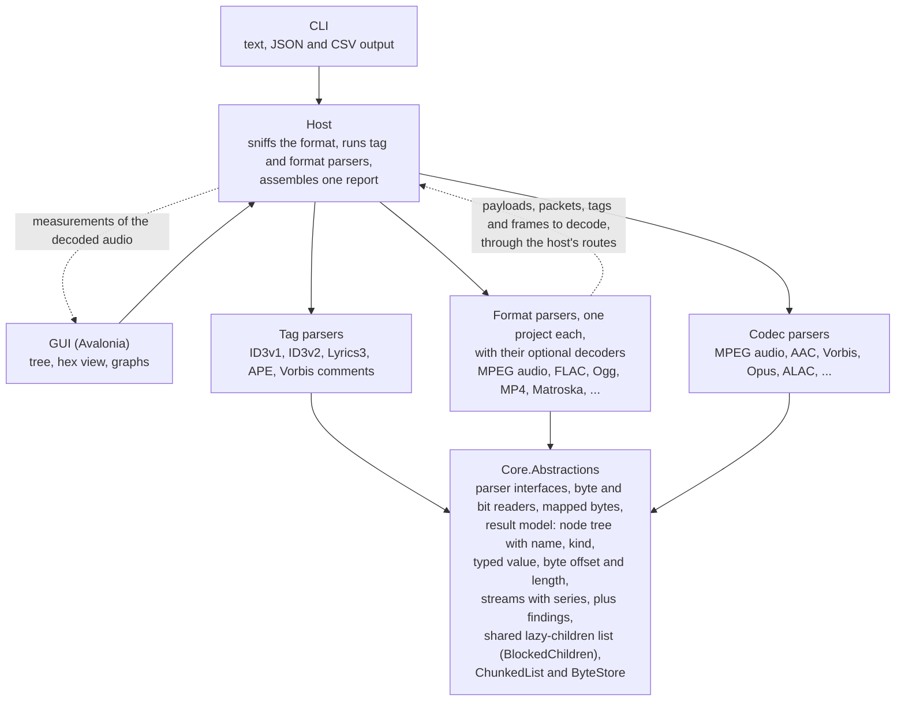

# Architecture

How Encspect is built: the parts, the result model, the contracts between parsers and the host, and how the host picks a format. The plan ([plan.md](plan.md)) holds the goals, the decisions and the order of work; the rules every change follows are in [CLAUDE.md](../CLAUDE.md).

## Overview

Every parser depends on one small abstractions library and on nothing else; the front ends reach parsers only through a host.

- The host sniffs the format, lets tag parsers claim their regions, then hands the rest to a format parser.
- A container hands what it holds back to the host, which passes it on to a codec or tag parser.
- **Tags are separate from formats,** because ID3, APE and Lyrics3 appear in many of them.
- **Decoders** are optional and live in their format's project, in its `Decoding` namespace, apart from its parsers.
  - Parsers reach them only through the host, so no parser depends on one; `DecodingBoundaryTests` checks this in the compiled assemblies.
  - The contract is [decoders.md](design/decoders.md).
- **Measurements** of the decoded audio are host code that reads the decoders' PCM and adds figures to the stream: [spectral-analysis.md](design/spectral-analysis.md).
- **The library:** the core, the host and the parsers are a front-end-agnostic library; the decision, what follows from it and why its API is not published yet are in [library.md, "A library others could use"](library.md#a-library-others-could-use).
- **Two front ends, one model:** the CLI and the GUI are thin views over the same result model, so neither can show something the other cannot ([cli.md](cli.md), [gui.md](gui.md)).

## Result model

- **Nodes:** every node has a name, a kind, a value, byte offset, length and children.
- **Typed values:** a node's value is a `NodeValue`:
  - text, an integer, a decimal with the decimals it is shown with, a boolean, or an integer shown in hexadecimal with its digits (a CRC, a flags field);
  - integers and decimals carry their unit ("kbps", "Hz", "s", "bytes", "samples", "dB");
  - its text is what the report shows ("128 kbps", "0.261 s", "0x1A2B", "true");
  - names, descriptions and mixed text ("255 (none)", a frame's summary) stay text, and so does a list of numbers ("1, 5, 12");
  - JSON writes numbers and booleans as such, with `unit` beside them: `"value": 128, "unit": "kbps"`.
- **Node kinds:** `NodeKind` says what a node stands for: a Tag (wherever it sits), a Stream (a stretch of a format's audio data, such as an MPEG Audio region), a Frame, its SideInfo, Statistics, or, by default, a Detail.
  - Front ends find sections by kind, never by name: `--hide` and the summary's tags read kinds.
  - So an APE item named "Frame" is tag content, and a Monkey's Audio stream named "APE" is no tag.
- **Bit positions:** a field that does not cover whole bytes also carries its bit offset within its first byte and its width in bits (`Node.FromBits`), so the hex view can mark the exact bits.
  - Its byte offset and length still cover every byte it touches.
  - Bits count from the most significant bit.
    - Formats that pack bits least significant first (Vorbis) number them from the least significant bit instead: `Node.FromBits` takes a `BitOrder`, and `Node.BitOrder` says how `BitOffset` counts.
    - Such a field's bits run on from the top of one byte into the bottom of the next.
  - The order takes one bit of the int that holds the bit position, so nodes keep their size.
  - JSON writes `bitOffset`, `bitLength` and, where it applies, `bitOrder` (`leastSignificantFirst`); the text tree with `--offsets` shows `[0x1+3, 2 bits]` or `[0x1+3, 2 bits, LSB first]`.
- **Node ranges:** a node whose bytes are not contiguous in the file (a packet that spans Ogg pages, a field that a page header splits) carries `Ranges`, its file ranges in order.
  - Its offset and length cover them from first to last, so containment, finding paths and the writers' nesting work on the covering range.
  - JSON writes `ranges` as offset and length pairs; the text tree with `--offsets` adds them as `[0x1A, 40 bytes in 0x1A 2 bytes, 0x40 2 bytes]`.
- **Nesting limit:** a tree nests at most `Node.MaxDepth` (64) levels below its root.
  - The writers stop there and say so (`hasOmittedChildren` in JSON, a line in the text tree), so a container that a damaged file nests thousands deep cannot overflow their stack.
  - A parser that would nest deeper reports a finding instead.
- **Children built on demand:** repeated parts such as frames give their node a build function.
  - The children are built when first read, held weakly, and built under a compare-and-swap, so threads that read a node at the same time get the same children.
  - A list of a million children may build its nodes in blocks, each held weakly the same way, as an MPEG region does with its frames.
  - `Node.HasChildren` answers without building them.
  - A build function that throws yields a single "Error" child instead of an exception in a writer or the GUI.
- **JSON schema:** each report carries `schemaVersion` (1) and the tool's name and version. The version changes when a field changes meaning or type or goes away, not when one is added.

## Findings

- **Severity:**
  - a warning when the file breaks a specification or holds something wrong or damaged, whoever caused it and however well decoders cope, above all where readers then show or play something different;
  - an info when what it reports is valid but worth knowing, or when the analyzer cannot check something whose cause is reported separately;
  - an error when parsing itself fails.
- **Linked to nodes:** a finding's node is a node of the tree, matched by name, offset and length, so a parser may point at a field of a frame it has not built by building an equal node.
  - After parsing, the host finds each finding's node by descending only into children whose bytes contain it, so of a stream's frames only the one on the way has its children built.
  - It sets `Finding.Path`, the child indexes from the root; the same for each stream's nodes.
- **Counts:** `Finding.Count` is the number of cases a finding reported once per stream stands for.

## Descriptions and topics

- **Descriptions:** every node a parser or the host makes carries a `Description`: one or two sentences on what the field is and, where it helps, what its value means, with the spec section where there is one, and no verdicts.
  - The parser that knows the field writes it, as a constant string shared by every node of its kind (per value, one of a few constants), so frames built by the hundred thousand allocate none.
  - A `Series` carries a `Description` too.
  - The two references take a node from 80 to 96 bytes; frame records are unchanged.
- **Topics:** a node may name a background article by ID (`Topic`); a node without one belongs to its nearest ancestor's.
  - Articles are Markdown with front matter (ID, title, related topics, specifications), embedded in the host (`TopicLibrary`) and shared by every format that uses the concept, since mid/side stereo is the same idea in MP3, AAC and Opus. Parsers name them by ID only.
  - Each says what problem a coding tool solves, how it works in principle, what seeing it in a file means and where it is specified.
- **The check:** a test walks the tree of every fixture, sampling each region's frames and following every finding's path, and fails on a node without a description or with a topic that does not exist.

## Streams and series

- **Streams:** a format parser reports each audio stream as a `StreamInfo` (`ParseContext.AddStream`):
  - the nodes that hold it, codec, sample rate, channels, channel mode, channel layout, bits per sample where the coding has them;
  - samples, duration in seconds, average bitrate in kbps, whether the bitrate varies;
  - the encoder, the writer and the processor, each with the confidence in it.
- **A stream is what the format says it is:** an MPEG stream continues across a tag embedded in it and ends where the version, layer, sample rate or free format changes, so one stream may span several regions and one region hold several streams.
- **How many:** a raw stream parser (MPEG audio, ADTS, AC-3 and E-AC-3, DTS) reports at most 64 streams per file (see "Stream changes"). A container reports one stream per track, or per stream its codec parser finds in it, bounded by its own record and node budgets, not by this cap.
- **The summary and the CSV** read streams only: they count real streams, add up durations and samples, and weigh the average bitrate by duration. The CSV's Channel Layout column is the first stream's described layout, next to its channel mode.
- **Playback groups:** streams that play at the same time share a `StreamInfo.PlaybackGroup`: the tracks of an MP4 movie or a Matroska Segment, the streams of an Ogg chain link or an ASF file, the independent substreams of an E-AC-3 file.
  - The summary and the CSV count the longest stream of a group once, and add up the groups and the streams without one.
  - In MP4 and Matroska every stream that comes from a track gets its movie's or Segment's group, also when the codec parser reports several for one track that play together (E-AC-3 independent substreams).
  - Streams of a track that follow one another (a configuration change) are not grouped.
  - An ASF file's streams are interleaved in one Data Object, so they play together or are bitrate alternatives of which one plays; either way the longest counts once, without the Bitrate Mutual Exclusion Object being read for it.
  - A DTS file's assets are not separate streams, so they need no group.
- **Series:** a stream carries `Series` for graphs: numbers with a unit over an x axis of frame offsets or seconds.
  - A series may name the node it belongs with, after which the text tree prints it in one line.
  - A series may carry a `Concept` (stereo coding, block switching, coded bandwidth, bit distribution), which the GUI lists graphs under.
- **Category series** (`StreamInfo.CategorySeries`): the category of each value of each frame, packet or block, with the counts over the stream, for graphs of each frame's coding choices and their summaries, including EncSpot-style shares over all frames.
  - The categories carry the names of the tally entries they count, and a test holds the counts equal to the tally.
  - The design is [coding-graphs.md](design/coding-graphs.md).

### Channel layout

- **What it is:** `ChannelLayout` is the speaker each channel feeds, one `Speaker` per channel, in the stream's channel order, which stays the format's (AAC's 5.1 starts with the center, MPEG-2 multichannel's with the left and right of its stereo base).
- **Speakers:** `Speaker` names the positions as the WAVE channel mask does (front left, front right, front center, LFE, back left and right, front left and right of center, back center, side left and right, the top positions), plus the wide, second LFE, top side and bottom positions of ISO/IEC 23091-3 that 22.2 needs.
  - `Discrete` is a channel without a position, such as either program of MPEG dual channel or a second stereo program.
- **Surround pairs:** a format's only surround pair is the back pair, as in the WAVE channel mask's 5.1. Where it also has a rear pair, the surround pair is the side pair and the rear pair the back pair, as in the 7.1 of ISO/IEC 14496-3 Table 1.19.
- **Names:** `ChannelLayoutName` follows from the speakers, never their order: mono, stereo, 2.1, 3.0, 3.1, 4.0, 4.1, quadraphonic, 5.0, 5.1, 6.0, 6.1, 7.0, 7.1, 7.1 (wide), 5.1.2, 5.1.4, 7.1.2, 7.1.4 and 22.2.
  - It is null for any other set, a discrete channel or a speaker twice.
  - `ChannelLayouts` writes the speakers out ("front left", never "FL") and describes a layout as "5.1 (front center, front left, …)".
- **Counts:** where a layout is set, `Channels` is its count. `MultilingualChannels` counts channels that carry other programs next to the layout, which a decoder plays in place of a speaker channel (MPEG-2 multilingual channels); neither `Channels` nor the layout includes them.
- **Formats without speaker positions** leave the layout null.
  - Vorbis sets it from its channel count, and Opus from its channel mapping family 0 or 1, in the order of section 4.3.9 of the Vorbis I specification, which RFC 7845 section 5.1.1.2 shares.
  - Opus's ambisonics (families 2 and 3) and family 255 name no speakers.
- **Containers:** a container that states a layout of its own (MP4's chan and chnl) completes a stream its codec reports without one, through `AnalysisContext.UpdateStream`, and reports a finding where the two name other speakers. The codec's statement counts.

### Names

- **One coding, one codec name in every container.** A container names the stream itself only when no codec parser read it (a coding without a parser, an encrypted stream), and then in the codec parsers' form with what the container knows (`CodecNames`):
  - where it states version and layer, the parser's own name ("MPEG-1 Layer III");
  - where it states only the layer, "MPEG Layer III" (Matroska A_MPEG/L3, ASF format tag 0x55, the MP4 .mp3 entry);
  - where it states only the version, "MPEG-1 audio" or "MPEG-2 audio" (MP4 object types 0x6B and 0x69; 0x40 is "MPEG-4 audio").
- **AAC** keeps the profile a container states, in the AAC parser's names ("AAC LC", "AAC Main", "AAC SSR", "AAC LTP", "HE-AAC": MP4 object types 0x66 to 0x68, Matroska's legacy A_AAC/MPEG2|4/* IDs).
- **Other codings:** "Apple Lossless", "PCM", "DTS-HD Master Audio" (Matroska A_DTS/LOSSLESS, MP4 dtsl). An unknown coding is "Other" in every container (an empty Matroska CodecID, an ASF format tag without a name).
- **Channel modes:** the channel mode of AC-3 and DTS is the arrangement alone ("2/0", "3/2", and "1+1" for two independent mono channels in both); the speakers are in the channel layout.
- **Text conventions:**
  - a libavcodec text names its encoder as every parser does ("FFmpeg (Lavc60.31.102 libmp3lame)");
  - a DRM system ID is lower case, as `ProtectionSystems.Text` writes it, and protection schemes start with a capital letter;
  - a count reads in the singular for one wherever it can be one, in node values, text and finding messages ("1 byte"; `Counts` for running text, `NodeValue.Integer` for the plural nouns the reports count in).

### Encoder and writer

- **Three roles:** the encoder is the software that turned the audio into the coded stream; the writer is the software that put the stream into the file (a muxer, a container writer, a tagger); the processor is software that changed the audio between its source and the encoder, such as lossyWAV, which turns PCM into PCM.
  - They are three fields of a stream (`Encoder`, `Writer` and `Processor`, shown as "Written by" and "processed by" in the GUI), each with a confidence and evidence of its own, because a file can be remuxed or tagged without its audio being touched, a container layout or a muxer tag says nothing about the encoder, and a processor's output is coded by an encoder that never saw the original.
- **Claims:** every `EncoderClaim` carries a `ClaimRole`, `Encoder`, `Writer` or `Processor`, given by the parser that makes it, with no default.
  - Each format parser resolves each role from its own claims: the encoder from the stream's evidence (signatures, encoder-specific header fields, coding habits) and the claims of the encoder role; the writer from the claims of the writer role (`WriterDetection`); the processor from the claims of the processor role (`ProcessorDetection`).
  - A writer or a processor that differs from the encoder is a fact and no finding. Only two claims of one role that name different software are (`<format>.encoder-claim-differs`, `<format>.writer-claim-differs`); claims of the processor role that name other software add no evidence, and the analyzer knows one processor, lossyWAV.
- **The processor's marker:** lossyWAV's `fact` chunk text (read by the WAV, FLAC, WavPack and Monkey's Audio parsers through the shared `FactText`) is a claim of the processor role with high confidence and the settings as evidence; a text that starts as lossyWAV's does but has not its form is an information finding, `<format>.…fact-text-unrecognized`, and makes no claim. See [wav.md](formats/wav.md#reported) and the `lossywav` article.
- **The processor's habits:** the FLAC and WavPack parsers also make a claim of the processor role from their coded counts of wasted bits (the "Wasted Bits" statistic): "lossyWAV", without a version, at low confidence, where the counts change on lossyWAV's block grid at the rates tested ([flac.md](formats/flac.md#encoder-detection)). The rule for habits is read for a processor: the other files of the test set do not show the habit (the negative set of `crosscheck_lossywav_behavior.py`: 152 FLAC fixtures coded again in frames of 512, none named), with one stated limit, a simulated tool that zeroes bits per block of 4,096 samples. A claim from a marker names the version and wins; the pattern then adds its figures as a second piece of evidence.
- **Which role a tag has** is where its specification puts it, and the writer's where the specification leaves it open:
  - ID3v2 TSSE is the encoder's (ID3v2.3 section 4.2.1 and ID3v2.4 frames section 4.2.5 define it as the used audio encoder and its settings);
  - a Vorbis comment's vendor string is the encoder's and its ENCODER field the writer's (section 5.2.2 of the Vorbis I specification lists no such field; RFC 7845 section 5.2 has applications use it to identify themselves);
  - the APEv2 Encoder item, MP4's ©too and QuickTime's ©swr, and ASF's attributes (WMFSDKVersion, MediaFoundationVersion, WM/ToolName, WM/EncodingSettings) are the writer's. WM/ToolName is "the application used to create the file"; the APEv2 key list and WMFSDKVersion could not be verified;
  - DTS-HD's BUILDVER is the encoder's, as A/103:2014 Table E.1 names it "DTS-HD Encoder Version Identification";
  - the version text of ffmpeg's muxer (`Lavf60.16.100`) is the writer's in whichever tag holds it, and its libavcodec encoder ID (`Lavc60.31.102 libvorbis`, which ffmpeg writes only when it encodes: fftools/ffmpeg_enc.c set_encoder_id, mp3enc.c, oggenc.c of n6.1.1) is the encoder's.
- **Container layouts** (the Windows Media Format SDK's and Media Foundation's headers, Apple's MP4 and ADTS layouts) are claims of the writer role.
  - Apple's sbtd box, which records the PCM source of an encode, is a claim of the encoder role of its own. The writer comes from the padding and stream type byte separately, so a file with an sbtd box and no page-aligned data has an encoder and no writer.
- **Known writers:** a claim that names software known to write another format (`KnownWriters`: LAME, FAAC, fdkaac, exhale, opusenc, oggenc, speexenc and WavPack, each from what the project's fixtures show it writes) is an information finding, `<format>.writer-other-format`.
  - Unknown software, FFmpeg and GPAC, which write many formats, and a writer that merely differs from the encoder raise none.
- **Another codec's encoder ID:** a libavcodec encoder ID in an ENCODER field that names another codec's encoder never becomes the encoder. It is evidence only under an Encoder that other evidence names (a vendor string, the header version), and it raises `<format>.encoder-other-format`.
- **ffmpeg's LAME tag:** an ffmpeg-style LAME tag (an encoder string of `Lavc…` or `Lavf…`, or ffmpeg's tag CRC) is the layout of its mp3 muxer, which writes the whole tag (libavformat/mp3enc.c). It names the writer "FFmpeg" without a version, with low confidence, beside the encoder.
- **The one exchange between the roles** (`ClaimRoles.CompleteVersion`): an encoder the stream named without a version takes the version of a writer claim that is the encoder's name followed by white space and a version (FAAC 2.x's layout names "FAAC", its ©too reads "FAAC 2.2.0 (6acbe23)").
  - A writer of another name, such as ffmpeg's or GPAC's, lends none.
  - A writer claim never creates an encoder or raises its confidence.
- **Evidence from behavior:**
  - a file without tags can be misidentified, so every encoder result carries a confidence, and an encoder's habits name it only with low or medium confidence; a processor's habits name it only with low confidence, and only where files it processed show them and the other files of the test set do not (a text the processor writes into the file is a marker and has high confidence);
  - only where encodes of known signals with that encoder show them every time and the other encoders available for testing do not, over at least 20 frames or payloads, which leaves out encoders that no longer run;
  - container traces name an encoder only where its stream holds nothing to name it by (Apple's AAC encoder). Where the stream itself has a layout (exhale's UsacConfig), the container's traces are not used, since a remux drops them.
- **Output:** the CLI writes `Writer` and `Writer Confidence` next to the encoder's columns, then `Processor` and `Processor Confidence`, and `writer`, `writerConfidence`, `processor`, `processorConfidence` next to `encoder` in JSON; the GUI has a "Written by" column and names the writer and then the processor ("processed by lossyWAV 1.4.2 (high)") after the encoder in a stream's line, with no column of its own for the processor. The articles are `encoder-detection`, `writer-detection` and, for the processor, `lossywav`.

### Stream changes

One rule for the raw stream formats MPEG audio, ADTS, AC-3 and E-AC-3, and DTS:

- **A change of the stream's configuration** ends the stream and starts a new one:
  - MPEG audio: the version, layer, sample rate, and free format or not;
  - ADTS: the fixed header;
  - AC-3 and E-AC-3: the configuration of an independent substream;
  - DTS: the core and extension configuration.
- **A configuration that returns** starts a stream of its own, so no stream is reused.
- **Counting:** every change is counted in one Info finding `<format>.stream-changed`, with the number of changes, never added per change.
- **The cap:** a file has at most 64 streams.
  - The change that would start stream 65 starts none: the units from there on (frames; DTS units) are in no stream, left out of every stream's figures and statistics, and counted in one Warning `<format>.streams-limited` that names the first of them.
- **E-AC-3:** the cap counts the streams of all independent substreams together. The units in no stream are those of the substream whose change would start stream 65, and of every later change of any substream; a substream that already has its stream and does not change keeps it, since the independent substreams play at the same time.
- **Why:** the cap, the counted findings and the linear algorithms keep a stream that changes at every frame from growing the report.
  - `ComplexityTests` alternates the configuration of MPEG audio, ADTS and DTS files for it, `Ac3ProgramTests` that of AC-3 files, and `MemoryTests` that of ADTS files.

## Parser contract

- **Sniffing:** `IFormatParser.Sniff(SniffContext)` sees the reader, the file name's extension as a hint (lower case without the dot, or null) and the cancellation token.
  - It returns a `SniffResult`: the evidence class, where the matched structure starts, how many consistent and how many checksum-verified frames it found, and optionally a note (see "Format detection").
  - The extension may only break ties between formats without a signature, never make a parser accept.
- **Tag probes:** tag parsers probe through a `TagProbeContext` (reader and token): `ProbeAt`, `ProbeBefore` and `FindFrom`.
- **One instance** of each parser serves every analysis, also on several threads at once, so parsers keep no per-call state in fields.
- **Exception boundary:**
  - a reader position or slice outside its range throws `EndOfStreamException`, so a corrupt size field reads as truncation (`parse.truncated`);
  - `InvalidDataException` carries a message for the report (`parse.invalid`);
  - the host wraps every parser entry point: any other exception from a sniff or a parse becomes an error `parse.failed` that names the parser and the exception, and a probe that throws is a rejected candidate with that error;
  - only cancellation and running out of memory pass through.
- **The host never changes a parser's node:** an accepted tag is shown as a node with the same name, value and bytes, whose children are the parser's and the host's Detection.
- **Cancellation and progress:** `Analyzer.Analyze` and `AnalyzeFile` take `AnalysisOptions` with a cancellation token and an `IProgress<long>` of bytes read.
  - Every read through `ByteReader` checks the token; loops that only compute (the MPEG passes over all frames) check `ParseContext.CancellationToken` every few thousand frames. Cancellation surfaces as `OperationCanceledException`.
  - Progress is the furthest file offset the format parser has read, which only grows, and the file length once the analysis is done.
- **Readers:**
  - `ByteReader` reads a stream, never the whole file, with absolute file offsets also in a slice: `Read(Span<byte>)` without allocating, 16-, 32- and 64-bit unsigned integers in either byte order, and 24-bit big-endian ones.
  - `BitReader` reads up to 64 bits at a time from a byte array or `ReadOnlyMemory<byte>`, most significant bit first (MPEG, FLAC) or least significant bit first (Vorbis), and yields zero bits past the end with `IsOverrun` set.
- **Declared end:** a container that states its own size (RIFF, FORM, a run of top-level MP4 boxes) says where it ends through `IFormatParser.DeclaredEnd`.
  - Before it looks for trailing tags, the host asks the parser that sniffs best on the data after the leading tags.
  - A trailing candidate that starts before that end is the container's own chunk, reported as a near miss naming the container, and the container hands it to the tag parser itself (an AIFF file's `ID3 ` chunk, which taggers write last).
  - A tag after the declared end is the file's. A parser returns null for a size it cannot trust, such as a placeholder.

## Routes between parsers

Parsers never reference each other; they reach other parsers only through routes on their context, which the host serves. Which container routes which codec is the table in [formats/README.md](formats/README.md#codecs-in-containers).

- **`ParseStream(codecId, parent, payload)`** hands a payload that is one byte range (a WAV data chunk) to the `ICodecParser` with that ID.
- **`Recognizes(codecId, parent, payload)`** asks the codec parser whether a payload starts with a stream of its coding, before a container whose own fields do not say what the data holds hands it over, as WAV does for a DTS stream in 16-bit stereo PCM samples.
  - `ICodecParser.Recognizes` looks for a chain of consistent frames at the start of the data, after any silence, the evidence the coding's own raw files are recognized by; the default says no.
- **`ParsePackets(codecId, parent, packets)`** hands packets as mapped bytes (Ogg pages, MP4 samples), enumerated while the codec parser runs, so a container reads them lazily.
- **`ParseTag(tagName, slice, parent)`** hands a tag that a container holds whole (an ID3v2 tag in a RIFF or AIFF chunk, a FLAC Vorbis comment block) to the tag parser of that name, through `ITagParser.ParseWhole`.
  - With mapped bytes, it hands a tag a container or codec took apart (a Speex, Vorbis or Opus comment packet, which may span Ogg pages), through `ITagParser.ParseWhole(MappedBytes, CancellationToken)`. A tag parser that does not read mapped bytes finds no tag there.
- **What the routed parser adds:** its nodes go under the container's node; its findings, streams and encoder claims join the container's; a tag is shown as top-level tags are, with its Detection, and its encoder claims reach the codecs routed after it.
- **`CodecConfiguration`,** optional on both codec routes: what the container stores about the coding apart from its data, as mapped bytes with the container's node that holds them, and whether the container states a variable or a constant bitrate.
  - MP4 keeps AAC's AudioSpecificConfig in the esds box inside moov, far from the samples in mdat, so the codec parser builds its configuration nodes there and its other nodes under the data's node.
  - `CodecConfiguration.Claims` carries encoder claims that hold for that one stream (MP4's sample-entry layout of one track). The routed codec parser sees them in `EncoderClaims` after the file's claims; they never go back to the caller, and they take effect only through the host's router.
- **`claims` on the route:** what the container states about the stream (a Matroska Segment's WritingApp and MuxingApp).
  - The codec parser weighs these after the file's.
  - What a codec parser claims itself (the comment of a Vorbis stream) stays with its stream and is not handed to the codec parsers that run after it.
- **The exception boundary holds on routes:** truncation, invalid data or a parser bug inside the routed data become findings on the container's node (`parse.truncated`, `parse.invalid`, `parse.failed`), and the container carries on; cancellation passes through.
- **Depth:** routes nest a few levels at most (`parse.too-deep`).
- **MPEG audio** is the codec `mpeg-audio` for one payload, which it analyzes as it would the same bytes as a file, at their file offsets. `DefaultParsers.Codecs` lists the codecs.
- **Mapped bytes:** `MappedBytes` holds bytes that a container or tag took apart (a packet put together from its pages, ID3v2 data with unsynchronization undone) with a map of segments back to the file: `OffsetOf`, `FileLength`, `FileRanges`, `Slice`, and opaque bytes (decompressed data) that map to their whole source.
  - A `BitReader` over them maps bit positions to file offsets (`FileOffsetOf`), and `Node.FromMapped` and `Node.FromBits` over mapped bytes build nodes at the file bytes the fields came from.
  - A packet also carries what the container knows about its place in the stream:
    - `EndPosition`, the container's position at its end in the codec's units where it records one (Ogg's granule position, on the last packet a page completes), with `EndPositionField`, the node of that field, for findings;
    - `IsEndOfStream` on the last packet of a stream the container says has ended;
    - `FollowsGap` on the first packet after packets the container lost;
    - `IsCut` on a packet the file ends inside.

## Format detection

Each format parser's `Sniff` returns a `SniffResult` (`Core.Abstractions`), and the host picks the format from the evidence of all of them, never from the order of the parser list.

- **Why:** short signatures and frame headers occur inside other formats' data. A chain of consistent frames, the earlier start and passing checksums decide instead.

### What a sniff reports

- `Class`: from 0 (not this format) to 100 (certain), by the kind of structure found: a signature, a chain at the start of the data, a chain further in. The table below lists them.
- `Offset`: the file offset where the matched structure starts (the signature, the first frame of the chain). `End`: where the frames counted end (0 for a match with no extent, a magic number).
- `Frames`: the consistent whole frames, pages, blocks, boxes or units found from there, at most `SniffResult.MaxFrames` (16), or the fewer the check needed. A last frame the data cuts short is not counted.
- `VerifiedFrames`: how many of them pass a checksum the format defines (MPEG's frame CRC, AC-3's crc1 and crc2, an Ogg page's CRC, a DTS extension substream's header CRC); never more than `Frames`. A format whose sniff reads no checksum reports 0.
- `Note`: an optional short text for the report.
- All of it is what the sniff reads anyway; a sniff does no parsing it would not do to find the chain.

### Ranking

- By class, highest first.
- **Within a class, candidates that do not overlap** rank by the earlier `Offset`: a chain that starts first owns the bytes, and another format's header-like bytes inside its frames start later. Then more `VerifiedFrames`, then more `Frames`.
- **Candidates of one class that overlap,** one starting inside the other's counted extent (`End`), rank by more `VerifiedFrames` first, then by the earlier `Offset`.
  - This is for the stray chain that starts first because the start of the file is cut off: the look-alike ADTS chain in the partial first frame of `junk-adts-in-frames-cut.eac3` starts at 290, the real E-AC-3 chain at 502, and the chain whose frames pass their CRCs (7 of 7, against none) is the file's.
  - Two formats never sync at one offset, so the verified frames decide only between overlapping chains.
- **The winner** is the first of the candidates ordered by start, unless a later one of its class overlaps it and has more verified frames (`SniffResult.Best`).
- **A tie on all of it** is ambiguous: the first in `DefaultParsers.Formats` is taken, and an info finding `format.ambiguous` on the root names both candidates and their evidence. The list order is the last resort, never the reason a file is read one way.
- **The check:** `DetectionOrderTests` runs every fixture, unchanged and with 352 and 1,000 seeded random bytes in front, through detection with the parser list in five shuffled orders, and fails if the choice changes.

### Classes

| Class | Evidence |
|---|---|
| 100 | A signature at the start that holds: TTA's "TTA1" header with a CRC-32 that holds; Matroska or WebM's EBML header with DocType matroska or webm followed by a Segment; `DTSHDHDR` followed by a chain of chunks that fit (8-character IDs of printable characters, sizes of 4 to 2^61 bytes); MP4's ftyp box; Ogg's chain of pages from the start; Musepack's magic number with a consistent SV7 header (version 7, a frame count, a max band from 1 to 31, a last frame of at most 1,152 samples) or an SV8 stream header; ASF's Header Object GUID; WavPack's block header followed by another or by the end; FLAC's marker followed by a STREAMINFO block header; Monkey's Audio's signature with a header the SDK would take; WAV, Wave64 and AIFF: the RIFF/RIFX/RF64/BW64 header with form type WAVE, or the FORM header with form type AIFF or AIFC, followed by a chunk header of four printable characters that fits, or the riff and wave GUIDs of Wave64 followed by a chunk header whose size is at least its 24 bytes and fits (the chunks that fit are the frames) |
| 95 | MP4's run of top-level boxes that holds moov, mdat or moof; Musepack versions 4 to 6 with three units or more |
| 94 | TrueHD or MLP: a major sync whose CRC holds, reached from the start of the data through the units' length words, followed by units that fit |
| 93 | DTS chain at the start |
| 92 | AC-3 chain at the start |
| 91 | ADTS chain at the start, ADIF header |
| 90 | Matroska EBML header (DocType matroska or webm) with no Segment after it; MPEG audio chain, wherever it starts in the first MiB; WavPack header whose block the data cuts short; WAV, Wave64 or AIFF header followed by a chunk header whose chunk runs past the data |
| 85 | FLAC frames without the marker: a chain whose headers, CRC-8 and CRC-16 hold, from the start of the data |
| 80 | TTA: "TTA1" at the start with a CRC-32 that fails and fields an encoder could write, or "TTA2" with the 36 bytes of its header and plausible channels, bits per sample and sample rate (1 to 64, 1 to 64, 1 to 1,000,000 Hz); Matroska Segment at the start with a consistent child (a file whose EBML header was cut off); WavPack header at the start followed by bytes that are none; `DTSHDHDR` at the start with a first chunk the data cuts short or a chain that breaks after it; FLAC's marker with another first block; Monkey's Audio's signature with a header that holds nothing plausible; WAV, Wave64 or AIFF header followed by bytes that are no chunk header, or by fewer than eight bytes (Wave64: fewer than 24) |
| 70 | TTA: "TTA1" at the start with fields that cannot be a header, or cut short, or "TTA2" with no plausible header; EBML header that does not hold (no DocType, or an invalid field); `DTSHDHDR` at the start with a first chunk whose size is invalid |
| 60 | Matroska run of top-level elements, or a Cluster with a Timestamp, at the start; Ogg chain further in (within 64 KiB); Musepack versions 4 to 6 with fewer than three units; "MP+" at the start of data whose SV7 header is not consistent; WavPack chain further in; TrueHD or MLP chain further in; Monkey's Audio's signature further in, within the first MiB, with a plausible header |
| 50 | AC-3, ADTS (with eight frames or frames to the end of the data), DTS and FLAC chain further in |
| 30 | MPEG audio chain that is not credible: a free-format chain whose frames do not hold what their headers promise, or a protected chain further in than the start of the data none of whose frames passes its CRC |

- **At the start of the data,** the sync words of AC-3 (0x0B77), DTS and ADTS/MPEG audio (0xFFE, 0xFFF) differ in their first bytes, so no chain is two formats' and the classes only order formats that cannot both match.
- **Further in,** other formats' frames repeat header-like bytes at a fixed distance. The evidence that keeps those out is in the sniffs, as fields where it can be:
  - ADTS asks eight frames of a chain among junk;
  - MPEG audio ranks a protected chain whose CRCs all fail at 30;
  - AC-3's chain starts first or, where it does not, its frames pass their CRCs and the look-alike's do not exist.
- Each format's page says what its sniff checks.

### Alternatives

- **Listed:** a candidate besides the chosen format is listed in the report (`Report.Detection.Alternatives`, JSON `detection.alternatives`) when its evidence is real, not a stray three-header match:
  - it has the chosen format's class; or
  - above class 30 (`SniffResult.WeakClass`, a match its own parser distrusts), it has at least one frame that passes a checksum, or a chain of at least `Analyzer.AlternativeFrames` (8) frames.
- **Not listed:** a candidate that starts inside the frames the chosen chain counted (the ADTS look-alike in the frames of an E-AC-3 file), or inside the data the chosen format declares for itself (`DeclaredEnd`: the boxes of an MP4 file, the pages of an Ogg file), is made of the chosen format's bytes, such as an AC-3 stream in the samples of an MP4 file. One that starts before the chosen chain is listed.
- Each carries its evidence: class, offset, frames, verified frames and note.
- A report with no alternatives and no forced format has no `detection` at all.

### Forcing a format

- **The option:** `AnalysisOptions.ForcedFormat` names a format parser (`Analyzer.FormatNames`) or the start of its name, ignoring case, spaces and hyphens, or a codec or file extension that stands for one (`ac3`, `mp3`, `m4a`, `eac3`, `opus`, `wma`); `Analyzer.MatchFormats` resolves it.
  - An unknown or ambiguous name makes `Analyze` throw `ArgumentException` (parameter `options`). `Analyzer.DetectFormat` ignores the option.
- **The run:** the analysis skips detection and runs that parser on the data left by the tags, which are found as always.
  - The forced parser's `DeclaredEnd` replaces the detected format's for the trailing tags only where its own sniff matches the data; otherwise the detected format's stays. So forcing a format that is not there does not turn the tags a detected container owns (an ID3v1 signature inside an MP4 file's mdat) into the file's.
- **The record:** `Report.Detection` has `IsForced`, the format that ran with its own evidence (none if it does not match), and `Detected`, what detection would have chosen. An info finding `format.forced` says so on the root, also for a file that is empty or holds only tags.
- **No exceptions:** parsers meet any input with findings, so a wrong format gives findings (leading junk, lost sync, `parse.invalid`) and never `parse.failed`; `FormatDetectionTests` forces every format on every fixture to check it.
- **Front ends:** the CLI's `--as`, the detail window's "Analyze as…". A forced analysis is never cached: the summary cache is filled by the file list only, which never forces.

## Tag detection and false positives

- **Decision:** tags are found by position, structural validation and byte ownership, never by a signature alone.
- **Why:** short signatures collide with each other and with audio data. `APETAGEX` holds `TAG` at offset 3, so a 131-byte APE tag at the end of a file puts a false ID3v1 signature at EOF-128.
- **What follows:**
  - each tag type is looked for only where its specification allows;
  - structural validation decides confidence, not existence: a tag that breaks its specification is reported with findings, not dropped;
  - when candidates compete for the same bytes, the strongest evidence wins, and the order APE, Lyrics3, ID3v2, ID3v1 only breaks ties;
  - a container that states its size owns the trailing candidates that start before its end (see "Declared end" under [Parser contract](#parser-contract));
  - a frame header only counts as MPEG sync when a chain of consistent frames follows it.
- **The rules and the fixtures that prove them:** [tags/README.md, "How tags are found"](tags/README.md#how-tags-are-found).

## Verification

Nobody reads the code line by line, so correctness comes from automated checks that do not depend on the author's judgment. The weak spot to guard against is spec details written from memory; known-input fixtures and tool cross-checks are the safety net.

1. **Known-input fixtures:** hand-built ones (standard library only, regenerated and compared in CI) control every byte; encoder-written ones are committed, since their bytes depend on the tool version.
   - Each has a manifest of the expected result.
2. **Cross-checks against other tools:** disagreements fail the build until explained; every format is also compared with MediaInfo.
3. **Official decoders:** where FFmpeg was the only reference, the format owner's decoder or reference implementation is the reference for sample counts, durations and the handling of damage, with FFmpeg as a second cross-check ([official-decoder-crosschecks.md](design/official-decoder-crosschecks.md)).
4. **Golden reports:** each fixture has a stored expected report; any output change shows up as a diff that has to be approved.
5. **Corrupt-file tests and fuzzing:** truncated, bit-flipped and garbage-prefixed files must never crash or hang the tool.
   - The fuzzer fails on `parse.failed` and on children that could not be built, as on an escaping exception.
6. **Spec references in the code:** each parsed field cites the spec section it implements.
7. **Independent review:** after each milestone, a separate review agent gets the code and the spec without the author's conclusions; its findings are recorded in the pull request.

- The per-format fixtures, tools and their pinned versions are in [development.md, "Fixtures and cross-checks"](development.md#fixtures-and-cross-checks).
- Nothing merges with a red pipeline. Work is pushed to its own branch, never to main directly.

## Large inputs

- **Streaming:** files are read as streams, and reports are written as they are read.
- **Compact records:** parsers keep repeated parts such as audio frames as compact records and give their nodes a build function, so a node's children exist only while something reads them.
  - The MPEG parser keeps a 48-byte record per frame (offset, length, header, CRC pair, main-data and reservoir values, and where its bytes are kept) and copies only the bytes its nodes are built from (the Layer III side information, Layer I and II audio data up to the samples, VBR header frames) one after another into shared blocks.
  - Its passes over the frames read the records one at a time, the coding statistics are counted as the frames are read, and a region's frame nodes are built in blocks of 1,024 when read.
  - The MP4 parser reads its sample tables into arrays of the entries the boxes hold and hands the samples to the codec one at a time, reading each from the file as the codec asks for it.
- **Category series** add a byte per value, a count byte per unit of a variable layout, a weight byte per value where weights are used and four bytes per 1,024 units; a grouping adds nothing per value. They are capped at 254 coded values per unit and 2^24 per series; values past them are counted without a code, so the series still equals its tally.
- **Memory tests** hold each parser to a bound per frame, both on what the report keeps and on the most the analysis holds live at once.
  - A sampler thread forces a blocking full collection every few milliseconds while the analysis runs and reads the heap that survives it, since the collector's own last figures stay those of the collection before the analysis when none runs during a short one.
  - On linux-x64 the peak is about 170 bytes per MPEG frame, 100 per MP4 sample, 133 per ADTS frame, 75 per Ogg page and 35 per Speex packet, and the bounds are about twice that. A parser that keeps every packet's bytes fails them (125 and 161 bytes per Speex packet and MP4 sample with packets of 63 and 100 bytes).
  - The formats' pull requests state the bytes they add per frame against these bounds.
- **Measured:**
  - MPEG audio: with the main-data runs and the per-frame series, about 130 bytes per frame; a 523 MB file of 500,000 frames peaks at about 240 MB and also analyzes in a 96 MB heap.
  - MP4 and AAC: a 195 MB M4A of 533,066 access units (3.4 hours at 128 kbps) analyzes in 4.3 seconds with a peak of 221 MB, and also in an 80 MB heap; the report keeps about 91 bytes per access unit.
  - Finding a finding's node does not sort a long list of children through its indexer (which rebuilt packet nodes over and over when the collector had taken their blocks); lists in file order are read once and bisected.
- **The GUI:** the structure tree is a flat, virtualized list that makes a row only when it is shown and reads a node's children only when its row is expanded; the hex view reads only the rows on screen.
  - On a 100 MB file of 100,410 frames, expanding the stream takes about 70 ms and jumping to its last frame about 75 ms, after the analysis itself.
  - On a 100 MB file of 96,250 frames, a graph of every frame draws in about 3 ms, and a click on a point finds and selects its frame in about 15 ms, reading a few frame nodes of the stream rather than all of them; the tree and hex view show it 60 to 150 ms later.
- Each format's page gives its own figures.
